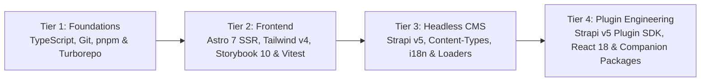

# Junior Developer Learning Roadmap & Hands-On Training Plan

Welcome! This roadmap is designed to take junior developers from **foundational TypeScript & monorepo tooling** to **shipping production features** across our full ecosystem:
- **[`central-mosque-bogota`](./README.md)**: Astro 7 SSR Frontend (`frontend/`), Strapi v5 Headless CMS (`backend/`), and Bilingual Astro Starlight + TypeDoc Docs (`docs/`).
- **[`strapi-v5-extensions`](../strapi-v5-extensions/README.md)**: Turborepo + `pnpm` workspace monorepo containing our 10 custom `@vicacha-devs/strapi-plugin-*` packages (`calendar`, `events`, `bookings`, `islam`, `donations`, `certificates`, `inbox`, `broadcasts`, `media-feeds`, `resources`) and `@notum-cz/strapi-plugin-seo`.
- **Companion Packages**: [`@vicacha-devs/astro-tiptap-blocks`](../astro-tiptap-blocks), [`@notum-cz/strapi-plugin-tiptap-editor`](../strapi-plugin-tiptap-editor), and [`strapi-global-search`](../strapi-global-search).

---

> **Note on links:** The direct YouTube video links below have not been re-verified. If one is dead, use the channel or search links in the same row.

---

## Architecture & Competency Progression Overview

---

## Golden Engineering Rules (Read Before Your First PR)

Every Pull Request across `central-mosque-bogota` and `strapi-v5-extensions` is gated by automated checks and must follow these 6 team rules:

1. **Documentation `<= 500` Lines Per File**:
   - Every markdown file in `docs/src/content/docs/` must stay at **500 lines or fewer** (enforced by `pnpm verify`). For source files there is no hard limit, but keep them small and focused: split large components into sub-components, helpers, or `*.controller.ts` modules.
2. **80-Column Line Width & Automated Formatting**:
   - In `central-mosque-bogota/frontend`, `oxfmt` (`.oxfmtrc.json`) and ESLint enforce an **80-character line width**. Always run `./node_modules/.bin/oxfmt` before committing.
3. **Multilingual i18n & Arabic RTL Parity**:
   - **Frontend (`es`, `en`, `ar`, `tr`)**: Every UI key added to `frontend/src/i18n/locales/es.ts` must also be added to `en.ts`, `ar.ts`, and `tr.ts`.
   - **Logical CSS Properties Only**: Use Tailwind v4 logical utilities (`ps-*`, `pe-*`, `ms-*`, `me-*`, `start-*`, `end-*`, `text-start`, `border-s-*`) instead of `pl-*`/`pr-*`/`ml-*`/`mr-*` so Arabic (`dir="rtl"`) mirrors automatically.
   - **Strapi Plugins**: Maintain 10-locale translation parity in `admin/src/translations/*.json` (verified by each plugin's `services-and-i18n.test.ts`).
4. **Zero `set:html` / `innerHTML` for Untrusted Data**:
   - Render rich text exclusively through `<TiptapContent content={...} />` (`@vicacha-devs/astro-tiptap-blocks`) and use `textContent` / `createElement` in client controllers.
5. **No Committed `dist/` Folders in `strapi-v5-extensions`**:
   - Never commit build artifacts (`dist/`) in `strapi-v5-extensions`. Run `pnpm clean` if needed before opening a PR.
6. **Conventional Commits & Unit Test Coverage**:
   - Commit messages must follow Conventional Commits (`feat(scope): ...`, `fix(scope): ...`, `docs(scope): ...`, `test(scope): ...`).
   - Frontend unit test titles must begin with `should ... when ...` and maintain `>= 90%` branch and `>= 95%` function coverage.

---

## Tier 1: Core Foundations (TypeScript, Git, `pnpm` Workspaces & Turborepo)

**Goal**: Master strict TypeScript (generics, discriminated unions, `zod` validation), Conventional Commits with Husky, and how `pnpm` workspaces + Turborepo link `central-mosque-bogota` with `strapi-v5-extensions` and `astro-tiptap-blocks`.

### Curated YouTube Tutorials (Spanish & English)

| Topic | Español (YouTube) | English (YouTube) |
| :--- | :--- | :--- |
| **TypeScript from Zero to Strict Types** | **Midudev** — [Curso Intensivo de TypeScript desde Cero](https://www.youtube.com/watch?v=fUgxxhI_bvc) (~2h 30m) & [TypeScript Parte 2: Generics, Utility Types y Narrowing](https://www.youtube.com/watch?v=L1Z8CG3314I) | **Traversy Media** — [TypeScript Crash Course](https://www.youtube.com/watch?v=BCg4U1FzODs) (~1h) & **Matt Pocock ([Total TypeScript](https://www.youtube.com/@mattpocockuk))** — [TypeScript Generics Tutorial](https://www.youtube.com/watch?v=EcCTIExsqmI) |
| **Git, GitHub Flow & Conventional Commits** | **Midudev** — [Curso de Git y GitHub desde Cero](https://www.youtube.com/watch?v=3GymExBkKjE) (~5h) | **Traversy Media** — [Git & GitHub Crash Course](https://www.youtube.com/watch?v=SWYqp7iY_Tc) (~1h) |
| **Monorepos with `pnpm` Workspaces & Turborepo** | **Fazt Code** — [Curso de pnpm y Workspaces / Monorepos](https://www.youtube.com/@FaztCode/search?query=pnpm%20monorepo) | **Vercel (Official)** — [Turborepo Crash Course & Monorepo Fundamentals](https://www.youtube.com/@VercelHQ/search?query=turborepo) |
| **Runtime Validation with Zod** | **Fazt Code** — [Zod Curso Práctico de Validación en TypeScript](https://www.youtube.com/watch?v=03w0baf2SC0) (~45m) | **Web Dev Simplified** — [Learn Zod In 30 Minutes](https://www.youtube.com/watch?v=L6BE-U3oy80) (~30m) |

### Codebase Reading List (Tier 1)
1. `central-mosque-bogota/package.json` — Inspect `pnpm.overrides` and workspace scripts (`verify`, `dev:frontend`, `dev:backend`, `dev:docs`).
2. `central-mosque-bogota/scripts/verify-all.ts` — See how our full-stack verification pipeline runs format, lint, typecheck, unit tests, and build checks.
3. `strapi-v5-extensions/package.json` & `strapi-v5-extensions/turbo.json` — Understand how Turborepo orchestrates `build`, `test`, and `test:ts` across all 10 plugins.

### Tier 1 Hands-On Graduation PR Challenge
- Clone all repositories into `/Projects/experiments/`, boot the frontend in offline mock mode (`pnpm dev:frontend`), boot the Starlight docs (`pnpm dev:docs`), and run `pnpm verify`.
- **Deliverable PR**: Add a pure TypeScript utility function (with strict types and edge-case handling) in `frontend/src/utils/` accompanied by a Vitest unit test file (`*.test.ts`) achieving 100% branch coverage.

---

## Tier 2: Frontend Engineering (Astro 7 SSR, Tailwind CSS v4, Storybook 10 & Vitest)

**Goal**: Build accessible (`WCAG AA`), 4-locale (`es`, `en`, `ar`, `tr`), RTL-aware server-rendered Astro 7 pages and interactive client controllers (`*.controller.ts`), documented in Storybook 10 and tested with Vitest + Astro Container API.

### Curated YouTube Tutorials (Spanish & English)

| Topic | Español (YouTube) | English (YouTube) |
| :--- | :--- | :--- |
| **Astro (SSR, Content Layer, Routing & Endpoints)** | **Midudev** — [Curso de Astro desde Cero (SSR, Content Collections, Islands)](https://www.youtube.com/watch?v=RB5tR_nqUEw) (~3h) | **Coding in Public** — [Astro Crash Course](https://www.youtube.com/@CodinginPublic/search?query=astro%20crash%20course) & **Traversy Media** — [Astro Crash Course](https://www.youtube.com/watch?v=Oi9z5gfIHJs) (~1h 30m) |
| **Tailwind CSS v4, Logical RTL & Dark Mode** | **Midudev** — [Tailwind CSS desde Cero + Novedades v4](https://www.youtube.com/@midudev/search?query=tailwind%20css) & **Fazt Code** — [Curso de Tailwind CSS](https://www.youtube.com/@FaztCode/search?query=tailwind) | **Tailwind Labs (Official)** — [What's New in Tailwind CSS v4.0](https://www.youtube.com/@TailwindLabs) & **Traversy Media** — [Tailwind CSS Crash Course](https://www.youtube.com/watch?v=dFgzHOX84xQ) |
| **Storybook & Accessibility (`a11y`)** | **Gentleman Programming** — [Storybook y Arquitectura de Componentes](https://www.youtube.com/@GentlemanProgramming/search?query=storybook) | **Storybook (Official)** — [Storybook Visual & Accessibility Testing Tutorials](https://www.youtube.com/@chromaui) |
| **Vitest, Happy DOM & Testing Library** | **Midudev** — [Testing en JavaScript y TypeScript con Vitest](https://www.youtube.com/@midudev/search?query=vitest) | **Net Ninja** — [Vitest Crash Course / Unit Testing](https://www.youtube.com/@NetNinja/search?query=vitest) |

### Codebase Reading List (Tier 2)
1. `frontend/src/pages/[lang]/index.astro` & `frontend/src/pages/[lang]/events-and-programs.astro` — See how localized SSR routes resolve `lang`, load CMS/mock data, and render components.
2. `frontend/src/i18n/ui.ts` & `frontend/src/i18n/locales/{es,en,ar,tr}.ts` — Study how `useTranslations(lang)` and `useTranslatedPath(lang)` work.
3. `frontend/src/components/data/display/` — Inspect how `.astro` markup pairs with a dedicated `*.controller.ts` script, `*.stories.ts` (Storybook 10), and `*.test.ts` (`renderAstroComponentToDom`).
4. `astro-tiptap-blocks/src/` — Understand how `<TiptapContent />` safely renders Strapi Tiptap JSON/HTML without `set:html` XSS risks.

### Tier 2 Hands-On Graduation PR Challenge
- **Deliverable PR**: Build or enhance a UI component in `frontend/src/components/` that:
  1. Uses Tailwind v4 logical properties (`ps-*`, `pe-*`, `start-*`, `end-*`) so it renders properly in both LTR (`es`, `en`, `tr`) and RTL (`ar`).
  2. Includes translations across all 4 locale dictionaries (`es.ts`, `en.ts`, `ar.ts`, `tr.ts`).
  3. Ships with a `.stories.ts` file (verified in Storybook `http://localhost:6006` with 0 `a11y` violations) and a `.test.ts` file using `renderAstroComponentToDom`.

---

## Tier 3: Backend & Headless CMS (Strapi v5, Document Service API, i18n & Resilient Loaders)

**Goal**: Understand Strapi v5's Content-Types, Components, Document Service API (`strapi.documents(uid)`), 4-locale i18n (`es`, `en`, `ar`, `tr`), first-boot seeding (`backend/src/bootstrap/` and `backend/src/seed/`, orchestrated by `backend/src/index.ts`), `strapi-cache`, and how the Astro frontend consumes Strapi with automatic offline mock fallbacks.

### Curated YouTube Tutorials (Spanish & English)

| Topic | Español (YouTube) | English (YouTube) |
| :--- | :--- | :--- |
| **Strapi v5 Headless CMS Fundamentals** | **Midudev** — [CMS Headless con Strapi + Astro Paso a Paso](https://www.youtube.com/watch?v=W4brAobC2Hc) (~1h 45m) & **Fazt Code** — [Curso de Strapi CMS desde Cero](https://www.youtube.com/@FaztCode/search?query=strapi) | **Strapi (Official Channel)** — [Strapi 5 Crash Course & Document Service API](https://www.youtube.com/@Strapi/search?query=Strapi%205) & **Traversy Media** — [Strapi Crash Course](https://www.youtube.com/@TraversyMedia/search?query=strapi) |
| **PostgreSQL & Relational Data Modeling** | **Fazt Code** — [Curso de PostgreSQL desde Cero](https://www.youtube.com/watch?v=c4E3b2taE7I) (~2h) | **freeCodeCamp** — [PostgreSQL Tutorial for Beginners](https://www.youtube.com/watch?v=qw--VYLpxG4) (~4h) |
| **Astro + Strapi Integration (`astro-strapi-loader`)** | **Midudev** — [Conectar Astro con Strapi Headless CMS](https://www.youtube.com/watch?v=W4brAobC2Hc) | **Paul Bratslavsky (Coding After Thirty / Strapi)** — [Build a Website with Astro & Strapi 5](https://www.youtube.com/@CodingAfterThirty/search?query=astro%20strapi%205) |

### Codebase Reading List (Tier 3)
1. `backend/src/api/` — Inspect the 17 Content-Type schemas (`schema.json`) such as `event`, `article`, `service`, `donation-campaign`, `visit-booking`, and `prayer-setting`.
2. `backend/config/plugins.ts` — Review how all Strapi v5 plugins (`i18n`, `strapi-cache` v1.13.0, `typesense`, `seo`, `tiptap-editor`, and our 10 `@vicacha-devs/*` plugins) are configured.
3. `backend/src/index.ts`, `backend/src/bootstrap/`, and `backend/src/seed/` — `index.ts` only orchestrates. Study how the bootstrap modules provision locales (`es`, `en`, `ar`, `tr`) and set public permissions, and how the seed modules create the initial multilingual records.
4. `frontend/src/services/strapi/api.ts`, `loader.ts`, & `frontend/src/utils/localized-mocks.ts` — Trace how the frontend queries Strapi v5 and falls back to offline mocks when Strapi is unreachable.

### Tier 3 Hands-On Graduation PR Challenge
- **Deliverable PR**:
  1. Add or extend a field on a Strapi Content-Type in `backend/src/api/`, update the matching seed data in `backend/src/seed/`, and add a backend test in `backend/tests/`.
  2. Map the field in the matching `mapStrapiEntry` in `frontend/src/content.config.ts`, provide 4-locale offline fallback data in `frontend/src/utils/localized-mocks.ts`, and display it on an Astro page with a unit test.

---

## Tier 4: Strapi v5 Plugin Engineering & Companion Packages (`strapi-v5-extensions`)

**Goal**: Build, test, and maintain enterprise Strapi v5 plugins inside `strapi-v5-extensions/packages/*` using `@strapi/sdk-plugin`, React 18, `@strapi/design-system` v2, FullCalendar, and Tiptap.

### Curated YouTube Tutorials (Spanish & English)

| Topic | Español (YouTube) | English (YouTube) |
| :--- | :--- | :--- |
| **React 18 Hooks (`useState`, `useEffect`, `useMemo`, `useCallback`)** | **Midudev** — [Curso de React desde Cero](https://www.youtube.com/watch?v=7iobxzd_2wY) (~8h) | **Net Ninja** — [Full Modern React Tutorial](https://www.youtube.com/playlist?list=PL4cUxeGkcC9gZD-Tvwfod2gaISzfRiP9d) |
| **Strapi v5 Plugin SDK & Custom Fields** | **Fazt Code / Comunidad Strapi ES** — [Crear Plugins y Custom Fields en Strapi](https://www.youtube.com/@Strapi/search?query=custom%20fields%20plugin) | **Strapi (Official Channel)** — [Strapi v5 Plugin Development & Custom Fields](https://www.youtube.com/@Strapi/search?query=Strapi%205%20plugin) |
| **Tiptap Headless Rich Text Editor** | **Fazt Code / Midudev** — [Editor de Texto Rico con Tiptap en React](https://www.youtube.com/results?search_query=tiptap+editor+tutorial+espa%C3%B1ol) | **Tiptap / Web Dev Tutorials** — [Tiptap Rich Text Editor Crash Course](https://www.youtube.com/results?search_query=tiptap+rich+text+editor+tutorial) |

### How Our Plugin Ecosystem Fits Together (`Option A` Unified Calendar Architecture)
- **`@vicacha-devs/strapi-plugin-calendar`** (`packages/strapi-plugin-calendar`): The **single unified calendar grid view** (`/admin/plugins/calendar`) powered by FullCalendar + ECMA-402 secondary calendar systems (Hijri, Hebrew, Persian, etc.) and RFC 5545 `RRULE` expansion. It is a **required dependency** of both `events` and `bookings`.
- **`@vicacha-devs/strapi-plugin-events`** (`packages/strapi-plugin-events`): Automatically registers its event sources into `calendar` on bootstrap, while its admin page (`/admin/plugins/events`) serves as the dedicated **RSVP, Waitlist Auto-Promotion & Attendee Check-In Workspace** (with an **Open in Calendar** shortcut to `/admin/plugins/calendar?source=events`).
- **`@vicacha-devs/strapi-plugin-bookings`** (`packages/strapi-plugin-bookings`): Automatically registers `plugin::bookings.booking` into `calendar` on bootstrap, while its admin page (`/admin/plugins/bookings`) serves as the dedicated **Reservations Approval, Resource Filter & Ledger Workspace** (with an **Open in Calendar** shortcut to `/admin/plugins/calendar?source=bookings`).
- **Domain Plugins**: `strapi-plugin-islam` (Prayer calculation & Hijri engine), `strapi-plugin-donations` (Campaigns, Zakat & multi-gateway checkout), `strapi-plugin-certificates` (Issued certificates, QR verification & PDF templates), `strapi-plugin-inbox` (Contact & ticket threads), `strapi-plugin-broadcasts` (Newsletter & WhatsApp/Telegram dispatch), `strapi-plugin-media-feeds` (RSS/Podcast/YouTube sync), and `strapi-plugin-resources` (Publications & digital library).

### Codebase Reading List (Tier 4)
1. `strapi-v5-extensions/packages/strapi-plugin-calendar/` — Inspect `shared/` (types, RRULE engine, calendar systems), `server/src/services/{registry,settings,occurrence}.ts`, and `admin/src/pages/CalendarPage.tsx`.
2. `strapi-v5-extensions/packages/strapi-plugin-events/` & `packages/strapi-plugin-bookings/` — See how `server/src/bootstrap.ts` registers sources with `strapi.plugin('calendar').service('registry').registerSource(...)`.
3. `strapi-v5-extensions/packages/*/tests/services-and-i18n.test.ts` — Study how every plugin tests its server services, controllers, security primitives, and 10-locale translation parity without needing a full Strapi server boot.

### Tier 4 Hands-On Graduation PR Challenge
- **Deliverable PR**:
  1. Pick a plugin in `strapi-v5-extensions/packages/` (e.g., `strapi-plugin-events`, `strapi-plugin-bookings`, or `strapi-plugin-certificates`).
  2. Add an enhancement or filter to its Admin UI (`admin/src/`) or Server Service (`server/src/services/`), keeping files small and focused.
  3. Add translation keys across all locale JSON files in `admin/src/translations/*.json`.
  4. Add unit test assertions in `tests/services-and-i18n.test.ts`, run `pnpm test`, and verify that no `dist/` folders are left in the working tree.

---

## Pre-PR Definition of Done Checklist for Juniors

Before requesting code review on any Pull Request, verify every box below:

- [ ] **Docs Size Limit**: Every markdown file you touch under `docs/src/content/docs/` has `<= 500` lines (`wc -l <file>`), and source files you add stay small and focused.
- [ ] **Formatting & Linting**: Ran `./node_modules/.bin/oxfmt --check` and `./node_modules/.bin/eslint . --quiet` with zero warnings or errors.
- [ ] **i18n & RTL Parity**: All user-facing strings exist in `es`, `en`, `ar`, and `tr` (plus all plugin locale JSON files if touching a Strapi plugin), and all spacing/borders use logical CSS properties (`ps-*`, `pe-*`, `ms-*`, `me-*`).
- [ ] **Security**: Zero `set:html` or `innerHTML` with untrusted content; external URLs sanitized.
- [ ] **No `dist/` Artifacts**: Verified `find . -name "dist" -type d -not -path "*/node_modules/*"` returns nothing in `strapi-v5-extensions`.
- [ ] **Tests & Full Verification**: `pnpm verify` (in `central-mosque-bogota`) and `pnpm test` (in `strapi-v5-extensions`) pass with 0 failures.
