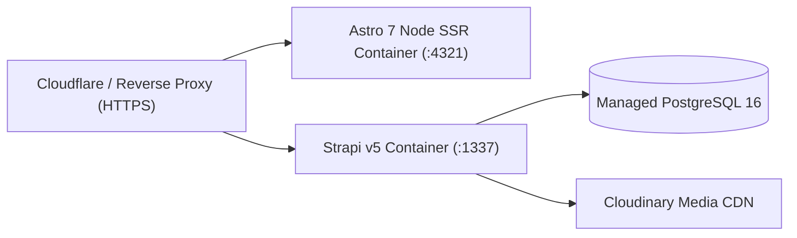

## 1. Production Deployment Topology



### Building & Starting Production Services

#### 1. Strapi v5 Backend (`apps/backend/Dockerfile`)
```bash
cd apps/backend
pnpm build
NODE_ENV=production pnpm start
```
- Liveness/Readiness Probe: `GET http://127.0.0.1:1337/api/health` -> returns `200 OK`.

#### 2. Astro 7 SSR Frontend (`apps/frontend/`)
```bash
cd apps/frontend
pnpm build
HOST=127.0.0.1 PORT=4321 node ./dist/server/entry.mjs
```
- **Vercel Deployment**: `apps/frontend/astro.config.ts` automatically selects `@astrojs/vercel` when `VERCEL` is set, paired with `apps/frontend/vercel.json` (`installCommand: "pnpm install --filter frontend..."`, `buildCommand: "pnpm build"`).

---

## 2. Database Backup & Restore (PostgreSQL 16)

### Create a Compressed Backup
```bash
pg_dump -h 127.0.0.1 -U mosque_admin -Fc central_mosque_bogota > mosque_backup_$(date +%F).dump
```

### Restore from Backup
```bash
pg_restore -h 127.0.0.1 -U mosque_admin -d central_mosque_bogota --clean mosque_backup_YYYY-MM-DD.dump
```

---

## 3. Common Incident Troubleshooting

| Symptom | Root Cause | Resolution |
| :--- | :--- | :--- |
| Frontend logs `[WARN] Strapi unreachable, falling back to localized mocks` | Strapi v5 is stopped or `STRAPI_URL` in `apps/frontend/.env` does not match `http://127.0.0.1:1337` | Verify `GET http://127.0.0.1:1337/api/health`; frontend continues serving traffic safely from localized mocks until Strapi recovers |
| Prayer times use fallback schedule instead of live IslamicAPI | `ISLAMIC_API_KEY` is missing or rate-limited (`HTTP 429`) | Set `ISLAMIC_API_KEY` in `apps/frontend/.env` or configure prayer times in Strapi's `@vicacha-devs/strapi-plugin-islam` cache |
| Newly published Strapi content does not appear immediately | `strapi-cache` 1-hour TTL or static page build | Trigger an editorial update in Strapi (which auto-clears `strapi-cache`) and re-run `astro build` for static routes |
| `oxfmt --check` fails after running `vitest --coverage` | Generated files in `coverage/` or `storybook-static/` | Already prevented by `ignorePatterns` in `apps/frontend/.oxfmtrc.json` (`["coverage", "dist", "storybook-static", "node_modules"]`) |
| Standalone CI fails resolving `file:../../../strapi-v5-extensions/...` | Local sibling `file:` plugin links committed on `develop` | Run `pnpm qa:link:npm` (or rely on the automated standalone fallback in `.github/workflows/ci.yml` and `e2e.yml`) |

---

## 4. Port-Isolated Local QA Infrastructure & Plugin Link Modes

Use the loopback-only QA Compose stack (`docker-compose.qa.yml`) to run isolated QA services without colliding with other Vicacha repositories:

```bash
# 1. Configure QA environment secrets (gitignored)
cp .env.qa.example .env.qa

# 2. Start isolated loopback-only services (Postgres 5433, Valkey 6380, Typesense 8109, Mailpit 1026/8026)
pnpm qa:docker:up

# 3. Run offline/installed QA verification + live HTTP smoke + Playwright E2E
pnpm qa:verify
pnpm qa:smoke
pnpm qa:e2e

# 4. Tear down QA services
pnpm qa:docker:down
```

### Switching Between Local & Published `@vicacha-devs/*` Plugins

- `pnpm qa:link:status` — Reports whether all 17 Strapi plugins and `@vicacha-devs/astro-tiptap-blocks` currently resolve to local sibling `file:` paths or published npm semver ranges.
- `pnpm qa:link:local` — Points dependencies to sibling `../strapi-v5-extensions` and `../astro-tiptap-blocks` workspaces for active plugin development.
- `pnpm qa:link:npm` — Switches dependencies to published npm versions defined in `.qa-plugin-versions.json` (use `-- --check-ci` as a release guardrail before merging to `main`).
- `pnpm qa:report` — Generates/aggregates `.qa/dashboard.html` across all sibling Vicacha repositories.
