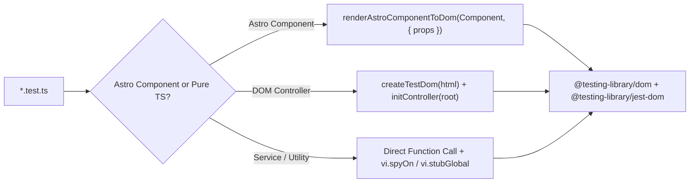

## 1. Testing Architecture (`apps/frontend/vitest.config.ts`)

The frontend test suite uses **Vitest 4** with two distinct projects configured in `apps/frontend/vitest.config.ts`:
- **`unit`**: Node/Happy-DOM test runner executing all `src/**/*.test.ts` files (92 test files, 201 tests).
- **`storybook`**: Playwright Chromium browser runner executing `@storybook/addon-vitest` stories.



---

## 2. Enforced Coverage Thresholds (`vitest.config.ts`)

| Metric | Required Threshold | Current Project Score |
| :--- | :--- | :--- |
| **Statements** | `>= 80%` | **98.26%** |
| **Branches** | `>= 90%` | **90.93%** |
| **Functions** | `>= 95%` | **98.96%** |
| **Lines** | `>= 80%` | **99.28%** |

> **Important**: `src/utils/test.helpers.ts` is included in coverage and tested at **100%** across all 4 metrics by `src/utils/test.helpers.test.ts`.

---

## 3. Test Helpers Reference (`apps/frontend/src/utils/test.helpers.ts`)

| Helper | Purpose |
| :--- | :--- |
| `renderAstroComponentToDom(Component, options)` | Uses Astro's `experimental_AstroContainer` to render an `.astro` component to HTML, mounts it into a `happy-dom` `Window`, and returns `{ window, root, close }` |
| `createTestDom(html, options)` | Creates a synchronous `happy-dom` `Window`, installs globals (`window`, `document`, `HTMLElement`, `CustomEvent`, `Event`, `SVGElement`), and returns `{ window, document, root, close }` |
| `installDomGlobals(window, document)` | Binds `globalThis.window`, `globalThis.document`, and a synchronous `requestAnimationFrame` for controller animation tests |
| `installMatchMedia(window)` | Patches `window.matchMedia` so `(prefers-reduced-motion: reduce)` matches by default in deterministic tests |
| `ensureDialogApi(dialog)` | Polyfills `showModal()`, `show()`, `close()`, and `getAnimations()` on `HTMLDialogElement` instances in `happy-dom` |
| `createUser(window)` | Configures `@testing-library/user-event` bound to the `happy-dom` document and Vitest fake timers |

---

## 4. ESLint Rules for Tests (`eslint.config.ts`)

1. **Test Title Convention (`vitest/valid-title`)**:
   - Every `it(...)` or `test(...)` block inside `src/components/**`, `src/utils/**`, `src/services/islamicAPI/**`, and `src/i18n/**` **must** follow the pattern:
     ```ts
     it("should <expected behavior> when <condition>", async () => { ... });
     ```
2. **Always Close Happy-DOM Windows**:
   - Wrap assertions in `try { ... } finally { await close(); }` so background timers and observers are cleaned up.

---

## 5. Multi-Repo QA Control Center, Plugin Link Switcher & Playwright E2E

In addition to Vitest unit coverage, the repository ships an offline-first QA automation suite under `scripts/qa/` and full-stack Playwright E2E tests under `apps/frontend/e2e/`:

| Command | Purpose |
| :--- | :--- |
| `pnpm qa:doctor` | Verifies Node.js runtime, `@vicacha-devs/*` link integrity, Strapi version parity with `strapi-v5-extensions`, and loopback-only QA Compose security |
| `pnpm qa:judges` | Runs 4 offline adversarial judges: doc line limit (`<= 500`), 4-locale parity (`es/en/ar/tr`), XSS `set:html` scan, and Playwright E2E suite presence |
| `pnpm qa:verify` | Executes doctor + judges + backend 10-plugin runtime tests + frontend Vitest, emitting `.qa/report.json` and interactive `.qa/dashboard.html` |
| `pnpm qa:report` | Aggregates `.qa/report.json` from sibling Vicacha repos into a unified multi-repo HTML Control Center |
| `pnpm qa:link:status` / `qa:link:local` / `qa:link:npm` | Toggles all 17 `@vicacha-devs/strapi-plugin-*` deps, overrides, and `@vicacha-devs/astro-tiptap-blocks` between sibling `file:` paths and npm semver (`.qa-plugin-versions.json`) |
| `pnpm qa:docker:up` / `qa:docker:down` | Manages port-isolated `127.0.0.1` QA services (`docker-compose.qa.yml`: Postgres `5433`, Valkey `6380`, Typesense `8109`, Mailpit `1026`/`8026`) |
| `pnpm qa:smoke` / `pnpm qa:e2e` | Runs live HTTP route/iCal/RSS smoke tests and Playwright Chromium E2E + WCAG 2.2 AA suites (`i18n-and-rtl.spec.ts`, `core-journeys.spec.ts`, `accessibility.spec.ts`) |

> **CI Automation**: `.github/workflows/ci.yml` and `e2e.yml` auto-switch unresolved `file:` links to npm in standalone CI and upload `.qa/dashboard.html` as a build artifact; `.github/workflows/qa-cross-repo.yml` checks out `strapi-v5-extensions` and `astro-tiptap-blocks` together for live cross-repo verification.
