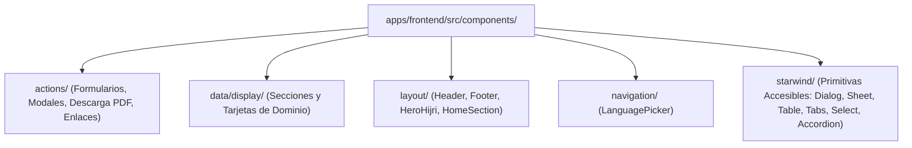

## 1. Jerarquía del Directorio de Componentes

Todos los componentes UI en `apps/frontend/src/components/` se organizan en 5 capas funcionales:

---

## 2. Componentes de Acción (`src/components/actions/`)

| Componente | Controlador (`*.controller.ts`) | Propósito |
| :--- | :--- | :--- |
| `ContactAndVisitFormsSection` | `contact-and-visit-forms.controller.ts` | Formulario con pestañas para mensajes de contacto (`contact-message`) y reservas de visitas guiadas (`visit-booking`), conectado a `POST /api/submissions` |
| `CourseEnrollmentForm` | `course-enrollment-form.controller.ts` | Modal (`Starwind Dialog`) abierto desde las tarjetas de `AcademyCoursesSection` (`data-enroll-course-slug`), enviando `course-enrollment` |
| `DonationSubmissionForm` | `donation-submission-form.controller.ts` | Modal para registrar comprobantes de donación (`donation-submission`), pre-llenando la campaña o factura de servicio público |
| `ServiceDeskIntakeSection` | `service-desk-intake.controller.ts` | Modal dinámico para los 5 flujos de atención (`service-desk-request`: Khutbah, Nikah, Janazah, Shahada o Certificados) |
| `DownloadPDF` | `download-pdf.controller.ts` | Captura `#pdf-table-content` con `html2canvas-pro` + `jspdf` para exportar el horario mensual de oración en PDF A4 horizontal |
| `Link` | — | Botón/enlace polimórfico con variantes CVA (`primary`, `secondary`, `ghost`) y soporte de íconos |

---

## 3. Componentes de Visualización de Dominio (`src/components/data/display/`)

| Grupo de Dominio | Componentes | Características Clave |
| :--- | :--- | :--- |
| **Oración y Calendario Hijri** | `DailyPrayTime`, `MonthlyPrayTime`, `DailyDuaModal`, `QiblaAndObservancesSection`, `RamadanScheduleBanner` | Resaltado en vivo, cuenta regresiva y estados `Passed / Now / Up Next`, audio de súplica diaria, tabla mensual desplegable, rumbo Qibla (`65.24° ENE`) |
| **Eventos y Spotlights** | `NextEventsSection`, `EventsCatalogSection`, `EventDetailSection`, `EventVerticalCard`, `EventSpotlightDock` | Filtros por categoría/audiencia, vista `Lista \| Calendario` (`events-catalog.controller.ts`) mensual y agenda diaria, exportación `.ics`, dock flotante con visor de póster |
| **Academia y Fe** | `AcademyCoursesSection`, `ArticleDetailSection`, `FivePillarsSection`, `ScriptureExplorerSection`, `VisitorEtiquetteSection`, `FaqAccordionSection` | Explorador de aleyas y hadices por tema, contador interactivo Tasbih 33/99 (`scripture-explorer.controller.ts`), bloques Tiptap |
| **Donaciones y Zakat** | `DonationImpactSection`, `DonationCampaignsSection`, `ZakatCalculatorSection`, `PaymentChannelsSection`, `UtilityInvoicesSection` | Calculadora de Nisab en Oro/Plata con resumen fijo en COP (`zakat-calculator.controller.ts`), transparencia 90%/10%, copiado bancario en un clic |
| **Medios, Recursos y Comunidad** | `MediaHighlightsSection`, `MediaArchiveSection`, `PublicationsAndGlossarySection`, `PhotoGalleriesSection`, `CommunityBroadcastChannelsSection`, `CommunityServicesSection`, `AboutInstitutionalSections`, `SiteSearchSection`, `UrgentAlertBanner`, `TiptapContent` | Búsqueda y filtros en cliente, canales de WhatsApp/Telegram, banner de alerta urgente persistente en `localStorage` |

---

## 4. Patrón de Controladores Cliente (`*.controller.ts`)

1. **Inicialización Idempotente**: Todo controlador exporta `init*(root: ParentNode = document)` y evita doble enlace mediante `dataset.*Initialized = "true"`.
2. **Manipulación Segura del DOM**: Utiliza `textContent`, `setAttribute`, `classList` y `DOMParser`, nunca `innerHTML`.
3. **Pruebas Unitarias Directas**: Al recibir `root`, las pruebas en Vitest renderizan el componente con `renderAstroComponentToDom()` e invocan `init*(root)` directamente en Happy DOM.

---

## 5. Tamaños de Pantalla y Personalizaciones de Starwind

### Escala de Breakpoints (`src/styles/global.css`)

| Nivel | Token(s) | Min-Width | Regla de Layout |
| :--- | :--- | :--- | :--- |
| **Móvil** | `mobile` (`sm: 365px`) | `320px` | Columnas apiladas (`grid-cols-1`), badges/botones con ajuste de línea, menú móvil en cajón |
| **Tablet** | `tablet` / `md` | `768px` | Grillas de 2 columnas (`md:grid-cols-2` en eventos, publicaciones, glosario y canales) |
| **Escritorio** | `desktop` / `lg` | `1024px` | Barra de navegación superior completa, grillas de 3 columnas (`lg:grid-cols-3`), `UrgentAlertBanner` en una sola fila |
| **Escritorio Amplio** | `xl` / `2xl` | `1440px` / `1536px` | Contenedores `1280px–1440px` y etiquetas secundarias visibles |

> **Regla:** Como `--breakpoint-sm` es `365px`, las grillas multicolumna deben activarse en `md:` (`768px`) o `lg:` (`1024px`), nunca en `sm:`.

### Personalizaciones Locales de Starwind UI (`src/components/starwind/`)

- **`badge/variants.ts`**: Usa `max-w-full flex-wrap justify-center whitespace-normal text-center md:whitespace-nowrap` para que las etiquetas largas se ajusten sin desbordar pantallas de `320px–390px`.
- **`button/variants.ts`**: Usa `max-w-full whitespace-normal text-center lg:whitespace-nowrap` y `min-h-*` con relleno vertical para evitar recortes o desbordes en tarjetas estrechas.
- **`card/variants.ts`**: `cardFooter` incluye `border-border` junto a `border-t` para usar `--border` en lugar de `currentColor`.
