## 1. Ecosistema de Plugins Propios `@vicacha-devs`

Además de los esquemas nativos de Strapi v5, `apps/backend/package.json` integra **10 extensiones `@vicacha-devs/strapi-plugin-*`** (ubicadas en `../../strapi-v5-extensions/packages/`):

```mermaid
flowchart TB
  Strapi["Strapi v5 Core (:1337)"] --> P1["strapi-plugin-islam (Oración, Zakat, Corán, Hadiz, Qibla, Ramadán)"]
  Strapi --> P2["strapi-plugin-events (Eventos, Spotlights, Cursos Academia, ICS)"]
  Strapi --> P3["strapi-plugin-donations (Campañas, Facturas Servicios, Comprobantes)"]
  Strapi --> P4["strapi-plugin-inbox (Mensajes Contacto y 5 Flujos de Ventanilla)"]
  Strapi --> P5["strapi-plugin-bookings (Agendamiento de Visitas Guiadas y Colegios)"]
  Strapi --> P6["strapi-plugin-resources (Publicaciones PDF, Glosario, Galerías)"]
  Strapi --> P7["strapi-plugin-media-feeds (Archivo Audio/Video y Sindicación RSS 2.0)"]
  Strapi --> P8["strapi-plugin-broadcasts (Canales WhatsApp/Telegram y Boletín)"]
  Strapi --> P9["strapi-plugin-calendar (Calendario de Efemérides Hijri-Gregoriano)"]
  Strapi --> P10["strapi-plugin-certificates (Certificados de Shahada, Nikah y Donación)"]
```

---

## 2. Matriz de Integración con el Frontend

| Paquete del Plugin | Llave Config | Prefijo REST | Consumidor Frontend (`src/services/strapi/api.ts`) |
| :--- | :--- | :--- | :--- |
| `@vicacha-devs/strapi-plugin-islam` | `islam` | `/api/islam/*` | `fetchIslamSuiteFromStrapi` (`prayerTimesLoader`, `zakatNisabLoader`, `DailyDuaModal`, `FivePillarsSection`, `ScriptureExplorerSection`, `QiblaAndObservancesSection`, `RamadanScheduleBanner`, `UrgentAlertBanner`) |
| `@vicacha-devs/strapi-plugin-events` | `events` | `/api/events/*` | `fetchEventsFromStrapi`, `fetchAcademyCoursesFromStrapi`, `fetchEventSpotlightsFromStrapi`, `GET /api/events/feed.ics` |
| `@vicacha-devs/strapi-plugin-donations` | `donations` | `/api/donations/*` | `fetchUtilityInvoicesFromStrapi`, `POST /api/submissions` (`donation-submission`) |
| `@vicacha-devs/strapi-plugin-inbox` | `inbox` | `/api/inbox/*` | `fetchServiceDeskWorkflowsFromStrapi`, `POST /api/submissions` (`contact-message`, `service-desk-request`) |
| `@vicacha-devs/strapi-plugin-bookings` | `bookings` | `/api/bookings/*` | `POST /api/submissions` (`visit-booking`) |
| `@vicacha-devs/strapi-plugin-resources` | `resources` | `/api/resources/*` | `fetchPublicationsFromStrapi`, `fetchGlossaryFromStrapi`, `fetchPhotoGalleriesFromStrapi`, `GET /api/resources/publications/[slug]/download` |
| `@vicacha-devs/strapi-plugin-media-feeds` | `media-feeds` | `/api/media-feeds/*` | `fetchMediaArchiveFromStrapi`, `GET /api/media-feeds/rss.xml` |
| `@vicacha-devs/strapi-plugin-broadcasts` | `broadcasts` | `/api/broadcasts/*` | `fetchBroadcastsFromStrapi`, `POST /api/submissions` (`newsletter-subscription`), correo (Resend SMTP), Telegram Bot y WhatsApp (`meta-cloud` / `rmyndharis/OpenWA` autoalojado) |
| `@vicacha-devs/strapi-plugin-calendar` | `calendar` | `/api/calendar/*` | Sincronización de efemérides Hijri (`islamic-umalqura`) con `QiblaAndObservancesSection` |
| `@vicacha-devs/strapi-plugin-certificates` | `certificates` | `/api/certificates/*` | Emisión y verificación QR de certificados firmados con Ed25519 y firma electrónica vía **DocuSeal** autoalojado (`ESIGN_PROVIDER=docuseal`, `send_email: false` con plantilla institucional `501` por Resend SMTP, `POST /api/certificates/webhooks/docuseal`) |
| `@vicacha-devs/strapi-plugin-notes` | `notes` | `/api/notes/*` | Notas editoriales (`plugin::notes.note`) con metadatos de autor/fecha tipo Audit Logs, notas fijadas, categorías y Hub Global (10 idiomas) |

---

## 3. Plugins Complementarios de Edición, Caché y Búsqueda (`apps/backend/config/plugins.ts`)

| Paquete | Versión | Función y Soporte de Idiomas (`en`, `es`, `ar`, `tr`) |
| :--- | :--- | :--- |
| `strapi-cache` | `^1.13.0` | Caché REST LRU / Redis / Valkey con invalidación automática al publicar y traducciones nativas del Admin en `en`, `es`, `ar`, `tr` y `de` |
| `@vicacha-devs/strapi-plugin-global-search` | `file:` | Búsqueda global tipo Spotlight (`Cmd/Ctrl + K`) en todos los tipos `api::*` y `plugin::*` (`en`, `es`, `ar`, `tr`, `fr`) |
| `@vicacha-devs/strapi-plugin-tiptap-editor` | `file:` | Editor TipTap v3 con presets, tema, field bindings y sincronización relacional de medios/enlaces (`en`, `es`, `ar`, `tr` +7 idiomas) |
| `@vicacha-devs/strapi-plugin-seo` | `file:` | Componente SEO, `autoPopulateOnSave` / generadores localizados (`apps/backend/config/plugins/seo.plugin.ts`) y analizador SERP/JSON-LD en vivo (`en`, `es`, `ar`, `tr`, `fr`, `pt-BR`) |
| `@juadariasmar/strapi-plugin-typesense` | `^1.0.0` | Indexación en tiempo real hacia Typesense |
| `strapi-plugin-navigation` | `^3.4.2` | Constructor de menús jerárquicos compatible con modelos `api::*` y `plugin::*` |
| `src/content-structure/groups.json` | Nativo | Agrupación nativa de colecciones de Strapi v5 sincronizada por `src/bootstrap/content-structure.ts` |
| `strapi-plugin-email-designer-5` | `^0.0.10` | Diseñador visual Unlayer para 20 plantillas institucionales transaccionales y de firma DocuSeal (`101–104`, `201–204`, `301–304`, `401–404`, `501`, `901–903`) enviadas vía Resend SMTP |
| `strapi-plugin-form-builder-cms` | `1.1.0-rc.2` | Constructor visual de formularios sincronizado con `@vicacha-devs/strapi-plugin-inbox` (incluyendo metadatos de campos `file`) |
| `@vicacha-devs/strapi-plugin-sitemap` | `file:` | Generador dinámico de sitemap e índice de sitemaps XML multilingüe (`en`, `es`, `ar`, `tr`, `fr`, `pt-BR`) |
| `strapi-plugin-publisher` | `^2.0.9` | Publicación y despublicación programada |
| `strapi-plugin-config-sync` | `^3.2.0` | Sincronización de configuración entre entornos (`en`, `es`, `ar`, `tr` +18 idiomas) |
| `strapi-plugin-preview-button` | `^3.0.2` | Botones de vista previa de borrador y vista en vivo en Content Manager (`en`, `es`, `tr`, `fr`, `ru`, `ja` nativos + `ar` en `src/admin/translations.ts`) |

---

## 4. Configuración Automatizada de Metadatos SEO (`apps/backend/config/plugins/seo.plugin.ts`)

`buildSeoPluginConfig(env)` configura `@vicacha-devs/strapi-plugin-seo` con `autoCreateComponent: true`, `autoPopulateOnSave: true` y cuatro generadores localizados (`generateTitle`, `generateDescription`, `generateImage`, `generateURL`) usando `PUBLIC_SITE_URL` y el nombre institucional de la mezquita por idioma (`es`, `en`, `ar`, `tr`) para páginas estáticas (`homepage`, `about-page`, `islam-faith-page`, `donations-page`, `contact-page`) y prefijos de colección (`/articles`, `/services`, `/leaders`, `/events`, `/donations`, `/media`, `/media/series`, `/islam-and-faith`, `/gallery`, `/bookings`).
