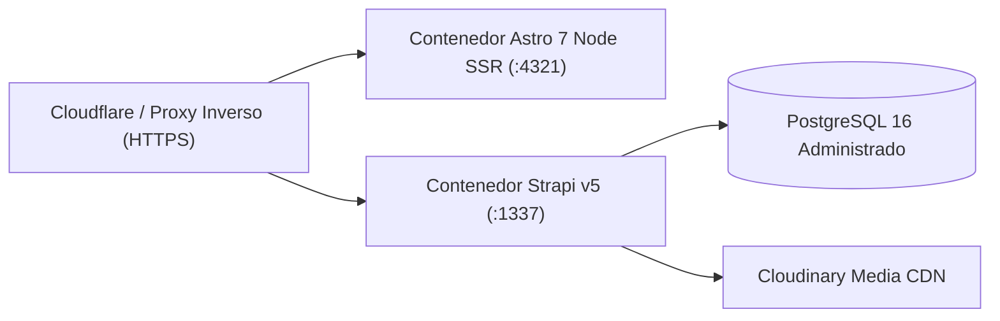

## 1. Topología de Despliegue en Producción



### Compilación y Arranque de Servicios

#### 1. Backend Strapi v5 (`apps/backend/Dockerfile`)
```bash
cd apps/backend
pnpm build
NODE_ENV=production pnpm start
```
- Sonda de salud: `GET http://127.0.0.1:1337/api/health` -> retorna `200 OK`.

#### 2. Frontend Astro 7 SSR (`apps/frontend/`)
```bash
cd apps/frontend
pnpm build
HOST=127.0.0.1 PORT=4321 node ./dist/server/entry.mjs
```
- **Despliegue en Vercel**: `apps/frontend/astro.config.ts` selecciona automáticamente `@astrojs/vercel` cuando la variable `VERCEL` está definida, junto con `apps/frontend/vercel.json` (`installCommand: "pnpm install --filter frontend..."`, `buildCommand: "pnpm build"`).

---

## 2. Respaldo y Restauración de Base de Datos (PostgreSQL 16)

```bash
# Crear respaldo comprimido
pg_dump -h 127.0.0.1 -U mosque_admin -Fc central_mosque_bogota > mosque_backup_$(date +%F).dump

# Restaurar respaldo
pg_restore -h 127.0.0.1 -U mosque_admin -d central_mosque_bogota --clean mosque_backup_YYYY-MM-DD.dump
```

---

## 3. Resolución de Incidentes Frecuentes

| Síntoma | Causa Raíz | Solución |
| :--- | :--- | :--- |
| El frontend muestra `[WARN] Strapi unreachable, falling back to localized mocks` | Strapi v5 está detenido o `STRAPI_URL` no apunta a `http://127.0.0.1:1337` | Verifica `GET http://127.0.0.1:1337/api/health`; el sitio sigue operando sin interrupción gracias a los mocks localizados |
| Los horarios de oración usan el respaldo en lugar de IslamicAPI | Falta `ISLAMIC_API_KEY` o se alcanzó el límite (`HTTP 429`) | Configura `ISLAMIC_API_KEY` en `apps/frontend/.env` o usa la caché del plugin `@vicacha-devs/strapi-plugin-islam` |
| Un cambio editorial en Strapi no se refleja de inmediato | TTL de 1 hora en `strapi-cache` o ruta pre-renderizada | Guardar/Publicar en Strapi limpia `strapi-cache` automáticamente; ejecuta `astro build` si es una página estática |
| El CI autónomo falla resolviendo `file:../../../strapi-v5-extensions/...` | Enlaces locales `file:` heredados de la rama `develop` | Ejecuta `pnpm qa:link:npm` (o confía en el fallback automático en `.github/workflows/ci.yml` y `e2e.yml`) |

---

## 4. Infraestructura QA Local Aislada y Modos de Enlace de Plugins

Usa el stack QA enlazado exclusivamente a `127.0.0.1` (`docker-compose.qa.yml`) para ejecutar servicios de prueba sin conflictos de puertos con otros repositorios de Vicacha:

```bash
# 1. Configura secretos de entorno QA (ignorado por git)
cp .env.qa.example .env.qa

# 2. Inicia servicios aislados (Postgres 5433, Valkey 6380, Typesense 8109, Mailpit 1026/8026)
pnpm qa:docker:up

# 3. Ejecuta verificación QA, pruebas smoke HTTP y Playwright E2E
pnpm qa:verify
pnpm qa:smoke
pnpm qa:e2e

# 4. Detiene los servicios QA
pnpm qa:docker:down
```

### Alternar Plugins `@vicacha-devs/*` entre Local y npm

- `pnpm qa:link:status` — Muestra si los 17 plugins de Strapi y `@vicacha-devs/astro-tiptap-blocks` usan rutas locales `file:` o versiones publicadas en npm.
- `pnpm qa:link:local` — Enlaza las dependencias a `../strapi-v5-extensions` y `../astro-tiptap-blocks` para desarrollo conjunto de plugins.
- `pnpm qa:link:npm` — Cambia las dependencias a versiones publicadas de `.qa-plugin-versions.json` (usa `-- --check-ci` como compuerta previa a fusionar en `main`).
- `pnpm qa:report` — Genera/agrega `.qa/dashboard.html` consolidando todos los repositorios hermanos de Vicacha.
