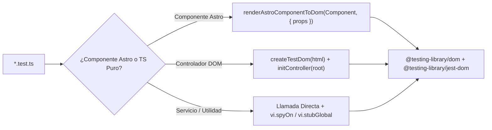

## 1. Arquitectura de Pruebas (`apps/frontend/vitest.config.ts`)

La suite de pruebas del frontend utiliza **Vitest 4** con dos proyectos configurados en `apps/frontend/vitest.config.ts`:
- **`unit`**: Ejecutor en Node/Happy-DOM para todos los archivos `src/**/*.test.ts` (92 archivos de prueba, 201 tests).
- **`storybook`**: Ejecutor en navegador Playwright Chromium para las historias de `@storybook/addon-vitest`.

---

## 2. Umbrales Obligatorios de Cobertura (`vitest.config.ts`)

| Métrica | Umbral Mínimo | Resultado Actual |
| :--- | :--- | :--- |
| **Statements** | `>= 80%` | **98.26%** |
| **Branches** | `>= 90%` | **90.93%** |
| **Functions** | `>= 95%` | **98.96%** |
| **Lines** | `>= 80%` | **99.28%** |

> **Nota**: `src/utils/test.helpers.ts` está incluido en las métricas de cobertura y cuenta con **100%** en las 4 categorías gracias a `src/utils/test.helpers.test.ts`.

---

## 3. Utilidades de Prueba (`apps/frontend/src/utils/test.helpers.ts`)

| Función | Propósito |
| :--- | :--- |
| `renderAstroComponentToDom(Component, options)` | Usa `experimental_AstroContainer` para renderizar un componente `.astro` a HTML, lo monta en una ventana `happy-dom` y retorna `{ window, root, close }` |
| `createTestDom(html, options)` | Crea una ventana `happy-dom` síncrona, instala globales (`window`, `document`, `HTMLElement`, `CustomEvent`, `Event`, `SVGElement`) y retorna `{ window, document, root, close }` |
| `installDomGlobals(window, document)` | Vincula `globalThis.window`, `globalThis.document` y un `requestAnimationFrame` síncrono |
| `installMatchMedia(window)` | Configura `window.matchMedia` para que `(prefers-reduced-motion: reduce)` coincida por defecto en pruebas deterministas |
| `ensureDialogApi(dialog)` | Agrega polyfills para `showModal()`, `show()`, `close()` y `getAnimations()` en elementos `HTMLDialogElement` |
| `createUser(window)` | Configura `@testing-library/user-event` enlazado al documento `happy-dom` |

---

## 4. Centro de Control QA, Selector de Enlaces Local/NPM y Playwright E2E

Además de las pruebas unitarias con Vitest, el repositorio incluye herramientas QA offline en `scripts/qa/` y pruebas E2E con Playwright en `apps/frontend/e2e/`:

| Comando | Propósito |
| :--- | :--- |
| `pnpm qa:doctor` | Verifica versión de Node.js, integridad de enlaces `@vicacha-devs/*`, paridad de Strapi con `strapi-v5-extensions` y seguridad loopback de Compose |
| `pnpm qa:judges` | Ejecuta 4 jueces offline: límite de `<= 500` líneas en docs, paridad de 4 idiomas (`es/en/ar/tr`), auditoría XSS `set:html` y presencia de specs E2E |
| `pnpm qa:verify` | Ejecuta doctor + jueces + pruebas runtime de 10 plugins en backend + Vitest de frontend, generando `.qa/report.json` y `.qa/dashboard.html` |
| `pnpm qa:report` | Consolida reportes `.qa/report.json` de repositorios hermanos en un Centro de Control HTML multi-repositorio |
| `pnpm qa:link:status` / `qa:link:local` / `qa:link:npm` | Alterna los 17 plugins `@vicacha-devs/strapi-plugin-*`, `overrides` y `@vicacha-devs/astro-tiptap-blocks` entre rutas locales `file:` y versiones npm (`.qa-plugin-versions.json`) |
| `pnpm qa:docker:up` / `qa:docker:down` | Inicia o detiene infraestructura QA aislada en `127.0.0.1` (`docker-compose.qa.yml`: Postgres `5433`, Valkey `6380`, Typesense `8109`, Mailpit `1026`/`8026`) |
| `pnpm qa:smoke` / `pnpm qa:e2e` | Ejecuta pruebas smoke HTTP/iCal/RSS y la suite Playwright + WCAG 2.2 AA (`i18n-and-rtl.spec.ts`, `core-journeys.spec.ts`, `accessibility.spec.ts`) |

> **Automatización en CI**: `.github/workflows/ci.yml` y `e2e.yml` resuelven automáticamente enlaces locales a npm en ejecuciones aisladas y publican `.qa/dashboard.html` como artefacto; `.github/workflows/qa-cross-repo.yml` valida compatibilidad cruzada junto con `strapi-v5-extensions` y `astro-tiptap-blocks`.
