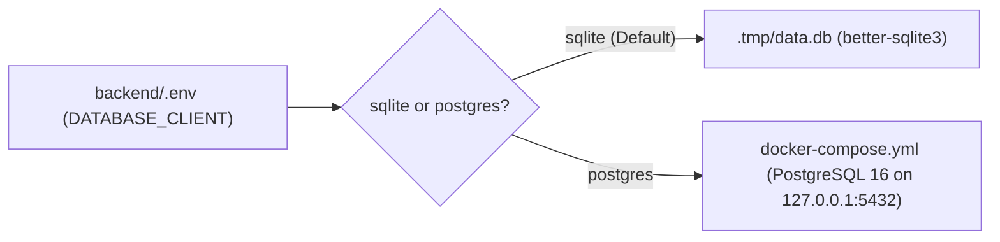

## 1. Local Ports Overview

| Service | Default URL | Bind Host | Config File |
| :--- | :--- | :--- | :--- |
| **Astro 7 SSR Frontend** | `http://localhost:4321` | `127.0.0.1` | `frontend/astro.config.ts` |
| **Storybook 10** | `http://localhost:6006` | `127.0.0.1` | `frontend/package.json` |
| **Starlight Docs Portal** | `http://localhost:4322` | `127.0.0.1` | `docs/package.json` |
| **Strapi v5 CMS Admin & API** | `http://127.0.0.1:1337` | `127.0.0.1` | `backend/config/server.ts` |
| **PostgreSQL 16 (Optional)** | `127.0.0.1:5432` | `127.0.0.1` | `docker-compose.yml` |

---

## 2. Frontend Environment Variables (`frontend/.env`)

Validated at build/startup time via `astro:env` in `frontend/astro.config.ts`:

| Variable | Context | Access | Required? | Default | Description |
| :--- | :--- | :--- | :--- | :--- | :--- |
| `ISLAMIC_API_URL` | `server` | `public` | Yes | `"https://islamicapi.com/api/v1/"` | Base URL for IslamicAPI v1 endpoints |
| `ISLAMIC_API_KEY` | `server` | `secret` | Optional | `undefined` | Server-only API key for IslamicAPI (falls back to Strapi/mocks when omitted) |
| `LOCATION_URL` | `server` | `public` | Yes | `"http://ip-api.com/json/"` | IP geolocation endpoint for visitor coordinates |
| `STRAPI_URL` | `server` | `public` | Optional | `"http://127.0.0.1:1337"` | Base URL of the Strapi v5 CMS |
| `STRAPI_API_TOKEN` | `server` | `secret` | Optional | `undefined` | Server-only Read/Write token for Strapi v5 REST API |

> **Security Rule**: `ISLAMIC_API_KEY` and `STRAPI_API_TOKEN` are declared with `access: "secret"` in `astro:env/server` and are **never** exposed to client-side browser bundles.

---

## 3. Backend Environment Variables (`backend/.env`)

Copy `backend/.env.example` to `backend/.env`:

| Variable Group | Variables | Purpose |
| :--- | :--- | :--- |
| **Server** | `HOST=127.0.0.1`, `PORT=1337`, `PUBLIC_URL=http://127.0.0.1:1337` | Binds Strapi strictly to loopback in local dev |
| **Secrets** | `APP_KEYS`, `API_TOKEN_SALT`, `ADMIN_JWT_SECRET`, `TRANSFER_TOKEN_SALT`, `JWT_SECRET`, `ENCRYPTION_KEY` | Cryptographic keys for sessions, tokens, and admin JWTs |
| **Database (SQLite default)** | `DATABASE_CLIENT=sqlite`, `DATABASE_FILENAME=.tmp/data.db` | Zero-config local database |
| **Database (PostgreSQL)** | `DATABASE_CLIENT=postgres`, `DATABASE_HOST=127.0.0.1`, `DATABASE_PORT=5432`, `DATABASE_NAME=central_mosque_bogota`, `DATABASE_USERNAME`, `DATABASE_PASSWORD` | Staging / production parity database |
| **Cloudinary CDN** | `CLOUDINARY_NAME`, `CLOUDINARY_KEY`, `CLOUDINARY_SECRET` | Optional media upload provider (uses local `public/uploads` when empty) |
| **CORS & Preview** | `CORS_ORIGINS=http://localhost:4321`, `CLIENT_FRONTEND_URL=http://localhost:4321`, `CLIENT_PREVIEW_SECRET` | Restricts CORS to the Astro frontend and enables editorial preview links |

---

## 4. Switching Between SQLite and Docker PostgreSQL 16



To test against PostgreSQL 16 locally:
```bash
# 1. Start PostgreSQL 16 bound to 127.0.0.1:5432
POSTGRES_PASSWORD="change-me-local-only" docker compose up -d

# 2. Set DATABASE_CLIENT=postgres and DATABASE_PASSWORD in backend/.env
# 3. Start Strapi v5
cd backend && pnpm develop
```
