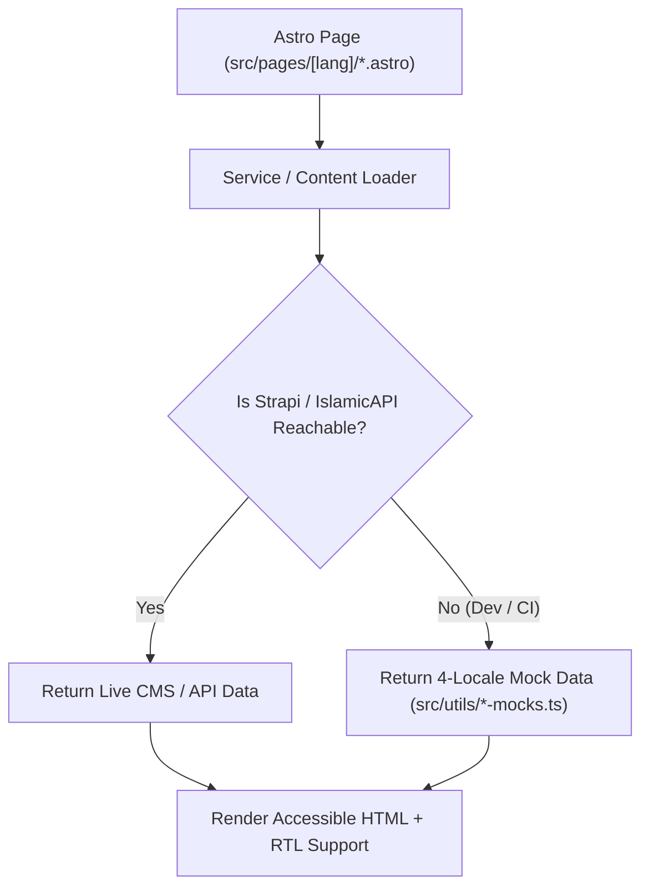

Welcome to the **Central Mosque of Bogotá (Mezquita Central Abu Bakr As-Siddiq)** codebase! This single-page cheat sheet is designed so you can get hands-on in **under 10 minutes**.

---

## 1. The 60-Second Mental Model

The repository is a TypeScript monorepo with **3 workspaces**:

| Workspace | Path | Tech Stack | Default Port |
| :--- | :--- | :--- | :--- |
| **Frontend** | `frontend/` | Astro 7 SSR (`@astrojs/node`), Tailwind CSS v4, Starwind UI, Vitest, Storybook 10 | `http://localhost:4321` |
| **Backend (CMS)** | `backend/` | Strapi v5 (`5.59.0`), SQLite (local) / PostgreSQL 16 (Docker), `strapi-cache` (`^1.13.0`), 10 `@vicacha-devs/strapi-plugin-*` extensions | `http://127.0.0.1:1337` |
| **Documentation** | `docs/` | Astro Starlight (`en` + `es`), Pele SVG diagrams (`https://pele.run/`), TypeDoc | `http://localhost:4322` |

### Why You Can Work Offline Immediately
**You do NOT need Strapi running or an `ISLAMIC_API_KEY` to develop on the frontend.** Every Strapi loader (`src/services/strapi/loader.ts`) and every IslamicAPI loader (`src/services/islamicAPI/loaders/`) automatically falls back to deterministic, 4-locale mock datasets in `frontend/src/utils/*-mocks.ts` whenever the backend or external API is unreachable.



---

## 2. Quickstart Commands (Copy & Paste)

```bash
# 1. Start the Frontend in dev mode (works immediately with offline mocks!)
cd frontend
cp .env.example .env
pnpm dev
# -> Open http://localhost:4321/es

# 2. Launch Storybook 10 to inspect UI components in isolation
pnpm storybook
# -> Open http://localhost:6006

# 3. Run the entire verification suite from the monorepo root
cd ..
pnpm verify
```

---

## 3. "Where Do I Find...?" Cheat Sheet

| If you need to... | Look in this file / folder |
| :--- | :--- |
| Edit a page route (`es`, `en`, `ar`, `tr`) | `frontend/src/pages/[lang]/` |
| Add or edit a UI / domain component | `frontend/src/components/data/display/` or `frontend/src/components/actions/` |
| Edit client-side interactivity (DOM scripts) | `*.controller.ts` right next to the `.astro` component |
| Add a UI translation string | `frontend/src/i18n/locales/{es,en,ar,tr}.ts` (add to all 4!) |
| Add a localized URL slug | `frontend/src/i18n/ui.ts` (`routes` dictionary) |
| Inspect or update Strapi API fetchers | `frontend/src/services/strapi/api.ts` and `loader.ts` |
| Inspect Prayer Times or Zakat Nisab logic | `frontend/src/services/islamicAPI/loaders/` and `frontend/src/utils/islamic.utils.ts` |
| Edit BFF API endpoints (Forms, ICS, RSS, PDF) | `frontend/src/pages/api/` |
| Update offline mock fallback data | `frontend/src/utils/*-mocks.ts` (`localized-mocks.ts`, `islam-suite-mocks.ts`, etc.) |
| Edit Strapi v5 CMS schemas | `backend/src/api/<content-type>/content-types/<name>/schema.json` |
| Edit first-boot CMS seed data & permissions | `backend/src/index.ts` |

---

## 4. The 5 Golden Rules for Every PR

1. **Zero `set:html` / `innerHTML` for Untrusted Content**:
   - Always render Strapi rich text via `<TiptapContent content={...} />` (`@vicacha-devs/astro-tiptap-blocks`).
   - In client-side `*.controller.ts` files, use `textContent`, `createElement`, or `DOMParser`—never `innerHTML`.
2. **4-Locale & Arabic RTL Parity**:
   - Every translation key added to `es.ts` **must** also be added to `en.ts`, `ar.ts`, and `tr.ts`.
   - Use logical Tailwind v4 properties (`ps-*`, `pe-*`, `ms-*`, `me-*`, `start-*`, `end-*`, `text-start`, `border-s-*`) instead of `pl-*`/`pr-*`/`ml-*`/`mr-*` so Arabic (`ar`, `dir="rtl"`) mirrors automatically.
3. **80-Column Line Width & Code Style**:
   - Both `oxfmt` (`.oxfmtrc.json`) and ESLint (`eslint.config.ts`) enforce an **80-character line limit**. Run `./node_modules/.bin/oxfmt` before committing.
4. **Unit Test Naming & Coverage Thresholds**:
   - Vitest enforces test titles starting with `should ... when ...` (`vitest/valid-title`).
   - Global unit test coverage must stay above **90% branches**, **95% functions**, **80% lines**, and **80% statements**.
5. **Offline Fallback First**:
   - Never write a page or component that crashes when `STRAPI_URL` or `ISLAMIC_API_KEY` is offline. Always provide a typed fallback in `src/utils/*-mocks.ts`.

---

## 5. Common Junior Dev Recipes

### Recipe A: Adding a New Component with Client Interactivity
1. Create `MyWidget.astro` for markup and `my-widget.controller.ts` for DOM logic.
2. Export an idempotent `initMyWidget(root: ParentNode = document)` function that marks initialized nodes with `dataset.initialized = "true"`.
3. Add `MyWidget.test.ts` (using `renderAstroComponentToDom` from `@utils/test.helpers`) and `MyWidget.stories.ts` for Storybook.

### Recipe B: Running a Single Unit Test File Fast
```bash
cd frontend
./node_modules/.bin/vitest --project=unit --run src/utils/islamic.utils.test.ts
```

### Recipe C: Checking All Quality Gates Before Pushing
```bash
cd frontend
./node_modules/.bin/oxfmt && \
./node_modules/.bin/oxfmt --check && \
./node_modules/.bin/eslint . --quiet && \
./node_modules/.bin/astro check && \
./node_modules/.bin/vitest --project=unit --run --coverage
```
