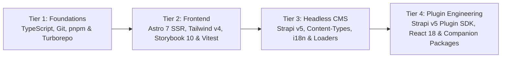

This roadmap takes junior developers from **foundational TypeScript & monorepo tooling** to **shipping production features** across our entire ecosystem:
- **`central-mosque-bogota`**: Astro 7 SSR Frontend (`frontend/`), Strapi v5 Headless CMS (`backend/`), and Bilingual Astro Starlight + TypeDoc Docs (`docs/`).
- **`strapi-v5-extensions`**: Turborepo + `pnpm` workspace monorepo containing our 10 custom `@vicacha-devs/strapi-plugin-*` packages (`calendar`, `events`, `bookings`, `islam`, `donations`, `certificates`, `inbox`, `broadcasts`, `media-feeds`, `resources`) and `@notum-cz/strapi-plugin-seo`.
- **Companion Packages**: `@vicacha-devs/astro-tiptap-blocks`, `@notum-cz/strapi-plugin-tiptap-editor`, and `strapi-global-search`.

---

## Competency Progression Overview

---

## Golden Engineering Rules (Read Before Your First PR)

1. **Strict `< 500` Lines Per File Limit**: No source or documentation file (`.ts`, `.tsx`, `.astro`, `.md`) may exceed **500 lines**.
2. **80-Column Line Width**: In `frontend/`, `oxfmt` and ESLint enforce an **80-character line width**. Always run `./node_modules/.bin/oxfmt` before committing.
3. **Multilingual i18n & Arabic RTL Parity**:
   - Every UI key added to `frontend/src/i18n/locales/es.ts` must also be added to `en.ts`, `ar.ts`, and `tr.ts`.
   - Use Tailwind v4 logical properties (`ps-*`, `pe-*`, `ms-*`, `me-*`, `start-*`, `end-*`, `text-start`, `border-s-*`) so Arabic (`dir="rtl"`) mirrors automatically.
   - In Strapi plugins, maintain 10-locale translation parity in `admin/src/translations/*.json`.
4. **Zero `set:html` / `innerHTML` for Untrusted Data**: Render rich text via `<TiptapContent content={...} />` (`@vicacha-devs/astro-tiptap-blocks`).
5. **No Committed `dist/` Folders in `strapi-v5-extensions`**: Never commit `dist/` build artifacts in the plugin monorepo.
6. **Conventional Commits & Unit Test Coverage**: Use Conventional Commits (`feat:`, `fix:`, `docs:`, `test:`) and keep unit test coverage above **90% branches** and **95% functions**.

---

## Tier 1: Core Foundations (TypeScript, Git, `pnpm` Workspaces & Turborepo)

**Goal**: Master strict TypeScript (generics, discriminated unions, `zod` validation), Conventional Commits with Husky, and how `pnpm` workspaces + Turborepo link `central-mosque-bogota` with `strapi-v5-extensions` and `astro-tiptap-blocks`.

### Curated YouTube Tutorials (Spanish & English)

| Topic | Español (YouTube) | English (YouTube) |
| :--- | :--- | :--- |
| **TypeScript from Zero to Strict Types** | **Midudev** — [Curso Intensivo de TypeScript desde Cero](https://www.youtube.com/watch?v=fUgxxhI_bvc) (~2h 30m) & [Parte 2: Generics y Utility Types](https://www.youtube.com/watch?v=L1Z8CG3314I) | **Traversy Media** — [TypeScript Crash Course](https://www.youtube.com/watch?v=BCg4U1FzODs) (~1h) & **Matt Pocock** — [TypeScript Generics Tutorial](https://www.youtube.com/watch?v=EcCTIExsqmI) |
| **Git, GitHub Flow & Conventional Commits** | **Midudev** — [Curso de Git y GitHub desde Cero](https://www.youtube.com/watch?v=3GymExBkKjE) (~5h) | **Traversy Media** — [Git & GitHub Crash Course](https://www.youtube.com/watch?v=SWYqp7iY_Tc) (~1h) |
| **Monorepos with `pnpm` Workspaces & Turborepo** | **Fazt Code** — [Curso de pnpm y Workspaces / Monorepos](https://www.youtube.com/@FaztCode/search?query=pnpm%20monorepo) | **Vercel (Official)** — [Turborepo Crash Course & Monorepo Fundamentals](https://www.youtube.com/@VercelHQ/search?query=turborepo) |
| **Runtime Validation with Zod** | **Fazt Code** — [Zod Curso Práctico de Validación en TypeScript](https://www.youtube.com/watch?v=03w0baf2SC0) (~45m) | **Web Dev Simplified** — [Learn Zod In 30 Minutes](https://www.youtube.com/watch?v=L6BE-U3oy80) (~30m) |

### Codebase Reading List & Graduation PR (Tier 1)
- **Read**: `package.json`, `scripts/verify-all.ts`, and `../strapi-v5-extensions/turbo.json`.
- **Graduation PR**: Add a strictly typed helper in `frontend/src/utils/` with a Vitest unit test (`*.test.ts`) achieving 100% branch coverage and passing `pnpm verify`.

---

## Tier 2: Frontend Engineering (Astro 7 SSR, Tailwind CSS v4, Storybook 10 & Vitest)

**Goal**: Build accessible (`WCAG AA`), 4-locale (`es`, `en`, `ar`, `tr`), RTL-aware server-rendered Astro 7 pages and interactive client controllers (`*.controller.ts`), documented in Storybook 10 and tested with Vitest.

### Curated YouTube Tutorials (Spanish & English)

| Topic | Español (YouTube) | English (YouTube) |
| :--- | :--- | :--- |
| **Astro (SSR, Content Layer, Routing & Endpoints)** | **Midudev** — [Curso de Astro desde Cero (SSR, Content Collections)](https://www.youtube.com/watch?v=RB5tR_nqUEw) (~3h) | **Coding in Public** — [Astro Crash Course](https://www.youtube.com/@CodinginPublic/search?query=astro%20crash%20course) & **Traversy Media** — [Astro Crash Course](https://www.youtube.com/watch?v=Oi9z5gfIHJs) |
| **Tailwind CSS v4, Logical RTL & Dark Mode** | **Midudev** — [Tailwind CSS desde Cero + Novedades v4](https://www.youtube.com/@midudev/search?query=tailwind%20css) & **Fazt Code** — [Curso de Tailwind CSS](https://www.youtube.com/@FaztCode/search?query=tailwind) | **Tailwind Labs (Official)** — [What's New in Tailwind CSS v4.0](https://www.youtube.com/@TailwindLabs) & **Traversy Media** — [Tailwind CSS Crash Course](https://www.youtube.com/watch?v=dFgzHOX84xQ) |
| **Storybook & Accessibility (`a11y`)** | **Gentleman Programming** — [Storybook y Arquitectura de Componentes](https://www.youtube.com/@GentlemanProgramming/search?query=storybook) | **Storybook (Official)** — [Storybook Visual & Accessibility Testing Tutorials](https://www.youtube.com/@chromaui) |
| **Vitest, Happy DOM & Testing Library** | **Midudev** — [Testing en JavaScript y TypeScript con Vitest](https://www.youtube.com/@midudev/search?query=vitest) | **Net Ninja** — [Vitest Crash Course / Unit Testing](https://www.youtube.com/@NetNinja/search?query=vitest) |

### Codebase Reading List & Graduation PR (Tier 2)
- **Read**: `frontend/src/pages/[lang]/index.astro`, `frontend/src/i18n/ui.ts`, `frontend/src/components/data/display/`, and `../astro-tiptap-blocks/src/`.
- **Graduation PR**: Build or enhance a component in `frontend/src/components/` using Tailwind v4 logical properties (`ps-*`, `pe-*`), 4-locale strings (`es`, `en`, `ar`, `tr`), a Storybook `.stories.ts` file (0 `a11y` violations), and a `.test.ts` file using `renderAstroComponentToDom`.

---

## Tier 3: Backend & Headless CMS (Strapi v5, Document Service API, i18n & Resilient Loaders)

**Goal**: Understand Strapi v5 Content-Types, Document Service API (`strapi.documents(uid)`), 4-locale i18n, first-boot seeding (`backend/src/index.ts`), `strapi-cache`, and resilient frontend loaders with offline mock fallbacks.

### Curated YouTube Tutorials (Spanish & English)

| Topic | Español (YouTube) | English (YouTube) |
| :--- | :--- | :--- |
| **Strapi v5 Headless CMS Fundamentals** | **Midudev** — [CMS Headless con Strapi + Astro Paso a Paso](https://www.youtube.com/watch?v=W4brAobC2Hc) (~1h 45m) & **Fazt Code** — [Curso de Strapi CMS](https://www.youtube.com/@FaztCode/search?query=strapi) | **Strapi (Official)** — [Strapi 5 Crash Course & Document Service API](https://www.youtube.com/@Strapi/search?query=Strapi%205) |
| **PostgreSQL & Relational Data Modeling** | **Fazt Code** — [Curso de PostgreSQL desde Cero](https://www.youtube.com/watch?v=c4E3b2taE7I) (~2h) | **freeCodeCamp** — [PostgreSQL Tutorial for Beginners](https://www.youtube.com/watch?v=qw--VYLpxG4) (~4h) |
| **Astro + Strapi Integration (`astro-strapi-loader`)** | **Midudev** — [Conectar Astro con Strapi Headless CMS](https://www.youtube.com/watch?v=W4brAobC2Hc) | **Paul Bratslavsky** — [Build a Website with Astro & Strapi 5](https://www.youtube.com/@CodingAfterThirty/search?query=astro%20strapi%205) |

### Codebase Reading List & Graduation PR (Tier 3)
- **Read**: `backend/src/api/`, `backend/config/plugins.ts`, `backend/src/index.ts`, `frontend/src/services/strapi/loader.ts`, and `frontend/src/utils/localized-mocks.ts`.
- **Graduation PR**: Add or extend a field on a Strapi Content-Type in `backend/src/api/`, seed it in `backend/src/index.ts`, map it in `frontend/src/services/strapi/mappers.ts` with 4-locale offline mock fallbacks, and verify with unit tests.

---

## Tier 4: Strapi v5 Plugin Engineering & Companion Packages (`strapi-v5-extensions`)

**Goal**: Build, test, and maintain enterprise Strapi v5 plugins inside `strapi-v5-extensions/packages/*` using `@strapi/sdk-plugin`, React 18, `@strapi/design-system` v2, FullCalendar, and Tiptap.

### Curated YouTube Tutorials (Spanish & English)

| Topic | Español (YouTube) | English (YouTube) |
| :--- | :--- | :--- |
| **React 18 Hooks (`useState`, `useEffect`, `useMemo`, `useCallback`)** | **Midudev** — [Curso de React desde Cero](https://www.youtube.com/watch?v=7iobxzd_2wY) (~8h) | **Net Ninja** — [Full Modern React Tutorial](https://www.youtube.com/playlist?list=PL4cUxeGkcC9gZD-Tvwfod2gaISzfRiP9d) |
| **Strapi v5 Plugin SDK & Custom Fields** | **Fazt Code / Comunidad Strapi ES** — [Crear Plugins y Custom Fields en Strapi](https://www.youtube.com/@Strapi/search?query=custom%20fields%20plugin) | **Strapi (Official)** — [Strapi v5 Plugin Development & Custom Fields](https://www.youtube.com/@Strapi/search?query=Strapi%205%20plugin) |
| **Tiptap Headless Rich Text Editor** | **Fazt Code / Midudev** — [Editor de Texto Rico con Tiptap en React](https://www.youtube.com/results?search_query=tiptap+editor+tutorial+espa%C3%B1ol) | **Tiptap Tutorials** — [Tiptap Rich Text Editor Crash Course](https://www.youtube.com/results?search_query=tiptap+rich+text+editor+tutorial) |

### Unified Calendar & Companion Plugin Architecture
- **`@vicacha-devs/strapi-plugin-calendar`**: The single unified calendar grid view (`/admin/plugins/calendar`) and a **required dependency** of both `events` and `bookings`.
- **`@vicacha-devs/strapi-plugin-events`**: Registers event sources into `calendar` on bootstrap and provides the dedicated **RSVP, Waitlist & Attendee Check-In Workspace** (`/admin/plugins/events`, with an **Open in Calendar** button to `/admin/plugins/calendar?source=events`).
- **`@vicacha-devs/strapi-plugin-bookings`**: Registers `plugin::bookings.booking` into `calendar` on bootstrap and provides the dedicated **Reservations Approval, Resource Filter & Ledger Workspace** (`/admin/plugins/bookings`, with an **Open in Calendar** button to `/admin/plugins/calendar?source=bookings`).

### Codebase Reading List & Graduation PR (Tier 4)
- **Read**: `packages/strapi-plugin-calendar/`, `packages/strapi-plugin-events/server/src/bootstrap.ts`, `packages/strapi-plugin-bookings/server/src/bootstrap.ts`, and `packages/*/tests/services-and-i18n.test.ts`.
- **Graduation PR**: Add a feature or filter to a plugin in `strapi-v5-extensions/packages/`, update all 10 locale JSON files in `admin/src/translations/`, add unit tests in `tests/services-and-i18n.test.ts`, ensure all files are `< 500` lines, and confirm zero `dist/` folders are committed.
