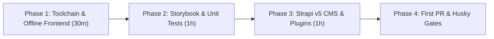

This guide walks new engineers through setting up their machine, understanding the full-stack workflow, and shipping their first verified Pull Request.



---

## Phase 1: Machine Prerequisites & Local Clone (Day 1 — First 30 Mins)

### 1. Required Toolchain
Verify your local versions before installing dependencies:

| Tool | Required Version | Check Command | Notes |
| :--- | :--- | :--- | :--- |
| **Node.js** | `>= 24.x` (`24` in `.nvmrc`) | `node -v` | Run `nvm use` inside `frontend/` |
| **pnpm** | `>= 10.x` (`10.33.3`) | `pnpm -v` | Managed via Corepack or standalone pnpm |
| **Git** | `>= 2.30` | `git --version` | Required for Husky pre-commit & pre-push hooks |
| **Docker** | Optional | `docker -v` | Only needed if testing PostgreSQL 16 instead of SQLite |

### 2. Sibling Workspace Dependencies
The monorepo links to two local sibling packages in the parent `/Projects/experiments` directory:
- `../astro-tiptap-blocks` (`@vicacha-devs/astro-tiptap-blocks`) — used by `frontend/` for zero-`set:html` rich text rendering.
- `../strapi-v5-extensions/packages/*` (`@vicacha-devs/strapi-plugin-*`) — 10 domain plugins used by `backend/`.

Ensure your directory tree matches:
```text
/Projects/experiments/
├── astro-tiptap-blocks/
├── strapi-v5-extensions/
└── central-mosque-bogota/
    ├── frontend/
    ├── backend/
    └── docs/
```

### 3. Booting the Frontend in Offline Mock Mode
```bash
cd central-mosque-bogota/frontend
cp .env.example .env
pnpm install
pnpm dev
```
Open `http://localhost:4321`:
- `/` automatically redirects to `/es` (or your browser's preferred locale among `es`, `en`, `ar`, `tr`).
- Switch languages using the Header `LanguagePicker` and verify that `/ar` switches `<html dir="rtl" lang="ar">`.

---

## Phase 2: Exploring UI Components & Tests (Day 1 — Afternoon)

### 1. Storybook 10 Component Explorer
Every domain component and Starwind primitive has an interactive `.stories.ts` file:
```bash
cd frontend
pnpm storybook
```
In Storybook (`http://localhost:6006`):
- Use the top toolbar to toggle **Light / Dark mode** and **LTR / RTL direction**.
- Inspect the **Accessibility (a11y)** tab powered by `@storybook/addon-a11y`.

### 2. Running the Unit & Component Test Suite
We use **Vitest** + **Astro Container API** (`renderAstroComponentToDom` in `src/utils/test.helpers.ts`) + **Happy DOM** + **Testing Library**:
```bash
cd frontend
./node_modules/.bin/vitest --project=unit --run --coverage
```
All 92 unit test files (201 tests) run in ~9 seconds and verify:
- Astro server-rendered component markup across locales.
- Client-side DOM controllers (`*.controller.ts`).
- Strapi & IslamicAPI loaders, mappers, BFF endpoints, and fallback mocks.

---

## Phase 3: Running the Strapi v5 Headless CMS (Day 2)

By default, `backend/` uses zero-config **SQLite** (`.tmp/data.db`) so you do not need PostgreSQL running locally.

```bash
cd central-mosque-bogota/backend
cp .env.example .env
pnpm install
pnpm develop
```

What happens automatically on first boot (`backend/src/index.ts`):
1. **Locale Provisioning**: Registers `es` (default), `en`, `ar`, and `tr` in `@strapi/i18n`.
2. **Public Role Permissions**: Grants read-only `find` / `findOne` permissions on public content types and `create` on submission collections (`contact-submission`, `visit-booking`, `donation-submission`).
3. **Initial Content Seeding**: Populates initial Mosque settings (`global-setting`, `prayer-setting`), leadership profiles (`leader`), FAQs, community services, events, articles, and donation campaigns across all 4 locales.

Once booted, open `http://127.0.0.1:1337/admin` to create your local Super Admin account.

---

## Phase 4: Git Hooks, Commit Conventions & First PR (Day 3+)

### 1. Automated Husky Hooks (`frontend/.husky/`)
- **`pre-commit`**: Runs `lint-staged` (`eslint --fix` and `oxfmt` on staged files).
- **`commit-msg`**: Runs `commitlint` enforcing Conventional Commits (`feat:`, `fix:`, `docs:`, `test:`, `refactor:`, `chore:`).
- **`pre-push`**: Runs the unit test suite (`vitest --project=unit`).

### 2. Commit Message Format
```text
feat(prayer-times): add Jumuah khutbah badge to daily prayer widget
fix(spotlight-dock): sanitize external action URLs before rendering
docs(onboarding): add bilingual Starlight onboarding and verification guide
```

### 3. Pre-PR Verification Checklist
Before opening a Pull Request, run `pnpm verify` from the repository root (`central-mosque-bogota/`) and walk through the [Verification TODO Checklist](/en/05-quality-and-verification/verification-todo-checklist/).
