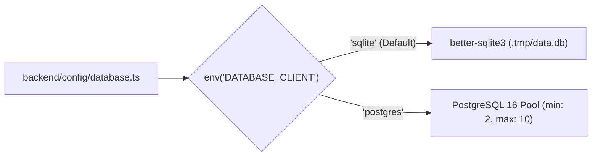

## 1. Backend Directory Layout (`backend/`)

```text
backend/
├── config/
│   ├── admin.ts          # Admin JWT, transfer tokens, preview button handler
│   ├── api.ts            # REST pagination limits (defaultLimit: 25, maxLimit: 100)
│   ├── database.ts       # Dual-mode SQLite (better-sqlite3) / PostgreSQL 16 (pg)
│   ├── middlewares.ts    # Strict CSP (Cloudinary + OpenStreetMap), CORS, security headers
│   ├── plugins.ts        # Configuration for 10 @vicacha-devs plugins + Tiptap + SEO + Cache
│   └── server.ts         # Host (127.0.0.1), Port (1337), Cron tasks
├── src/
│   ├── api/              # 17 Single Types, Collection Types & Custom Health Route
│   ├── components/       # Reusable Strapi schemas (shared.seo, shared.link, prayer.iqamah-config, etc.)
│   └── index.ts          # Bootstrap lifecycle: locale setup, permissions, and content seeding
├── Dockerfile            # Multi-stage Node 24 Alpine production container
└── package.json
```

---

## 2. Dual Database Strategy (`backend/config/database.ts`)



- **Local Development (`sqlite`)**: Zero external dependencies; stores data in `backend/.tmp/data.db` and automatically seeds on first boot.
- **Staging & Production (`postgres`)**: Connects to PostgreSQL 16 (provisioned locally via `docker-compose.yml` bound to `127.0.0.1:5432`, or managed Cloud SQL / RDS in production).

---

## 3. Security & Middleware Hardening (`backend/config/middlewares.ts`)

1. **Content Security Policy (`strapi::security`)**:
   - Explicitly allow-lists `res.cloudinary.com` for media assets and `*.tile.openstreetmap.org` for location maps.
   - Blocks `upgradeInsecureRequests` only in local HTTP dev; enforces strict HTTPS in production.
2. **CORS (`strapi::cors`)**:
   - Restricts cross-origin requests to configured origins (`CORS_ORIGINS`, defaulting to `http://localhost:4321` and `http://127.0.0.1:4321`) and restricts methods to `GET, POST, PUT, PATCH, DELETE, HEAD, OPTIONS`.
3. **API Caching (`strapi-cache`)**:
   - Caches read-heavy `GET` responses for `/api/global-setting`, `/api/prayer-setting`, `/api/about-page`, `/api/islam-faith-page`, `/api/donations-page`, `/api/contact-page`, `/api/events`, `/api/articles`, `/api/faqs`, `/api/leaders`, `/api/community-services`, `/api/media-highlights`, and `/api/donation-campaigns` (1-hour TTL, max 500 keys) with automatic cache invalidation on editorial updates.
