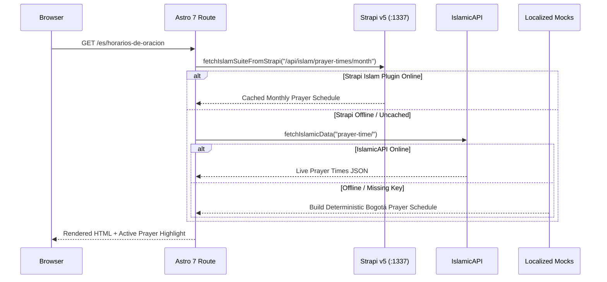

## 1. Dual Content Collection Architecture

The frontend uses two complementary Astro 7 data mechanisms:

1. **Build-Time / Synced Content Layer (`frontend/src/content.config.ts`)**:
   - Powered by `createResilientStrapiLoader` and `createStrapiSingleTypeLoader` (`src/services/strapi/loader.ts`), wrapping `@sensinum/astro-strapi-loader`.
   - Fetches and caches all 4 locales (`es`, `en`, `ar`, `tr`) for:
     - **Collection Types**: `events`, `articles`, `faqs`, `leaders`, `communityServices`, `mediaHighlights`, `donationCampaigns`
     - **Single Types**: `globalSetting`, `aboutPage`, `islamFaithPage`, `donationsPage`, `contactPage`
2. **Real-Time Live Content Collections (`frontend/src/live.config.ts`)**:
   - Powered by `defineLiveCollection` in Astro 7:
     - `prayerTimes` (`src/services/islamicAPI/loaders/prayerTimesLoader.ts`)
     - `zakatNisab` (`src/services/islamicAPI/loaders/zakatNisabLoader.ts`)

---

## 2. Application Route Map (`frontend/src/pages/`)

| Route File | Rendering Mode | Description |
| :--- | :--- | :--- |
| `src/pages/index.astro` | Static Redirect | Redirects `/` to `/es` (default locale) |
| `src/pages/404.astro` | Static | Multilingual 404 page with quick links |
| `src/pages/[lang]/index.astro` | Static (4 locales) | Homepage (HeroHijri, DailyPrayTime, UrgentAlertBanner, NextEvents, Services, Donations, Spotlights) |
| `src/pages/[lang]/[prayerInformation].astro` | **SSR (`prerender = false`)** | Localized Prayer Information slug (`/es/horarios-de-oracion`, `/en/prayer-information`, `/ar/مواقيت-الصلاة`, `/tr/namaz-vakitleri`) |
| `src/pages/[lang]/about-us.astro` | Static (4 locales) | Institutional history, mission/vision, leadership directory, and FAQs |
| `src/pages/[lang]/islam-and-faith.astro` | Static (4 locales) | Five Pillars, Scripture Explorer (Quran/Hadith/Tasbih), Qibla & Hijri Observances, Visitor Etiquette |
| `src/pages/[lang]/events-and-programs.astro` | Static (4 locales) | Filterable Events Catalog, Academy Courses + Enrollment Modal, Ramadan Schedule Banner |
| `src/pages/[lang]/events/[slug].astro` | Static (`getStaticPaths`) | Individual event detail page with poster, schedule, and registration actions |
| `src/pages/[lang]/articles/[slug].astro` | Static (`getStaticPaths`) | Academy/article detail page rendered via `<TiptapContent />` |
| `src/pages/[lang]/community-services.astro` | Static (4 locales) | Community Services directory + interactive Service Desk Intake Modal (Khutbah/Nikah/Janazah/Shahada/Certificate) |
| `src/pages/[lang]/media.astro` | Static (4 locales) | Media Highlights, Filterable Media Archive, Publications & Glossary, Photo Galleries, Broadcast Channels |
| `src/pages/[lang]/donate.astro` | Static (4 locales) | Zakat Calculator, Donation Campaigns, Payment Channels, Utility Invoices Sponsorship, Donation Proof Form |
| `src/pages/[lang]/contact-and-visit.astro` | Static (4 locales) | Contact Message Form, Guided Visit Booking Form, Visitor Etiquette, Location & Hours |
| `src/pages/[lang]/search.astro` | Static (4 locales) | Cross-domain client-side search across articles, events, services, publications, and FAQs |
