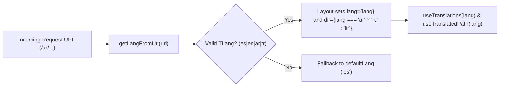

## 1. Supported Locales (`frontend/src/i18n/ui.ts`)

| Locale Code | Language | Direction | Default? | Primary Audience |
| :--- | :--- | :--- | :--- | :--- |
| `es` | Español | `ltr` | **Yes (`defaultLang`)** | Local Bogotá & Colombian community, visitors, and schools |
| `en` | English | `ltr` | No | International visitors, diplomats, and English-speaking Muslims |
| `ar` | العربية (Arabic) | **`rtl`** | No | Native Arabic-speaking community, scholars, and embassies |
| `tr` | Türkçe (Turkish) | `ltr` | No | Turkish community and Diyanet / Türkiye Bursları partners |

---

## 2. Core i18n Helper Functions (`frontend/src/i18n/utils.ts`)

| Helper | Signature | Purpose |
| :--- | :--- | :--- |
| `getLangFromUrl` | `(url: URL) => TLang` | Extracts the first path segment (`es`, `en`, `ar`, `tr`) or falls back to `defaultLang` (`"es"`) |
| `useTranslations` | `(lang: TLang) => (key) => string` | Returns a type-safe translator `t(key)` with automatic fallback to `ui.es[key]` |
| `useTranslatedPath` | `(lang: TLang) => (path, l?) => string` | Translates route slugs using the `routes` dictionary in `ui.ts` (e.g. `prayer-information` -> `horarios-de-oracion` in `es`, `مواقيت-الصلاة` in `ar`, `namaz-vakitleri` in `tr`) |
| `getRouteFromUrl` | `(url: URL) => string \| undefined` | Reverse-maps a localized slug back to its canonical route key so the `LanguagePicker` switches locales on the exact same page |

---

## 3. Mandatory Arabic (`ar`) RTL Styling Rules

When `lang === "ar"`, `frontend/src/layouts/Layout.astro` renders `<html lang="ar" dir="rtl">`. Additionally, Storybook includes `storybook-addon-rtl` for live LTR/RTL toggling.

To guarantee automatic layout mirroring in Arabic without writing separate CSS:

| Never Use (Physical) | Always Use (Logical Tailwind v4) | Why |
| :--- | :--- | :--- |
| `ml-*`, `mr-*` | `ms-*`, `me-*` | Margin-inline-start / end flips automatically in RTL |
| `pl-*`, `pr-*` | `ps-*`, `pe-*` | Padding-inline-start / end flips automatically in RTL |
| `left-*`, `right-*` | `start-*`, `end-*` | Inset-inline-start / end positions docks and badges properly |
| `text-left`, `text-right` | `text-start`, `text-end` | Aligns text to the reading start edge |
| `border-l-*`, `border-r-*` | `border-s-*`, `border-e-*` | Keeps accent borders on the leading edge of callouts |
| `rounded-l-*`, `rounded-r-*` | `rounded-s-*`, `rounded-e-*` | Preserves pill/input group corner radii in RTL |
