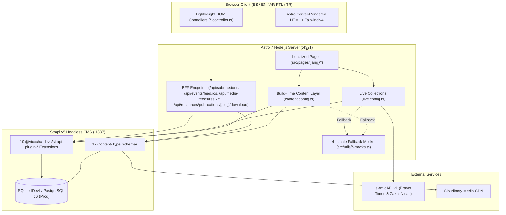

## 1. Platform Topology

The **Central Mosque of Bogotá** web platform is architected as a decoupled, resilient Headless CMS + SSR Frontend system with offline-first fallbacks and a server-side Backend-for-Frontend (BFF) layer.

---

## 2. Core Architectural Pillars

| Pillar | Implementation | Benefit |
| :--- | :--- | :--- |
| **Hybrid Static + Live SSR** | Static pre-rendering (`getStaticPaths`) for institutional/catalog pages + `prerender = false` SSR for dynamic prayer schedules and BFF API routes | Sub-50ms TTFB on content pages while keeping prayer countdowns and form submissions dynamic |
| **3-Tier Data Resilience** | `Strapi v5 Plugin Cache` -> `Upstream API (IslamicAPI)` -> `Deterministic Localized Mocks` | Zero downtime even if Strapi or IslamicAPI is temporarily unreachable |
| **Backend-for-Frontend (BFF)** | Server-side Astro API routes (`src/pages/api/*`) proxy submissions, PDF downloads, RSS, and ICS feeds | Keeps `STRAPI_API_TOKEN` and `ISLAMIC_API_KEY` strictly on the server |
| **Zero-`set:html` Security** | `@vicacha-devs/astro-tiptap-blocks` + `isomorphic-dompurify` (`tiptap-sanitizer.ts`) | Eliminates XSS vectors from CMS rich-text fields |
| **Native 4-Locale & RTL** | Logical CSS properties (`ps-*`, `pe-*`, `start-*`, `end-*`) + locale dictionaries (`es`, `en`, `ar`, `tr`) | Seamless right-to-left mirroring for Arabic (`ar`) without duplicate templates |
