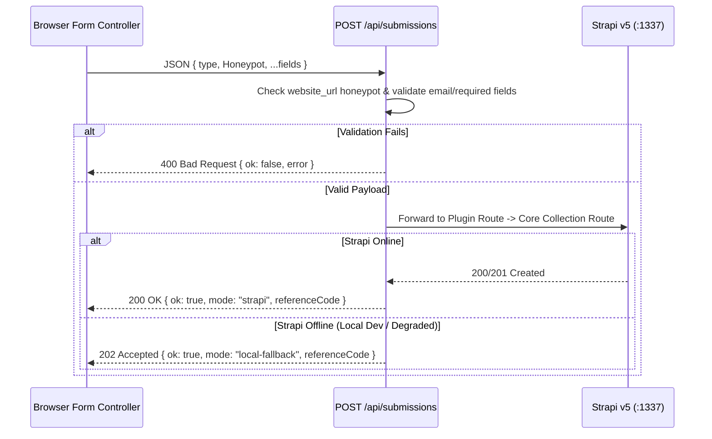

## 1. BFF Overview (`frontend/src/pages/api/`)

All dynamic browser actions communicate with Astro SSR endpoints (`prerender = false`) rather than calling Strapi directly from the browser.

| Endpoint | Method | File | Purpose |
| :--- | :--- | :--- | :--- |
| `/api/submissions` | `POST` | `src/pages/api/submissions.ts` | Unified form intake BFF for 6 submission types with honeypot, validation, and Strapi v5 forwarding |
| `/api/events/feed.ics` | `GET` | `src/pages/api/events/feed.ics.ts` | RFC 5545 iCalendar (`.ics`) feed of upcoming Mosque events (`?lang=es\|en\|ar\|tr`) |
| `/api/media-feeds/rss.xml` | `GET` | `src/pages/api/media-feeds/rss.xml.ts` | RSS 2.0 XML syndication feed for Mosque articles and media highlights (`?lang=es\|en\|ar\|tr`) |
| `/api/resources/publications/[slug]/download` | `GET` | `src/pages/api/resources/publications/[slug]/download.ts` | Validated PDF stream endpoint with `%PDF-` magic-byte inspection and offline `%PDF-1.4` fallback generator |

---

## 2. Unified Form Intake (`POST /api/submissions`)

### Supported Submission Types (`SubmissionType`)
1. `contact-message` -> `/api/inbox/contact-messages` -> `/api/contact-submissions`
2. `visit-booking` -> `/api/bookings/visit-requests` -> `/api/visit-bookings`
3. `donation-submission` -> `/api/donations/submissions` -> `/api/donation-submissions`
4. `service-desk-request` -> `/api/inbox/service-requests` -> `/api/contact-submissions`
5. `course-enrollment` -> `/api/events/course-enrollments` -> `/api/contact-submissions`
6. `newsletter-subscription` -> `/api/broadcasts/subscribers` -> `/api/contact-submissions`

---

## 3. Secure Publication PDF Download (`GET /api/resources/publications/[slug]/download`)

1. **Path Traversal Protection**: Rejects any `slug` that does not match `/^[a-z0-9-]+$/i` with `400 Bad Request` and `X-Content-Type-Options: nosniff`.
2. **Magic-Byte Verification**: Inspects upstream response bytes from Strapi to confirm the `%PDF-` (`0x25 0x50 0x44 0x46 0x2d`) header before streaming to the client.
3. **Offline `%PDF-1.4` Synthesis**: If Strapi is offline or no binary PDF is attached yet, `buildFallbackPublicationPdf(pub, lang)` synthesizes a valid, multi-object `%PDF-1.4` document containing the localized publication title, author, category, and summary.
