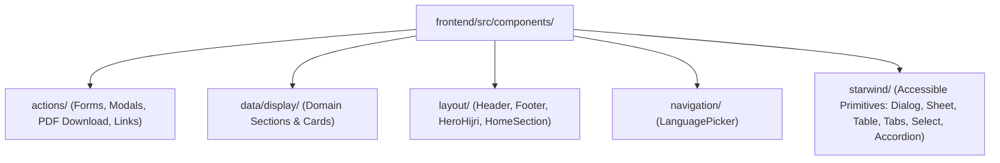

## 1. Component Directory Hierarchy

All UI components in `frontend/src/components/` are organized into 5 functional layers:

---

## 2. Action Components (`src/components/actions/`)

| Component | Controller (`*.controller.ts`) | Purpose |
| :--- | :--- | :--- |
| `ContactAndVisitFormsSection` | `contact-and-visit-forms.controller.ts` | Dual tabbed form for general contact messages (`contact-message`) and guided mosque tour bookings (`visit-booking`), posting to `POST /api/submissions` |
| `CourseEnrollmentForm` | `course-enrollment-form.controller.ts` | Modal dialog (`Starwind Dialog`) triggered from `AcademyCoursesSection` cards (`data-enroll-course-slug`), submitting `course-enrollment` payloads |
| `DonationSubmissionForm` | `donation-submission-form.controller.ts` | Modal form for submitting donation transfer receipts (`donation-submission`), pre-filling campaign slug or utility invoice reference |
| `ServiceDeskIntakeSection` | `service-desk-intake.controller.ts` | Dynamic 5-workflow intake modal (`service-desk-request` for Khutbah, Nikah, Janazah, Shahada, or Certificate requests) |
| `DownloadPDF` | `download-pdf.controller.ts` | Captures `#pdf-table-content` using `html2canvas-pro` + `jspdf` to generate a landscape A4 monthly prayer schedule PDF |
| `Link` | — | Polymorphic button/anchor component with CVA variants (`primary`, `secondary`, `ghost`) and icon support |

---

## 3. Domain Display Components (`src/components/data/display/`)

| Domain Group | Components | Key Features |
| :--- | :--- | :--- |
| **Prayer & Hijri** | `DailyPrayTime`, `MonthlyPrayTime`, `DailyDuaModal`, `QiblaAndObservancesSection`, `RamadanScheduleBanner` | Live active prayer highlight, audio pronunciation for Daily Dua, collapsible monthly table, Qibla bearing (`65.24° ENE`), Hijri observance cards |
| **Events & Spotlights** | `NextEventsSection`, `EventsCatalogSection`, `EventDetailSection`, `EventVerticalCard`, `EventSpotlightDock` | Category/audience filtering, `.ics` calendar export link, floating corner dock with poster lightbox and countdown |
| **Academy & Faith** | `AcademyCoursesSection`, `ArticleDetailSection`, `FivePillarsSection`, `ScriptureExplorerSection`, `VisitorEtiquetteSection`, `FaqAccordionSection` | Quran/Hadith topic explorer, interactive 33/99 Tasbih counter (`scripture-explorer.controller.ts`), Tiptap rich text rendering |
| **Donations & Zakat** | `DonationImpactSection`, `DonationCampaignsSection`, `ZakatCalculatorSection`, `PaymentChannelsSection`, `UtilityInvoicesSection` | Live Gold/Silver Nisab calculator (`zakat-calculator.controller.ts`), one-click bank account copy, utility bill sponsorship |
| **Media, Resources & Community** | `MediaHighlightsSection`, `MediaArchiveSection`, `PublicationsAndGlossarySection`, `PhotoGalleriesSection`, `CommunityBroadcastChannelsSection`, `CommunityServicesSection`, `AboutInstitutionalSections`, `SiteSearchSection`, `UrgentAlertBanner`, `TiptapContent` | Client-side search & category filters, WhatsApp/Telegram broadcast directory, dismissible `localStorage` urgent alert banner |

---

## 4. Client Controller Pattern (`*.controller.ts`)

Instead of shipping heavy React/Vue hydration bundles, interactive components pair an `.astro` template with a colocated `*.controller.ts` module:

1. **Idempotent Initialization**: Every controller exports `init*(root: ParentNode = document)` and guards against double-binding via `dataset.*Initialized = "true"`.
2. **Safe DOM Manipulation**: Uses `textContent`, `setAttribute`, `classList`, and `DOMParser`—never `innerHTML`.
3. **Unit Testability**: Because `init*` accepts a `root` parameter, Vitest tests can render the `.astro` component with `renderAstroComponentToDom()` and invoke `init*(root)` directly in Happy DOM.
