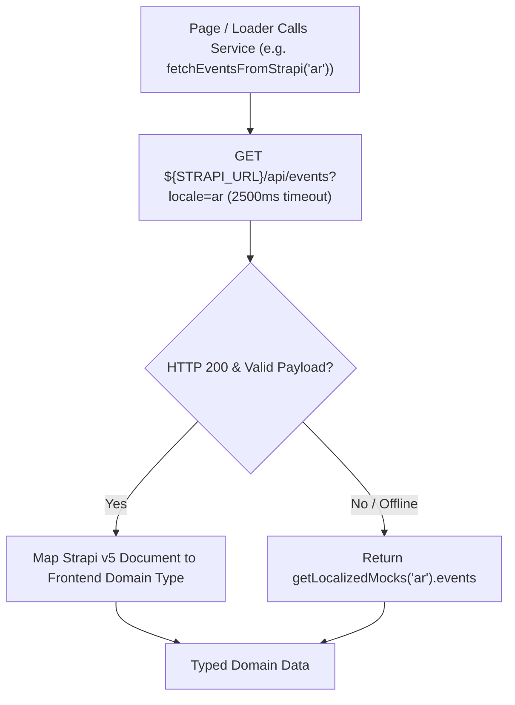

## 1. Strapi Service Layer (`frontend/src/services/strapi/`)

| File | Exports | Responsibility |
| :--- | :--- | :--- |
| `loader.ts` | `createResilientStrapiLoader`, `createStrapiSingleTypeLoader` | Wraps `@sensinum/astro-strapi-loader` across all 4 locales (`es`, `en`, `ar`, `tr`) and populates Astro's Content Store with fallback mocks if Strapi is unreachable |
| `api.ts` | `fetchFromStrapi`, `fetchPluginFromStrapi`, `fetchIslamSuiteFromStrapi`, `fetchEventsFromStrapi`, `fetchArticlesFromStrapi`, `fetchAcademyCoursesFromStrapi`, `fetchBroadcastsFromStrapi`, `fetchPublicationsFromStrapi`, `fetchGlossaryFromStrapi`, `fetchPhotoGalleriesFromStrapi`, `fetchUtilityInvoicesFromStrapi`, `fetchEventSpotlightsFromStrapi`, etc. | Typed REST fetchers for Strapi v5 core endpoints and custom `@vicacha-devs/strapi-plugin-*` endpoints with 2.5s timeout and graceful fallback |
| `tiptap-sanitizer.ts` | `sanitizeTiptapHtml`, `stripHtmlTags`, `extractPlainTextParagraphs` | Sanitizes Tiptap HTML with `isomorphic-dompurify` and extracts plain-text excerpts |

---

## 2. How `createResilientStrapiLoader` Works

In `frontend/src/content.config.ts`, each collection declares:
- `contentType`: The Strapi v5 singular/plural API name (e.g. `"event"`).
- `params`: Deep population query parameters (`populate: "*"`).
- `fallbackByLang`: A function `(lang: TLang) => Array<Record<string, unknown>>` supplying offline entries per locale.

During `astro sync` / `astro build`:
1. For each locale (`es`, `en`, `ar`, `tr`), it creates ascoped proxy store that prefixes entry IDs with `${lang}:` (e.g. `es:event-0`, `ar:event-0`).
2. It invokes `@sensinum/astro-strapi-loader`.
3. If Strapi is offline or returns 0 entries for that locale, it validates and inserts the `fallbackByLang(lang)` entries using `parseData` so Astro's Zod schema validation always runs identically on both live and mock data.

---

## 3. Localized Mock Modules (`frontend/src/utils/*-mocks.ts`)

| Mock Module | Domain Data Provided (in `es`, `en`, `ar`, `tr`) |
| :--- | :--- |
| `localized-mocks.ts` | Master aggregator (`getLocalizedMocks(lang)`) combining all domain mocks |
| `data.mocks.ts` | Default `es` baseline fixtures for prayer times, events, services, leaders, and FAQs |
| `islam-suite-mocks.ts` | Daily Dua, Five Pillars, Scripture Explorer (Ayahs, Hadiths, Tasbih presets), Qibla & Hijri Observances, Ramadan Schedule, Urgent Alert |
| `event-mocks.ts` | Events catalog, detailed event pages (`events/[slug]`), and Academy courses |
| `spotlight-mocks.ts` | Active scholarship & event spotlights (`eventSpotlights`) for `EventSpotlightDock` |
| `article-mocks.ts` | Educational articles with Tiptap rich-text HTML & fallback paragraphs |
| `donation-mocks.ts` | Donation campaigns, impact stats, and Colombian payment channels (Bancolombia, Nequi, Bre-B) |
| `utility-invoice-mocks.ts` | Monthly Mosque utility invoices (Electricity, Water, Gas, Internet, Administration) |
| `resources-mocks.ts` | Downloadable PDF publications, Islamic glossary terms, and photo gallery albums |
| `media-mocks.ts` | Media highlights, filterable audio/video/document archive, and WhatsApp/Telegram broadcast channels |
| `institutional-mocks.ts` | About Us history timeline, mission/vision, leadership profiles, and Visitor Etiquette rules |
| `inbox-mocks.ts` | Service Desk intake workflows (Khutbah, Nikah, Janazah, Shahada, Certificates) |
