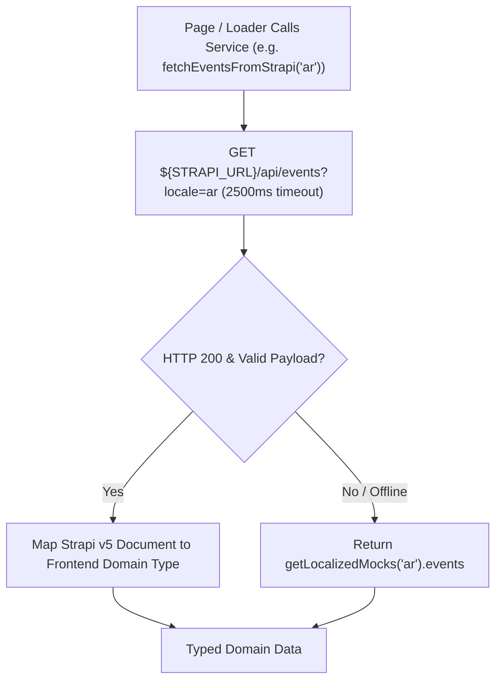

## 1. Strapi Service Layer (`frontend/src/services/strapi/`)

| File | Exports | Responsibility |
| :--- | :--- | :--- |
| `loader.ts` | `createResilientStrapiLoader`, `createStrapiSingleTypeLoader` | Wraps `@sensinum/astro-strapi-loader` across all 4 locales (`es`, `en`, `ar`, `tr`) and populates Astro's Content Store with fallback mocks if Strapi is unreachable |
| `api.ts` | `fetchFromStrapi`, `fetchPluginFromStrapi`, `fetchIslamSuiteFromStrapi`, `fetchEventsFromStrapi`, `fetchArticlesFromStrapi`, `fetchAcademyCoursesFromStrapi`, `fetchBroadcastsFromStrapi`, `fetchPublicationsFromStrapi`, `fetchGlossaryFromStrapi`, `fetchPhotoGalleriesFromStrapi`, `fetchUtilityInvoicesFromStrapi`, `fetchEventSpotlightsFromStrapi`, etc. | Typed REST fetchers for Strapi v5 core endpoints and custom `@vicacha-devs/strapi-plugin-*` endpoints with 2.5s timeout and graceful fallback |
| `tiptap-sanitizer.ts` | `sanitizeTiptapHtml`, `stripHtmlTags`, `extractPlainTextParagraphs` | Sanitizes Tiptap HTML with `isomorphic-dompurify` and extracts plain-text excerpts |

---

## 2. How `@sensinum/astro-strapi-loader` (`VirtusLab-Open-Source/astro-strapi-loader`) Is Integrated

Our Astro frontend uses [`VirtusLab-Open-Source/astro-strapi-loader`](https://github.com/VirtusLab-Open-Source/astro-strapi-loader) (`"@sensinum/astro-strapi-loader": "^1.0.7"` in [`frontend/package.json`](file:///Users/sjoseluis/Projects/experiments/central-mosque-bogota/frontend/package.json#L29)), wrapped by [`frontend/src/services/strapi/loader.ts`](file:///Users/sjoseluis/Projects/experiments/central-mosque-bogota/frontend/src/services/strapi/loader.ts).

Out of the box, `strapiLoader` fetches a single locale from a Strapi REST endpoint and throws an unhandled error if Strapi is unreachable during `astro build` or `astro dev`. Our wrapper functions [`createResilientStrapiLoader`](file:///Users/sjoseluis/Projects/experiments/central-mosque-bogota/frontend/src/services/strapi/loader.ts#L38-L160) (aliased as `createStrapiCollectionLoader`) and [`createStrapiSingleTypeLoader`](file:///Users/sjoseluis/Projects/experiments/central-mosque-bogota/frontend/src/services/strapi/loader.ts#L168-L196) add **four production capabilities**:

1. **Multi-Locale Fetching (`es`, `en`, `ar`, `tr`)**:
   - Loops through `DEFAULT_LOCALES = ["es", "en", "ar", "tr"]` and invokes `strapiLoader(contentType, { url, token }, { ...query, locale: lang })`.
   - Stores each record in Astro's Content Layer store with a composite key `documentId: "${lang}:${slugOrId}"` so pages can filter `getCollection(...)` by `entry.data.locale === lang`.
2. **Automatic `populate: "deep"`**:
   - Defaults `query` to `{ populate: "deep" }` (working alongside `strapi-v5-plugin-populate-deep` on the backend) so nested components, media, and relations are hydrated.
3. **Custom Entry Mapping (`mapStrapiEntry`)**:
   - Transforms raw Strapi v5 documents into strictly typed frontend domain objects before running Astro's `parseData` Zod validation.
4. **Timeout Circuit-Breaker & Offline Mock Fallback (`fallbackByLocale`)**:
   - Wraps `baseLoader.load(innerContext)` in a `2500ms` timeout and a `10s` circuit-breaker (`offlineEndpoints`). If Strapi is offline or returns 0 entries for a locale, `fallbackByLocale(lang)` supplies localized mocks validated through the exact same Zod schema.

### All 12 Astro Content Layer Collections (`frontend/src/content.config.ts`)

| Astro Collection | Loader Wrapper | Strapi Endpoint (`contentType`) | Kind |
| :--- | :--- | :--- | :--- |
| `articles` | `createStrapiCollectionLoader` | `/api/articles` | Collection Type |
| `events` | `createStrapiCollectionLoader` | `/api/events/occurrences` | Plugin Collection (`@vicacha-devs/strapi-plugin-events`) |
| `faqs` | `createStrapiCollectionLoader` | `/api/faqs` | Collection Type |
| `communityServices` | `createStrapiCollectionLoader` | `/api/community-services` | Collection Type |
| `mediaHighlights` | `createStrapiCollectionLoader` | `/api/media-feeds/episodes` | Plugin Collection (`@vicacha-devs/strapi-plugin-media-feeds`) |
| `donationCampaigns` | `createStrapiCollectionLoader` | `/api/donations/campaigns` | Plugin Collection (`@vicacha-devs/strapi-plugin-donations`) |
| `leaders` | `createStrapiCollectionLoader` | `/api/leaders` | Collection Type |
| `aboutPage` | `createStrapiSingleTypeLoader` | `/api/about-page` | Single Type |
| `globalSetting` | `createStrapiSingleTypeLoader` | `/api/global-setting` | Single Type |
| `islamFaithPage` | `createStrapiSingleTypeLoader` | `/api/islam-faith-page` | Single Type |
| `donationsPage` | `createStrapiSingleTypeLoader` | `/api/donations/calculator` | Plugin Endpoint |
| `contactPage` | `createStrapiSingleTypeLoader` | `/api/contact-page` | Single Type |

---

## 3. Localized Mock Modules (`frontend/src/utils/*-mocks.ts`)

| Mock Module | Domain Data Provided (in `es`, `en`, `ar`, `tr`) |
| :--- | :--- |
| `localized-mocks.ts` | Master aggregator (`getLocalizedMocks(lang)`) combining all domain mocks |
| `data.mocks.ts` | Default `es` baseline fixtures for prayer times, events, services, leaders, and FAQs |
| `islam-suite-mocks.ts` | Daily Dua, Five Pillars, Scripture Explorer (Ayahs, Hadiths, Tasbih presets), Qibla & Hijri Observances, Ramadan Schedule, Urgent Alert |
| `event-mocks.ts` | Events catalog, detailed event pages (`events/[slug]`), and Academy courses |
| `spotlight-mocks.ts` | Active scholarship & event spotlights (`eventSpotlights`) for `EventSpotlightDock` |
| `article-mocks.ts` | Educational articles with Tiptap rich-text HTML & fallback paragraphs |
| `donation-mocks.ts` | Donation campaigns, impact stats, and Colombian payment channels (Bancolombia, Nequi, Bre-B) |
| `utility-invoice-mocks.ts` | Monthly Mosque utility invoices (Electricity, Water, Gas, Internet, Administration) |
| `resources-mocks.ts` | Downloadable PDF publications, Islamic glossary terms, and photo gallery albums |
| `media-mocks.ts` | Media highlights, filterable audio/video/document archive, and WhatsApp/Telegram broadcast channels |
| `institutional-mocks.ts` | About Us history timeline, mission/vision, leadership profiles, and Visitor Etiquette rules |
| `inbox-mocks.ts` | Service Desk intake workflows (Khutbah, Nikah, Janazah, Shahada, Certificates) |
