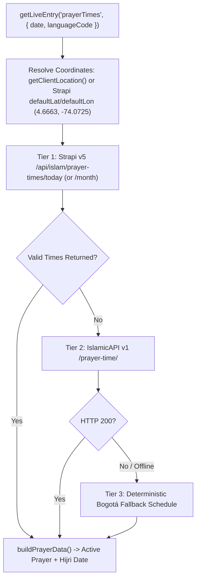

## 1. 3-Tier Prayer Times Loader (`prayerTimesLoader.ts`)

Registered in `frontend/src/live.config.ts` as the `prayerTimes` Live Collection, `prayerTimesLoader` supports both **daily** (`loadEntry`) and **monthly** (`loadCollection` with `YYYY-MM`) queries:

---

## 2. Active Prayer Calculation (`src/utils/islamic.utils.ts`)

`calculateActivePrayer(times: TPrayerTimes, currentMinutes?: number)` determines which obligatory prayer (`fajr`, `dhuhr`, `asr`, `maghrib`, `isha`) is currently active in Bogotá (`America/Bogota` timezone):

1. **Buffer Window Before Sunrise (`BUFFER_MINUTES_BEFORE_SUNRISE = 45`)**:
   - Between `Sunrise` and `Dhuhr` (specifically once `currentMinutes >= sunriseMinutes - 45` and `< dhuhrMinutes`), `calculateActivePrayer` returns `undefined` because Sunrise (`shuruq`) is a transition boundary rather than an obligatory prayer window.
2. **Midnight Wrap-Around for Isha**:
   - If `currentMinutes >= ishaMinutes` OR `currentMinutes < fajrMinutes` (after midnight before Fajr), `isha` remains the active prayer.
3. **Only Today Highlights an Active Prayer**:
   - `buildPrayerData` (`src/services/islamicAPI/adaptor/buildPrayerData.ts`) checks `isSameDay(date, new Date())` and only sets `activePray` when rendering today's entry.

---

## 3. Zakat Nisab Loader & Calculator (`zakatNisabLoader.ts`)

Registered in `frontend/src/live.config.ts` as `zakatNisab`, supporting:
- **Calculation Standards**: `"common"` (85g Gold / 595g Silver) and `"classical"` (87.48g Gold / 612.36g Silver).
- **Currencies**: `"cop"` (Colombian Peso default), `"usd"`, `"eur"`, `"try"`, `"sar"`.
- **Client Controller (`zakat-calculator.controller.ts`)**:
  - Computes `totalAssets = cash + gold + investments + receivables`.
  - Computes `netWealth = Math.max(0, totalAssets - liabilities)`.
  - Compares `netWealth` against the selected Nisab basis (`silver` recommended for broader community benefit, or `gold`) and calculates `zakatDue = netWealth * 0.025` (2.5%) when `netWealth >= nisabThreshold`.
