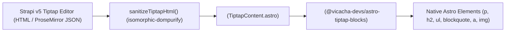

## 1. Security-First Rich Text Pipeline

CMS rich-text fields (`article.content`, `event.body`, `aboutPage.historyContent`) are authored in Strapi v5 using `@notum-cz/strapi-plugin-tiptap-editor`. To prevent XSS vulnerabilities, the frontend **never** injects raw HTML strings with Astro's `set:html`.

---

## 2. `<TiptapContent />` (`src/components/data/display/TiptapContent/TiptapContent.astro`)

`<TiptapContent />` accepts two props:
- `content`: Tiptap HTML string or ProseMirror JSON document from Strapi v5.
- `fallbackParagraphs`: Optional `string[]` array from localized mocks when `content` is empty.

It passes a tailored `TiptapTheme` object to `<TiptapBlocks />` using logical Tailwind v4 classes (`ps-5`, `border-s-4`, `text-start`) so Arabic (`ar`) rich text articles and blockquotes render with proper right-to-left indentation and emerald borders.

---

## 3. Sanitizer Helpers (`src/services/strapi/tiptap-sanitizer.ts`)

| Function | Signature | Description |
| :--- | :--- | :--- |
| `sanitizeTiptapHtml` | `(rawHtml?: string \| null) => string` | Uses `DOMPurify.sanitize` with a strict allow-list of semantic tags (`p`, `h2`–`h6`, `strong`, `em`, `ul`, `ol`, `li`, `blockquote`, `code`, `pre`, `a`, `img`, `table`, etc.) and hooks `afterSanitizeAttributes` to strip unsafe `href`/`src` protocols (`javascript:`, `data:`) and enforce `rel="noopener noreferrer"` on `target="_blank"` links |
| `stripHtmlTags` | `(rawHtml?: string \| null) => string` | Strips all tags (`ALLOWED_TAGS: []`) and normalizes whitespace for meta descriptions, RSS summaries, and search snippets |
| `extractPlainTextParagraphs` | `(rawHtml?: string \| null) => string[]` | Splits block-level closing tags (`
`, `</li>`, `</h*>`, `</blockquote>`) into an array of clean plain-text paragraphs |
