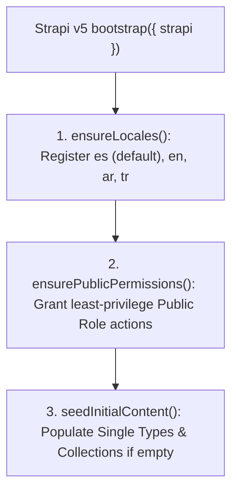

## 1. First-Boot Lifecycle (`backend/src/index.ts`)

When Strapi v5 starts (`pnpm develop` or `pnpm start`), the `bootstrap({ strapi })` hook in `backend/src/index.ts` executes three idempotent steps:

---

## 2. Step 1: Locale Provisioning (`ensureLocales`)

Queries `plugin::i18n.locales` and ensures all 4 required locales exist:
- `es` — Spanish (`isDefault: true`)
- `en` — English
- `ar` — Arabic (`العربية`)
- `tr` — Turkish (`Türkçe`)

---

## 3. Step 2: Least-Privilege Public API Permissions (`ensurePublicPermissions`)

The Strapi `Public` role is strictly limited to:

| Permission Scope | Allowed Actions | Security Rationale |
| :--- | :--- | :--- |
| **Read-Only Content (`find`, `findOne`)** | `global-setting`, `prayer-setting`, `about-page`, `islam-faith-page`, `donations-page`, `contact-page`, `event`, `article`, `faq`, `leader`, `community-service`, `media-highlight`, `donation-campaign` | Public visitors and Astro Content Layer loaders can read published content, never modify or delete it |
| **Write-Only Intake (`create`)** | `contact-submission`, `visit-booking`, `donation-submission` | Visitors can submit forms (`POST`), but **cannot** list (`find`) or read (`findOne`) other visitors' PII submissions |

> **Critical Security Guarantee**: `contact-submission.find`, `visit-booking.find`, and `donation-submission.find` are **never** granted to the Public role. Only authenticated Mosque administrators inside the Strapi Admin Panel can view visitor submissions.

---

## 4. Step 3: Idempotent Content Seeding (`seedInitialContent`)

If the database is fresh (0 entries), `seedInitialContent` populates localized documents (`es`, `en`, `ar`, `tr`) for:
- Global Mosque contact details & Bogotá coordinates (`4.6663, -74.0725`).
- Prayer calculation parameters (`MWL`, `Shafi`, Jumu'ah times).
- Institutional pages (`about-page`, `islam-faith-page`, `donations-page`, `contact-page`).
- Initial Leaders, Community Services, Events, Articles, FAQs, Media Highlights, and Donation Campaigns.
