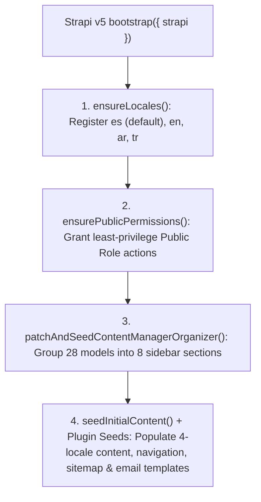

## 1. First-Boot Lifecycle (`backend/src/index.ts`)

When Strapi v5 starts (`pnpm develop` or `pnpm start`), `backend/src/index.ts` orchestrates the modular bootstrap pipeline across `backend/src/bootstrap/` and `backend/src/seed/`:

---

## 2. Step 1: Locale Provisioning (`ensureLocales`)

Queries `plugin::i18n.locales` (`backend/src/bootstrap/permissions-and-locales.ts`) and ensures all 4 required locales exist:
- `es` — Spanish (`isDefault: true`)
- `en` — English
- `ar` — Arabic (`العربية`)
- `tr` — Turkish (`Türkçe`)

---

## 3. Step 2: Least-Privilege Public API Permissions (`ensurePublicPermissions`)

The Strapi `Public` role is strictly limited to:

| Permission Scope | Allowed Actions | Security Rationale |
| :--- | :--- | :--- |
| **Read-Only Models (`PUBLIC_READ_MODELS`: `find`, `findOne`)** | `api::global-setting.global-setting`, `api::about-page.about-page`, `api::donations-page.donations-page`, `api::islam-faith-page.islam-faith-page`, `api::contact-page.contact-page`, `api::community-service.community-service`, `api::article.article`, `api::leader.leader`, `api::faq.faq`, `plugin::events.event`, `plugin::donations.campaign`, `plugin::media-feeds.media-item`, `plugin::resources.publication`, `plugin::resources.gallery-album`, `plugin::resources.glossary-term` | Public visitors and Astro Content Layer loaders can read published content, never modify or delete it |
| **Write-Only Intake (`PUBLIC_CREATE_ONLY_MODELS`: `create`)** | `plugin::inbox.submission`, `plugin::bookings.booking`, `plugin::donations.pledge` | Visitors can submit forms (`POST`), but **cannot** list (`find`) or read (`findOne`) other visitors' PII submissions |
| **Public Plugin Controllers** | Selected read/action endpoints on `islam`, `events`, `bookings`, `calendar`, `donations`, `inbox`, `broadcasts`, `resources`, `media-feeds`, `certificates`, `navigation`, `typesense`, and `strapi-5-sitemap-plugin` | Exposes only public liturgical, calendar, search, and verification endpoints |

> **Critical Security Guarantee**: `plugin::inbox.submission.find`, `plugin::bookings.booking.find`, and `plugin::donations.pledge.find` are **never** granted to the Public role. Only authenticated Mosque administrators inside the Strapi Admin Panel can view visitor submissions.

---

## 4. Step 3: Idempotent Content & Plugin Seeding (`backend/src/seed/`)

If the database is fresh, the seed modules populate localized documents (`es`, `en`, `ar`, `tr`) and plugin configurations:
- **`initial-content-seed.ts`**: Global Mosque settings, institutional single types (`about-page`, `islam-faith-page`, `donations-page`, `contact-page`), Leaders, Community Services, Articles, FAQs, and all 10 `@vicacha-devs` plugin collections.
- **`navigation-seed.ts`, `sitemap-seed.ts`, `tiptap-seed.ts`, `email-templates-seed.ts`, `media-folders-seed.ts`**: Pre-configures header/footer menus, XML sitemap content types, TipTap v3 preset options, transactional email templates, and Media Library folder hierarchies.
