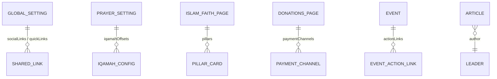

## 1. Entity Relationship Overview

---

## 2. Single Types (`backend/src/api/`)

| API Identifier | Localized (`i18n`)? | Key Fields | Consumed By |
| :--- | :--- | :--- | :--- |
| `global-setting` | Yes (`es`, `en`, `ar`, `tr`) | `mosqueName`, `tagline`, `address`, `phone`, `email`, `whatsappNumber`, `socialLinks`, `seo` | `Header.astro`, `Footer.astro`, `Layout.astro` |
| `prayer-setting` | No (Global config) | `calculationMethod`, `juristicSchool`, `hijriCalendarMethod`, `hijriAdjustmentDays`, `defaultLatitude` (`4.6663`), `defaultLongitude` (`-74.0725`), `jumuahKhutbahTime`, `jumuahPrayerTime`, `iqamahConfigs` | `prayerTimesLoader.ts`, `DailyPrayTime.astro` |
| `about-page` | Yes (`es`, `en`, `ar`, `tr`) | `heroTitle`, `heroSubtitle`, `historyTitle`, `historyContent` (Tiptap), `missionStatement`, `visionStatement`, `values` | `src/pages/[lang]/about-us.astro` |
| `islam-faith-page` | Yes (`es`, `en`, `ar`, `tr`) | `heroTitle`, `pillars` (`faith.pillar-card`), `shahadaArabic`, `shahadaTransliteration`, `shahadaTranslation` | `src/pages/[lang]/islam-and-faith.astro` |
| `donations-page` | Yes (`es`, `en`, `ar`, `tr`) | `heroTitle`, `impactHeadline`, `impactStats`, `zakatExplanation`, `paymentChannels` (`donation.payment-channel`) | `src/pages/[lang]/donate.astro` |
| `contact-page` | Yes (`es`, `en`, `ar`, `tr`) | `heroTitle`, `officeHours`, `visitingGuidelines`, `googleMapsEmbedUrl`, `publicTransportDirections` | `src/pages/[lang]/contact-and-visit.astro` |

---

## 3. Collection Types (`backend/src/api/`)

| API Identifier | Localized (`i18n`)? | Public Access | Description |
| :--- | :--- | :--- | :--- |
| `event` | Yes | `find`, `findOne` | Mosque events, lectures, workshops, and spotlight promotions (`spotlightEnabled`, `spotlightPriority`, `poster`, `actionLinks`) |
| `article` | Yes | `find`, `findOne` | Educational articles & khutbah transcripts with Tiptap rich text (`content`), `category`, `readingTimeMinutes` |
| `community-service` | Yes | `find`, `findOne` | Mosque services (Matrimony/Nikah, Janazah, Shahada, Counseling, Library, Halal certification) |
| `donation-campaign` | Yes | `find`, `findOne` | Active fundraising campaigns (`goalAmountCop`, `raisedAmountCop`, `donorCount`, `isUrgent`) |
| `faq` | Yes | `find`, `findOne` | Frequently asked questions grouped by `category` (`visiting`, `prayer`, `islam`, `donations`) and `sortOrder` |
| `leader` | Yes | `find`, `findOne` | Imams, scholars, and board members (`fullName`, `roleTitle`, `biography`, `languagesSpoken`) |
| `media-highlight` | Yes | `find`, `findOne` | Featured videos, khutbah recordings, interviews, and podcasts |
| `contact-submission` | No | `create` only | Incoming contact & service-desk messages submitted via `POST /api/submissions` |
| `visit-booking` | No | `create` only | Guided visit & school group tour bookings (`visitorName`, `groupSize`, `preferredDate`, `status`) |
| `donation-submission` | No | `create` only | Donor payment proof records (`donorName`, `amountCop`, `paymentMethod`, `referenceNumber`) |
| `health` | No | `GET /api/health` | Lightweight liveness/readiness probe for Docker and load balancers |
