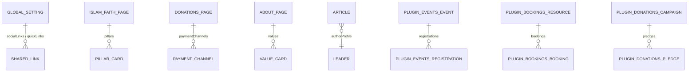

## 1. Entity Relationship Overview

---

## 2. Site-Specific Single Types (`backend/src/api/`)

| UID (`api::*`) | Localized (`i18n`)? | Key Fields | Consumed By |
| :--- | :--- | :--- | :--- |
| `api::global-setting.global-setting` | Yes (`es`, `en`, `ar`, `tr`) | `mosqueName`, `tagline`, `address`, `phone`, `email`, `whatsappNumber`, `socialLinks`, `seo` | `Header.astro`, `Footer.astro`, `Layout.astro` |
| `api::about-page.about-page` | Yes (`es`, `en`, `ar`, `tr`) | `heroTitle`, `heroSubtitle`, `historyTitle`, `historyContent` (Tiptap), `missionStatement`, `visionStatement`, `values` (`institution.value-card`) | `src/pages/[lang]/about-us.astro` |
| `api::islam-faith-page.islam-faith-page` | Yes (`es`, `en`, `ar`, `tr`) | `heroTitle`, `pillars` (`faith.pillar-card`), `shahadaArabic`, `shahadaTransliteration`, `shahadaTranslation` | `src/pages/[lang]/islam-and-faith.astro` |
| `api::donations-page.donations-page` | Yes (`es`, `en`, `ar`, `tr`) | `heroTitle`, `impactHeadline`, `impactStats` (`donation.impact-stat`), `zakatExplanation`, `paymentChannels` (`donation.payment-channel`) | `src/pages/[lang]/donate.astro` |
| `api::contact-page.contact-page` | Yes (`es`, `en`, `ar`, `tr`) | `heroTitle`, `officeHours`, `visitingGuidelines`, `googleMapsEmbedUrl`, `publicTransportDirections` | `src/pages/[lang]/contact-and-visit.astro` |

---

## 3. Site-Specific Collection Types (`backend/src/api/`)

| UID (`api::*`) | Localized (`i18n`)? | Public Access | Description |
| :--- | :--- | :--- | :--- |
| `api::article.article` | Yes | `find`, `findOne` | Educational articles & khutbah transcripts with Tiptap rich text (`content`), `category`, `readingTimeMinutes`, and synchronized `authorProfile` (`api::leader.leader`) |
| `api::community-service.community-service` | Yes | `find`, `findOne` | Mosque services (Matrimony/Nikah, Janazah, Shahada, Counseling, Library, Halal certification) |
| `api::faq.faq` | Yes | `find`, `findOne` | Frequently asked questions grouped by `category` (`visiting`, `prayer`, `islam`, `donations`) and `sortOrder` |
| `api::leader.leader` | Yes | `find`, `findOne` | Imams, scholars, and board members (`fullName`, `slug`, `roleTitle`, `biography`, `languagesSpoken`) linked to `/[lang]/staff/[slug]` |
| `api::health.health` | No | `GET /api/health` | Lightweight liveness/readiness probe for Docker and load balancers |

---

## 4. Plugin-Managed Domain Content Types (`plugin::*`)

Domain entities for events, bookings, donations, liturgy, media, publications, inbox workflows, certificates, and broadcasts are provided by the 10 `@vicacha-devs/strapi-plugin-*` packages:

| Sidebar Organizer Group | Plugin Content-Type UIDs | Public Role Access |
| :--- | :--- | :--- |
| **Events, Scheduling & Bookings** | `plugin::events.event`, `plugin::events.registration`, `plugin::bookings.resource`, `plugin::bookings.booking` | `event` (`find`, `findOne`); `booking` (`create` only) |
| **Islam, Liturgy & Scripture** | `plugin::islam.scripture-entry`, `plugin::islam.hilal-announcement` | Via `/api/islam/*` content-api endpoints |
| **Donations & Certificates** | `plugin::donations.campaign`, `plugin::donations.pledge`, `plugin::certificates.template`, `plugin::certificates.certificate` | `campaign` (`find`, `findOne`); `pledge` (`create` only) |
| **Media, Resources & Library** | `plugin::media-feeds.media-item`, `plugin::media-feeds.media-series`, `plugin::resources.publication`, `plugin::resources.gallery-album`, `plugin::resources.glossary-term` | `media-item`, `publication`, `gallery-album`, `glossary-term` (`find`, `findOne`) |
| **Inbox & Omnichannel Broadcasts** | `plugin::inbox.form`, `plugin::inbox.submission`, `plugin::inbox.subscriber`, `plugin::inbox.alert-banner`, `plugin::broadcasts.campaign`, `plugin::broadcasts.automation-rule`, `plugin::broadcasts.delivery-log` | `submission` (`create` only) + `/api/inbox/*` & `/api/broadcasts/*` public endpoints |
