## 1. Custom Plugin Ecosystem Overview

In addition to core Strapi v5 schemas, `backend/package.json` integrates **10 purpose-built `@vicacha-devs/strapi-plugin-*` extensions** (located in `../strapi-v5-extensions/packages/`):

```mermaid
flowchart TB
  Strapi["Strapi v5 Core (:1337)"] --> P1["strapi-plugin-islam (Prayer, Zakat, Quran, Hadith, Qibla, Ramadan)"]
  Strapi --> P2["strapi-plugin-events (Events, Spotlights, Academy Courses, ICS)"]
  Strapi --> P3["strapi-plugin-donations (Campaigns, Utility Invoices, Receipts)"]
  Strapi --> P4["strapi-plugin-inbox (Contact Messages & 5 Service Desk Workflows)"]
  Strapi --> P5["strapi-plugin-bookings (Guided Tour & Group Visit Scheduling)"]
  Strapi --> P6["strapi-plugin-resources (PDF Publications, Glossary, Photo Galleries)"]
  Strapi --> P7["strapi-plugin-media-feeds (Audio/Video Archive & RSS 2.0 Syndication)"]
  Strapi --> P8["strapi-plugin-broadcasts (WhatsApp/Telegram Channels & Newsletter)"]
  Strapi --> P9["strapi-plugin-calendar (Hijri-Gregorian Observance Calendar)"]
  Strapi --> P10["strapi-plugin-certificates (Shahada, Nikah & Donation Certificates)"]
```

---

## 2. Plugin Reference & Frontend Integration Matrix

| Plugin Package | Strapi Config Key | REST Prefix | Frontend Consumer (`src/services/strapi/api.ts`) |
| :--- | :--- | :--- | :--- |
| `@vicacha-devs/strapi-plugin-islam` | `islam` | `/api/islam/*` | `fetchIslamSuiteFromStrapi` (`prayerTimesLoader`, `zakatNisabLoader`, `DailyDuaModal`, `FivePillarsSection`, `ScriptureExplorerSection`, `QiblaAndObservancesSection`, `RamadanScheduleBanner`, `UrgentAlertBanner`) |
| `@vicacha-devs/strapi-plugin-events` | `events` | `/api/events/*` | `fetchEventsFromStrapi`, `fetchAcademyCoursesFromStrapi`, `fetchEventSpotlightsFromStrapi`, `GET /api/events/feed.ics` |
| `@vicacha-devs/strapi-plugin-donations` | `donations` | `/api/donations/*` | `fetchUtilityInvoicesFromStrapi`, `POST /api/submissions` (`donation-submission`) |
| `@vicacha-devs/strapi-plugin-inbox` | `inbox` | `/api/inbox/*` | `fetchServiceDeskWorkflowsFromStrapi`, `POST /api/submissions` (`contact-message`, `service-desk-request`) |
| `@vicacha-devs/strapi-plugin-bookings` | `bookings` | `/api/bookings/*` | `POST /api/submissions` (`visit-booking`) |
| `@vicacha-devs/strapi-plugin-resources` | `resources` | `/api/resources/*` | `fetchPublicationsFromStrapi`, `fetchGlossaryFromStrapi`, `fetchPhotoGalleriesFromStrapi`, `GET /api/resources/publications/[slug]/download` |
| `@vicacha-devs/strapi-plugin-media-feeds` | `media-feeds` | `/api/media-feeds/*` | `fetchMediaArchiveFromStrapi`, `GET /api/media-feeds/rss.xml` |
| `@vicacha-devs/strapi-plugin-broadcasts` | `broadcasts` | `/api/broadcasts/*` | `fetchBroadcastsFromStrapi`, `POST /api/submissions` (`newsletter-subscription`) |
| `@vicacha-devs/strapi-plugin-calendar` | `calendar` | `/api/calendar/*` | Hijri observance synchronization with `QiblaAndObservancesSection` |
| `@vicacha-devs/strapi-plugin-certificates` | `certificates` | `/api/certificates/*` | Official Mosque PDF certificate generation (Shahada, Nikah, Tax-deductible Donations) |
