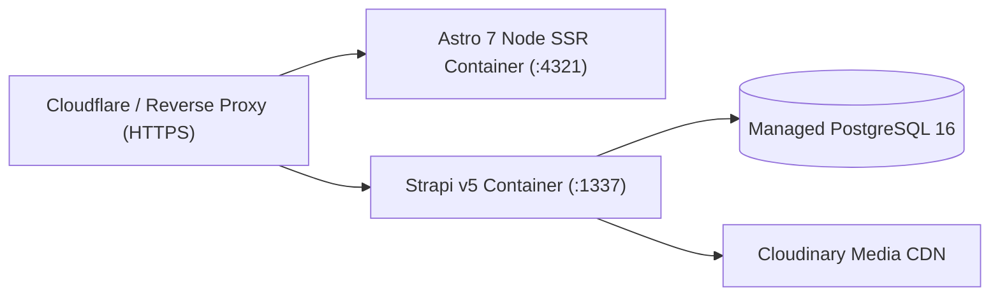

## 1. Production Deployment Topology



### Building & Starting Production Services

#### 1. Strapi v5 Backend (`backend/Dockerfile`)
```bash
cd backend
pnpm build
NODE_ENV=production pnpm start
```
- Liveness/Readiness Probe: `GET http://127.0.0.1:1337/api/health` -> returns `200 OK`.

#### 2. Astro 7 SSR Frontend (`frontend/`)
```bash
cd frontend
pnpm build
HOST=127.0.0.1 PORT=4321 node ./dist/server/entry.mjs
```

---

## 2. Database Backup & Restore (PostgreSQL 16)

### Create a Compressed Backup
```bash
pg_dump -h 127.0.0.1 -U mosque_admin -Fc central_mosque_bogota > mosque_backup_$(date +%F).dump
```

### Restore from Backup
```bash
pg_restore -h 127.0.0.1 -U mosque_admin -d central_mosque_bogota --clean mosque_backup_YYYY-MM-DD.dump
```

---

## 3. Common Incident Troubleshooting

| Symptom | Root Cause | Resolution |
| :--- | :--- | :--- |
| Frontend logs `[WARN] Strapi unreachable, falling back to localized mocks` | Strapi v5 is stopped or `STRAPI_URL` in `frontend/.env` does not match `http://127.0.0.1:1337` | Verify `GET http://127.0.0.1:1337/api/health`; frontend continues serving traffic safely from localized mocks until Strapi recovers |
| Prayer times use fallback schedule instead of live IslamicAPI | `ISLAMIC_API_KEY` is missing or rate-limited (`HTTP 429`) | Set `ISLAMIC_API_KEY` in `frontend/.env` or configure prayer times in Strapi's `@vicacha-devs/strapi-plugin-islam` cache |
| Newly published Strapi content does not appear immediately | `strapi-cache` 1-hour TTL or static page build | Trigger an editorial update in Strapi (which auto-clears `strapi-cache`) and re-run `astro build` for static routes |
| `oxfmt --check` fails after running `vitest --coverage` | Generated files in `coverage/` or `storybook-static/` | Already prevented by `ignorePatterns` in `frontend/.oxfmtrc.json` (`["coverage", "dist", "storybook-static", "node_modules"]`) |
