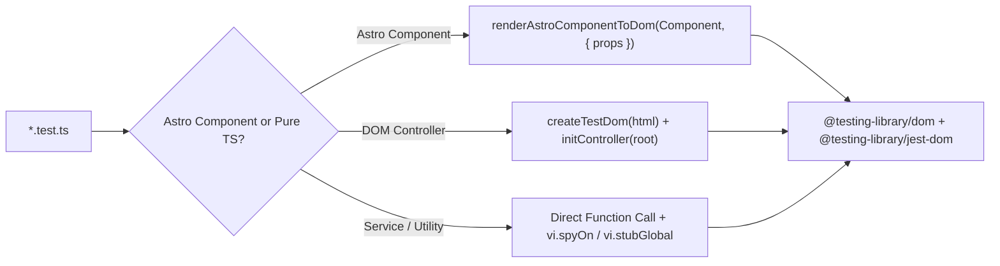

## 1. Testing Architecture (`frontend/vitest.config.ts`)

The frontend test suite uses **Vitest 4** with two distinct projects configured in `frontend/vitest.config.ts`:
- **`unit`**: Node/Happy-DOM test runner executing all `src/**/*.test.ts` files (92 test files, 201 tests).
- **`storybook`**: Playwright Chromium browser runner executing `@storybook/addon-vitest` stories.



---

## 2. Enforced Coverage Thresholds (`vitest.config.ts`)

| Metric | Required Threshold | Current Project Score |
| :--- | :--- | :--- |
| **Statements** | `>= 80%` | **98.26%** |
| **Branches** | `>= 90%` | **90.93%** |
| **Functions** | `>= 95%` | **98.96%** |
| **Lines** | `>= 80%` | **99.28%** |

> **Important**: `src/utils/test.helpers.ts` is included in coverage and tested at **100%** across all 4 metrics by `src/utils/test.helpers.test.ts`.

---

## 3. Test Helpers Reference (`frontend/src/utils/test.helpers.ts`)

| Helper | Purpose |
| :--- | :--- |
| `renderAstroComponentToDom(Component, options)` | Uses Astro's `experimental_AstroContainer` to render an `.astro` component to HTML, mounts it into a `happy-dom` `Window`, and returns `{ window, root, close }` |
| `createTestDom(html, options)` | Creates a synchronous `happy-dom` `Window`, installs globals (`window`, `document`, `HTMLElement`, `CustomEvent`, `Event`, `SVGElement`), and returns `{ window, document, root, close }` |
| `installDomGlobals(window, document)` | Binds `globalThis.window`, `globalThis.document`, and a synchronous `requestAnimationFrame` for controller animation tests |
| `installMatchMedia(window)` | Patches `window.matchMedia` so `(prefers-reduced-motion: reduce)` matches by default in deterministic tests |
| `ensureDialogApi(dialog)` | Polyfills `showModal()`, `show()`, `close()`, and `getAnimations()` on `HTMLDialogElement` instances in `happy-dom` |
| `createUser(window)` | Configures `@testing-library/user-event` bound to the `happy-dom` document and Vitest fake timers |

---

## 4. ESLint Rules for Tests (`eslint.config.ts`)

1. **Test Title Convention (`vitest/valid-title`)**:
   - Every `it(...)` or `test(...)` block inside `src/components/**`, `src/utils/**`, `src/services/islamicAPI/**`, and `src/i18n/**` **must** follow the pattern:
     ```ts
     it("should <expected behavior> when <condition>", async () => { ... });
     ```
2. **Always Close Happy-DOM Windows**:
   - Wrap assertions in `try { ... } finally { await close(); }` so background timers and observers are cleaned up.
