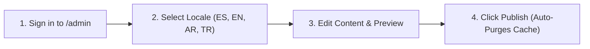

This guide is written for **Central Mosque of Bogotá administrators and content editors** managing the website through the Strapi v5 Admin Panel (`/admin`), which is fully localized in **Spanish (`es`), English (`en`), Arabic (`ar`), and Turkish (`tr`)**.

---

## 1. Managing Daily, Jumu'ah & Hilal Prayer Settings

1. In the left sidebar, open the **Islam Suite** plugin (`@vicacha-devs/strapi-plugin-islam`) or **Content Manager -> Islam, Liturgy & Scripture -> Hilal Announcement**.
2. Update:
   - **Jumu'ah Khutbah & Prayer Shifts** and **Iqamah Offsets** for Fajr, Dhuhr, Asr, Maghrib, and Isha.
   - **Hilal Moon-Sighting Announcements** (`hilal-announcement`, `-2` to `+2` days adjustment) when local moon-sighting adjusts the start of Ramadan, Eid al-Fitr, or Dhul Hijjah.
3. Click **Save** and **Publish**.

---

## 2. Posting an Urgent Community Alert Banner

When an urgent announcement is needed (e.g., Eid prayer schedule, Ramadan moonsighting, or emergency janazah notice):
1. Open **Content Manager -> Inbox & Omnichannel Broadcasts -> Alert Banner** (`plugin::inbox.alert-banner`) or the **Inbox** plugin page.
2. Enable the banner, select the severity (`info`, `important`, `urgent`), and fill in the title, summary, and CTA link for `es`, `en`, `ar`, and `tr`.
3. Visitors will see the banner at the top of the homepage; if you update the alert's `id`, it will reappear even for visitors who dismissed an older banner.

---

## 3. Creating Events & Promoting to the Corner Spotlight Dock

1. Go to **Content Manager -> Events, Scheduling & Bookings -> Event** (`plugin::events.event`) and click **Create new entry**.
2. Fill in **Title**, **Category**, **Schedule**, **Location**, and **Body** (using the TipTap v3 Rich Text Editor).
3. **To promote the event in the floating bottom-corner Spotlight Dock** (used for scholarships like *Türkiye Bursları* / *Diyanet TDV* or major conferences):
   - Toggle `spotlightEnabled` to **True**.
   - Upload a vertical **Poster** image (`poster`).
   - Set `spotlightBadgeText` (e.g., `"Convocatoria Abierta"`), `spotlightPriority` (higher numbers appear first), and `spotlightEndAt` (for the live remaining-days countdown badge).
4. Use the top-right **Locales** dropdown to translate the event into `en`, `ar`, and `tr`, then click **Publish**.

---

## 4. Managing Donations, Zakat & Utility Invoice Sponsorships

1. **Donation Campaigns (`Content Manager -> Donations & Certificates -> Campaign`)**:
   - Update `goalAmountCop`, `raisedAmountCop`, and `donorCount` to update the live progress bars on `/[lang]/donate`.
2. **Payment Channels (`Content Manager -> Public Website Pages -> Donations Page`)**:
   - Manage Bancolombia, Nequi, and Bre-B transfer details and QR instructions.
3. **Monthly Utility Invoices (`Donations Plugin -> Utility Invoices`)**:
   - Add or mark monthly Mosque utility bills (Electricity, Water, Gas, Internet, Administration) as `pending`, `partially_funded`, or `paid`.
4. **Reviewing Donor Pledges & Issuing Certificates (`Donations & Certificates -> Pledge` / `Certificate`)**:
   - Verify transfer receipts submitted by donors (`donorName`, `amount`, `referenceNumber`) and issue Ed25519-signed tax/donation certificates via the **Certificates** plugin.

---

## 5. Handling Visitor Bookings, Global Search & Cache Purge

- **Guided Mosque Visits (`Events, Scheduling & Bookings -> Booking`)**:
  - Review incoming school, university, and individual tour requests (`visitorName`, `groupSize`, `startTime`) and update `status` from `pending` to `confirmed`.
- **Service Desk Requests (`Inbox & Omnichannel Broadcasts -> Submission`)**:
  - Process community requests for **Khutbah topics**, **Nikah (Matrimony) officiating**, **Janazah (Funeral) support**, **Shahada appointments**, and **Islamic Certificates**.
- **Global Search (`Cmd/Ctrl + K`) & Cache Purge (`strapi-cache v1.13.0`)**:
  - Press `Cmd+K` (or `Ctrl+K`) anywhere in `/admin` to jump to any entry across all languages.
  - Publishing an entry automatically clears `strapi-cache`, or you can click **Purge Cache** / **Purge Entity Cache** (localized in `es`, `en`, `ar`, and `tr`) directly in the Content Manager.
