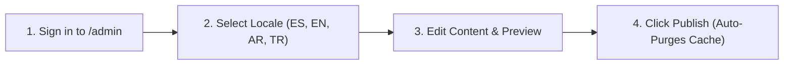

This guide is written for **Central Mosque of Bogotá administrators and content editors** managing the website through the Strapi v5 Admin Panel (`/admin`), which is fully localized in **Spanish (`es`), English (`en`), Arabic (`ar`), and Turkish (`tr`)**.



---

## 1. Managing Daily, Jumu'ah & Hilal Prayer Settings

1. In the left sidebar, open the **Islam Suite** plugin (`@vicacha-devs/strapi-plugin-islam`) or **Content Manager -> Islam, Liturgy & Scripture -> Hilal Announcement**.
2. Update:
   - **Jumu'ah Khutbah & Prayer Shifts** and **Iqamah Offsets** for Fajr, Dhuhr, Asr, Maghrib, and Isha.
   - **Hilal Moon-Sighting Announcements** (`hilal-announcement`, `-2` to `+2` days adjustment) when local moon-sighting adjusts the start of Ramadan, Eid al-Fitr, or Dhul Hijjah.
3. Click **Save** and **Publish**.

---

## 2. Posting an Urgent Community Alert Banner

When an urgent announcement is needed (e.g., Eid prayer schedule, Ramadan moonsighting, or emergency janazah notice):
1. Open **Content Manager -> Inbox & Omnichannel Broadcasts -> Alert Banner** (`plugin::inbox.alert-banner`) or the **Inbox** plugin page.
2. Enable the banner, select the severity (`info`, `important`, `urgent`), and fill in the title, summary, and CTA link for `es`, `en`, `ar`, and `tr`.
3. Visitors will see the banner at the top of the homepage; if you update the alert's `id`, it will reappear even for visitors who dismissed an older banner.

---

## 3. Creating Events & Promoting to the Corner Spotlight Dock

1. Go to **Content Manager -> Events, Scheduling & Bookings -> Event** (`plugin::events.event`) and click **Create new entry**.
2. Fill in **Title**, **Category**, **Schedule**, **Location**, and **Body** (using the TipTap v3 Rich Text Editor).
3. **To promote the event in the floating bottom-corner Spotlight Dock** (used for scholarships like *Türkiye Bursları* / *Diyanet TDV* or major conferences):
   - Toggle `spotlightEnabled` to **True**.
   - Upload a vertical **Poster** image (`poster`).
   - Set `spotlightBadgeText` (e.g., `"Convocatoria Abierta"`), `spotlightPriority` (higher numbers appear first), and `spotlightEndAt` (for the live remaining-days countdown badge).
4. Use the top-right **Locales** dropdown to translate the event into `en`, `ar`, and `tr`, then click **Publish**.

---

## 4. Managing Donations, Zakat & Utility Invoice Sponsorships

1. **Donation Campaigns (`Content Manager -> Donations & Certificates -> Campaign`)**:
   - Update `goalAmountCop`, `raisedAmountCop`, and `donorCount` to update the live progress bars on `/[lang]/donate`.
2. **Payment Channels (`Content Manager -> Public Website Pages -> Donations Page`)**:
   - Manage Bancolombia, Nequi, and Bre-B transfer details and QR instructions.
3. **Monthly Utility Invoices (`Donations Plugin -> Utility Invoices`)**:
   - Add or mark monthly Mosque utility bills (Electricity, Water, Gas, Internet, Administration) as `pending`, `partially_funded`, or `paid`.
4. **Reviewing Donor Pledges & Issuing Certificates (`Donations & Certificates -> Pledge` / `Certificate`)**:
   - Verify transfer receipts submitted by donors (`donorName`, `amount`, `referenceNumber`) and issue Ed25519-signed tax/donation certificates via the **Certificates** plugin.

---

## 5. Handling Visitor Bookings, Global Search & Cache Purge

- **Guided Mosque Visits (`Events, Scheduling & Bookings -> Booking`)**:
  - Review incoming school, university, and individual tour requests (`visitorName`, `groupSize`, `startTime`) and update `status` from `pending` to `confirmed`.
- **Service Desk Requests (`Inbox & Omnichannel Broadcasts -> Submission`)**:
  - Process community requests for **Khutbah topics**, **Nikah (Matrimony) officiating**, **Janazah (Funeral) support**, **Shahada appointments**, and **Islamic Certificates**.
- **Global Search (`Cmd/Ctrl + K`) & Cache Purge (`strapi-cache v1.13.0`)**:
  - Press `Cmd+K` (or `Ctrl+K`) anywhere in `/admin` to jump to any entry across all languages.
  - Publishing an entry automatically clears `strapi-cache`, or you can click **Purge Cache** / **Purge Entity Cache** (localized in `es`, `en`, `ar`, and `tr`) directly in the Content Manager.

---

## 6. Adding Friday's Khutbah & Multilingual Written Transcripts

In the backend, Friday sermons (**Khutbat al-Jumu'ah**) support both **audio/video recordings** and **full written transcripts localized across `es`, `en`, `ar`, and `tr`**.

### Option A: Video / Audio Khutbah + Written Transcript (`Media Item` — Recommended)
1. Go to **Content Manager -> Media, Resources & Library -> Media Item** (`plugin::media-feeds.media-item`) or open the **Media Feeds** plugin (`/admin/plugins/media-feeds`).
2. Click **Create new entry** and select the locale (`es`, `en`, `ar`, or `tr`) in the top-right **Locales** selector:
   - **`title`**: Title of the Khutbah in the selected language.
   - **`slug`**: URL-safe identifier (e.g. `khutbah-viernes-paciencia-y-gratitud`).
   - **`type`**: Select **`khutbah`**.
   - **`sourceUrl`**: Paste the YouTube, Vimeo, Spotify, or SoundCloud link (the backend automatically extracts `provider`, `externalId`, and `embedUrl`).
   - **`speaker`** & **`speakerProfile`**: Select the Khateeb (e.g. *Sheikh Ahmad Al-Mansoor*).
   - **`publishedDate`**: Date of the Friday sermon (the backend automatically computes the **Hijri date** `hijriDate`).
   - **`spokenLanguages`**: JSON array of languages spoken in the audio/video (e.g. `["ar", "es"]`).
   - **`languageTracks`**: Optional per-language audio/transcript tracks (`[{ "locale": "es", "label": "Español", "audioUrl": "...", "transcriptUrl": "..." }]`).
   - **`transcript`** *(Localized Rich Text)*: Write or paste the **full written Khutbah text / translation** for the active locale (`es`, `en`, `ar`, or `tr`).
3. Switch the **Locales** dropdown at the top right to **`en`**, **`ar`**, and **`tr`** to write the translated `title`, `description`, and `transcript` for each language, then click **Publish**.

### Option B: Standalone Written Khutbah Article (`Article`)
If you also want the Khutbah to appear as a standalone reading card in the **Articles (`/[lang]/articles/[slug]`)** section:
1. Go to **Content Manager -> Collection Types -> Article** (`api::article.article`).
2. Set **`tag`** to `"Khutbah"` (or `"Jumu'ah"`), select **`authorProfile`**, and write the sermon body in **`content`** using the TipTap Rich Text Editor across `es`, `en`, `ar`, and `tr`.

---

## 7. Where & How to Add Islamic Lessons

Islamic lessons are organized into **4 content types** depending on how the community consumes them:

| Lesson Format | Strapi Admin Location | Content-Type UID | Frontend Route |
| :--- | :--- | :--- | :--- |
| **1. Live / Weekly Halaqas & Study Circles** | **Content Manager -> Events, Scheduling & Bookings -> Event** | `plugin::events.event` | `/[lang]/events` & `/[lang]/events/[slug]` |
| **2. Structured Academy Courses (Multi-Week)** | **Content Manager -> Collection Types -> Course** | `api::course.course` | `/[lang]/education` |
| **3. Written Islamic Lessons & Articles** | **Content Manager -> Collection Types -> Article** | `api::article.article` | `/[lang]/articles/[slug]` |
| **4. Recorded Audio / Video Lesson Series** | **Content Manager -> Media, Resources & Library -> Media Series & Media Item** | `plugin::media-feeds.media-series` & `plugin::media-feeds.media-item` | `/[lang]/media` |

- **For Weekly Halaqas (`Event`)**: Set `category` to **`education`**, fill in `scheduleLabel` (e.g. *"Saturdays after Maghrib"*), `speakerProfile`, and `recurrenceRule` (`weekly`).
- **For Academy Courses (`Course`)**: Fill in `title`, `level` (`beginner`, `intermediate`, `advanced`), `modality` (`in-person`, `online`, `hybrid`), `schedule`, `instructor`, and `syllabus`.
- **For Recorded Lesson Playlists (`Media Series` + `Media Item`)**: First create the playlist in **Media Series** (e.g. *Introducción al Fiqh*), then create each episode in **Media Item** with `type` set to **`video`** or **`podcast`**, link it via the `series` relation, and add its localized `transcript`.

---

## 8. Adding & Editing Brand Email Templates in Email Designer 5

The backend integrates **`@Publishable/strapi-plugin-email-designer-5`** (`/admin/plugins/email-designer-5`), which manages two tabs of templates:

1. **Custom Templates (`plugin::email-designer-5.email-template`)**:
   - Pre-seeded at startup by [`seedEmailDesignerTemplates`](file:///Users/sjoseluis/Projects/experiments/central-mosque-bogota/backend/src/seed/cms-seed-data.ts) with 3 official **Mezquita Central de Bogotá** brand templates (`#1B4332` emerald header, `#D4AF37` gold border, bilingual footer):
     - **`101`**: *Mezquita Central — Confirmación de Solicitud y Ventanilla (Inbox)*
     - **`102`**: *Mezquita Central — Confirmación de Visita Guiada / Reserva*
     - **`103`**: *Mezquita Central — Boletín Comunitario y Horarios de Yumu'ah*
2. **Core Email Templates (`Reset Password` & `Email Address Confirmation`)**:
   - Stored in Strapi's core store (`plugin_users-permissions_email`) and pre-seeded with the Mosque's emerald-and-gold HTML layout.

### How to Create a New Branded Email Template
1. Open **Email Designer** (`/admin/plugins/email-designer-5`) in the left sidebar.
2.To reuse the Mosque's header/footer, click the **Duplicate** icon on template **`101`** (or click **Create a new template**).
3. Set:
   - **Template Reference ID**: Unique number (e.g. `104`).
   - **Template Name**: Descriptive name (e.g. `Mezquita Central — Recibo de Donación`).
   - **Subject**: Email subject supporting Mustache variables (e.g. `[Mezquita Central] Certificado {{certificateNumber}}`).
4. Edit blocks visually in the Unlayer canvas using dynamic variables (`{{applicantName}}`, `{{referenceCode}}`, `{{details}}`) and click **Save**.
5. To send the template from backend code:
   ```ts
   await strapi
     .plugin("email-designer-5")
     .service("email")
     .sendTemplatedEmail(
       { to: recipientEmail },
       { templateReferenceId: 104 },
       { applicantName, referenceCode, details }
     );
   ```

---

## 9. Casework Inbox & Form Builder CMS Synchronization

The **Inbox & Service Desk** plugin (`@vicacha-devs/strapi-plugin-inbox`, `/admin/plugins/inbox`) and **Forms** (`strapi-plugin-form-builder-cms`, `/admin/plugins/strapi-plugin-form-builder-cms`) operate as a synchronized two-way bridge:

- **Form Definitions (`formcraft_forms`)**: Starter templates (`service-desk-application`, `general-contact`, `service-request`) and visual drag-and-drop forms created in Form Builder CMS are automatically available in Inbox.
- **Submissions & Casework Tickets (`formcraft_submissions` ↔ `inbox_submissions`)**:
  - Submitting via `/api/inbox/forms/:slug/submit` validates honeypot/rate-limit/CAPTCHA rules, creates the Casework ticket (`INB-YYYYMMDD-XXXXXX`) with Hijri date and document verification checklist, and mirrors the raw submission into `formcraft_submissions`.
  - Submitting directly via Form Builder CMS (or existing rows in `formcraft_submissions`) is automatically ingested into `inbox_submissions` on `afterCreate`, during `syncWithFormBuilderCms()`, and whenever viewing the **Casework Inbox** tab (`listSubmissions()`).

