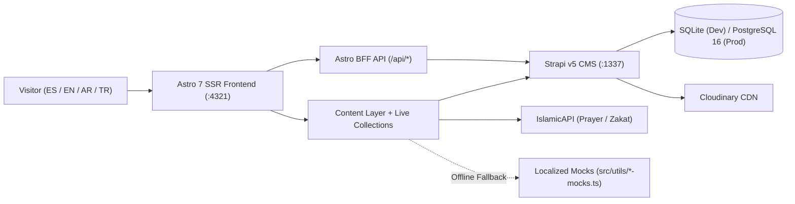

import { Card, CardGrid } from "@astrojs/starlight/components";

## Documentation Modules

<CardGrid stagger>
  <Card title="1. Getting Started & Jr. Dev Summary" icon="rocket">
    Get productive in 10 minutes with our [Jr. Dev Executive Summary](/en/01-getting-started/jr-dev-summary/), [Step-by-Step Onboarding Guide](/en/01-getting-started/onboarding-guide/), and [Environment Setup](/en/01-getting-started/environment-setup/).
  </Card>
  <Card title="2. Architecture & ADRs" icon="puzzle">
    Explore the [System Overview](/en/02-architecture/system-overview/), [Astro 7 SSR & Content Layers](/en/02-architecture/frontend-astro-ssr/), [Strapi v5 Backend](/en/02-architecture/backend-strapi-v5/), [4-Locale & RTL](/en/02-architecture/i18n-and-rtl/), and [ADRs 001–012](/en/02-architecture/adrs/).
  </Card>
  <Card title="3. Frontend Deep Dive" icon="laptop">
    Understand [Components & Controllers](/en/03-frontend/components-and-starwind/), [Resilient Loaders & Mocks](/en/03-frontend/content-loaders-and-mocks/), [IslamicAPI & Prayer Engine](/en/03-frontend/islamic-api-and-prayer-engine/), [BFF Endpoints](/en/03-frontend/bff-endpoints-and-forms/), and [Tiptap Rich Text](/en/03-frontend/tiptap-rich-text/).
  </Card>
  <Card title="4. Backend & Strapi v5 Plugins" icon="setting">
    Inspect the [17 Strapi Schemas](/en/04-backend-and-plugins/content-types-and-schemas/), [10 Custom Vicacha Plugins](/en/04-backend-and-plugins/vicacha-strapi-plugins/), and [Bootstrap & Permissions](/en/04-backend-and-plugins/bootstrap-and-permissions/).
  </Card>
  <Card title="5. Verification TODO & QA" icon="approve-check">
    Execute the [Verification TODO Checklist](/en/05-quality-and-verification/verification-todo-checklist/), [Unit Testing & Coverage Guide](/en/05-quality-and-verification/testing-and-coverage/), [Storybook & A11y](/en/05-quality-and-verification/storybook-and-a11y/), and [Operational Runbook](/en/05-quality-and-verification/operational-runbook/).
  </Card>
  <Card title="6. Editorial & TypeDoc Reference" icon="open-book">
    Share the [Mosque Staff CMS Handbook](/en/06-editorial-guide/cms-editor-handbook/) with editors and browse the [TypeDoc API Reference](/en/api/overview/).
  </Card>
</CardGrid>

## High-Level Platform Map (Rendered with Pele)

