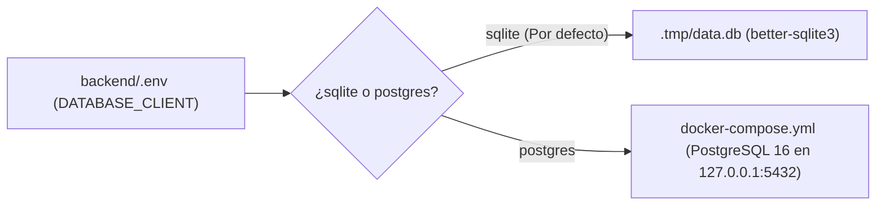

## 1. Mapa de Puertos Locales

| Servicio | URL por Defecto | Host | Archivo de Configuración |
| :--- | :--- | :--- | :--- |
| **Frontend Astro 7 SSR** | `http://localhost:4321` | `127.0.0.1` | `frontend/astro.config.ts` |
| **Storybook 10** | `http://localhost:6006` | `127.0.0.1` | `frontend/package.json` |
| **Portal Docs Starlight** | `http://localhost:4322` | `127.0.0.1` | `docs/package.json` |
| **Strapi v5 Admin y API** | `http://127.0.0.1:1337` | `127.0.0.1` | `backend/config/server.ts` |
| **PostgreSQL 16 (Opcional)** | `127.0.0.1:5432` | `127.0.0.1` | `docker-compose.yml` |

---

## 2. Variables de Entorno del Frontend (`frontend/.env`)

Validadas mediante `astro:env` en `frontend/astro.config.ts`:

| Variable | Contexto | Acceso | ¿Requerida? | Valor por Defecto | Descripción |
| :--- | :--- | :--- | :--- | :--- | :--- |
| `ISLAMIC_API_URL` | `server` | `public` | Sí | `"https://islamicapi.com/api/v1/"` | URL base de IslamicAPI v1 |
| `ISLAMIC_API_KEY` | `server` | `secret` | Opcional | `undefined` | Llave secreta de IslamicAPI (usa fallback si no se define) |
| `LOCATION_URL` | `server` | `public` | Sí | `"http://ip-api.com/json/"` | Endpoint de geolocalización IP |
| `STRAPI_URL` | `server` | `public` | Opcional | `"http://127.0.0.1:1337"` | URL base del CMS Strapi v5 |
| `STRAPI_API_TOKEN` | `server` | `secret` | Opcional | `undefined` | Token privado para llamadas servidor-a-servidor a Strapi v5 |

---

## 3. Variables de Entorno del Backend (`backend/.env`)

| Grupo | Variables | Propósito |
| :--- | :--- | :--- |
| **Servidor** | `HOST=127.0.0.1`, `PORT=1337`, `PUBLIC_URL=http://127.0.0.1:1337` | Asigna Strapi exclusivamente a loopback en desarrollo |
| **Secretos** | `APP_KEYS`, `API_TOKEN_SALT`, `ADMIN_JWT_SECRET`, `TRANSFER_TOKEN_SALT`, `JWT_SECRET`, `ENCRYPTION_KEY` | Llaves criptográficas para sesiones y JWT |
| **Base de Datos (SQLite)** | `DATABASE_CLIENT=sqlite`, `DATABASE_FILENAME=.tmp/data.db` | Base de datos local cero-configuración |
| **Base de Datos (PostgreSQL)** | `DATABASE_CLIENT=postgres`, `DATABASE_HOST=127.0.0.1`, `DATABASE_PORT=5432`, `DATABASE_NAME=central_mosque_bogota`, `DATABASE_USERNAME`, `DATABASE_PASSWORD` | Paridad con entornos de staging y producción |
| **Cloudinary CDN** | `CLOUDINARY_NAME`, `CLOUDINARY_KEY`, `CLOUDINARY_SECRET` | Proveedor CDN para imágenes, pósters y documentos |

---

## 4. Cambio entre SQLite y PostgreSQL 16 (Docker)



```bash
# Levantar PostgreSQL 16 en 127.0.0.1:5432
POSTGRES_PASSWORD="change-me-local-only" docker compose up -d
```
