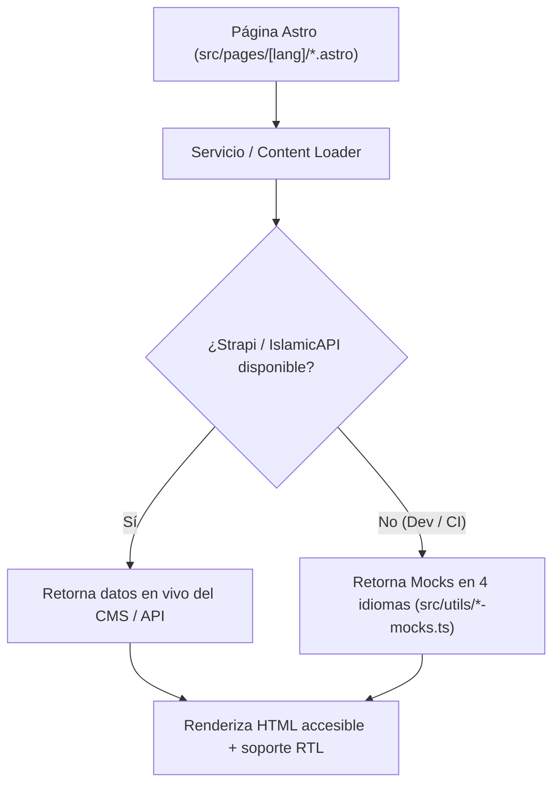

¡Bienvenido al repositorio de la **Mezquita Central de Bogotá (Abu Bakr As-Siddiq)**! Esta guía rápida está diseñada para que puedas trabajar en el código en **menos de 10 minutos**.

---

## 1. Modelo Mental en 60 Segundos

El repositorio es un monorepo en TypeScript dividido en **3 paquetes**:

| Paquete | Ruta | Stack Tecnológico | Puerto Local |
| :--- | :--- | :--- | :--- |
| **Frontend** | `frontend/` | Astro 7 SSR (`@astrojs/node`), Tailwind CSS v4, Starwind UI, Vitest, Storybook 10 | `http://localhost:4321` |
| **Backend (CMS)** | `backend/` | Strapi v5 (`^5.39.0`), SQLite (local) / PostgreSQL 16 (Docker), 10 plugins `@vicacha-devs/strapi-plugin-*` | `http://127.0.0.1:1337` |
| **Documentación** | `docs/` | Astro Starlight (`en` + `es`), diagramas SVG con Pele (`https://pele.run/`), TypeDoc | `http://localhost:4322` |

### Por Qué Puedes Trabajar Offline Desde el Minuto 1
**NO necesitas tener Strapi encendido ni una llave `ISLAMIC_API_KEY` para desarrollar en el frontend.** Todos los loaders de Strapi (`src/services/strapi/loader.ts`) y de IslamicAPI (`src/services/islamicAPI/loaders/`) hacen fallback automático a los datos mock en 4 idiomas (`frontend/src/utils/*-mocks.ts`) si el backend o la API externa no responden.



---

## 2. Comandos Rápidos (Copiar y Pegar)

```bash
# 1. Iniciar el Frontend en modo desarrollo (funciona de inmediato con mocks offline)
cd frontend
cp .env.example .env
pnpm dev
# -> Abre http://localhost:4321/es

# 2. Abrir Storybook 10 para explorar los componentes UI de forma aislada
pnpm storybook
# -> Abre http://localhost:6006

# 3. Ejecutar toda la suite de verificación desde la raíz del monorepo
cd ..
pnpm verify
```

---

## 3. Tabla "¿Dónde Encuentro...?"

| Si necesitas... | Revisa este archivo / carpeta |
| :--- | :--- |
| Editar una página o ruta (`es`, `en`, `ar`, `tr`) | `frontend/src/pages/[lang]/` |
| Crear o editar un componente de dominio / UI | `frontend/src/components/data/display/` o `frontend/src/components/actions/` |
| Editar la interactividad en el navegador (DOM) | `*.controller.ts` junto al archivo `.astro` |
| Agregar un texto traducido de la interfaz | `frontend/src/i18n/locales/{es,en,ar,tr}.ts` (¡agrégalo en los 4!) |
| Agregar un slug traducido de URL | `frontend/src/i18n/ui.ts` (objeto `routes`) |
| Revisar llamadas REST a Strapi v5 | `frontend/src/services/strapi/api.ts` y `loader.ts` |
| Revisar cálculo de horarios de oración o Zakat | `frontend/src/services/islamicAPI/loaders/` y `frontend/src/utils/islamic.utils.ts` |
| Editar endpoints BFF (Formularios, ICS, RSS, PDF) | `frontend/src/pages/api/` |
| Actualizar datos mock para modo offline | `frontend/src/utils/*-mocks.ts` (`localized-mocks.ts`, `islam-suite-mocks.ts`, etc.) |
| Editar esquemas de contenido en Strapi v5 | `backend/src/api/<content-type>/content-types/<name>/schema.json` |
| Editar semilla inicial y permisos públicos del CMS | `backend/src/index.ts` |

---

## 4. Las 5 Reglas de Oro en Cada Pull Request

1. **Cero `set:html` / `innerHTML` con Contenido No Confiable**:
   - Renderiza siempre el texto enriquecido de Strapi con `<TiptapContent content={...} />` (`@vicacha-devs/astro-tiptap-blocks`).
   - En los controladores `*.controller.ts`, usa `textContent`, `createElement` o `DOMParser`, nunca `innerHTML`.
2. **Paridad en 4 Idiomas y RTL para Árabe (`ar`)**:
   - Toda llave agregada en `es.ts` **debe** existir en `en.ts`, `ar.ts` y `tr.ts`.
   - Usa clases lógicas de Tailwind v4 (`ps-*`, `pe-*`, `ms-*`, `me-*`, `start-*`, `end-*`, `text-start`, `border-s-*`) para que el diseño en árabe (`dir="rtl"`) se invierta automáticamente.
3. **Límite de 80 Caracteres por Línea**:
   - Tanto `oxfmt` como ESLint exigen **máximo 80 columnas**. Ejecuta `./node_modules/.bin/oxfmt` antes de hacer commit.
4. **Convención de Nombres en Pruebas y Cobertura**:
   - Todo test en Vitest debe iniciar con `should ... when ...` (`vitest/valid-title`).
   - La cobertura global debe mantenerse por encima de **90% branches**, **95% functions**, **80% lines** y **80% statements**.
5. **Resiliencia Offline Primero**:
   - Ninguna página o componente debe fallar si Strapi o IslamicAPI están apagados.
