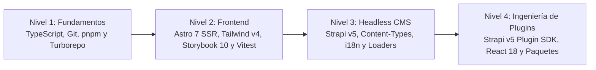

Esta ruta de aprendizaje guía a nuestros desarrolladores junior desde los **fundamentos de TypeScript y monorepos** hasta **entregar funcionalidades en producción** en todo nuestro ecosistema:
- **`central-mosque-bogota`**: Frontend SSR en Astro 7 (`frontend/`), CMS Headless Strapi v5 (`backend/`), y Documentación Bilingüe en Astro Starlight + TypeDoc (`docs/`).
- **`strapi-v5-extensions`**: Monorepo con Turborepo + `pnpm` workspaces que aloja nuestros 10 paquetes `@vicacha-devs/strapi-plugin-*` (`calendar`, `events`, `bookings`, `islam`, `donations`, `certificates`, `inbox`, `broadcasts`, `media-feeds`, `resources`) y `@notum-cz/strapi-plugin-seo`.
- **Paquetes Complementarios**: `@vicacha-devs/astro-tiptap-blocks`, `@notum-cz/strapi-plugin-tiptap-editor`, y `strapi-global-search`.

---

## Mapa de Progresión por Niveles (Tiers)

---

## Reglas de Oro de Ingeniería (Leer Antes de tu Primer PR)

1. **Límite Estricto de `< 500` Líneas por Archivo**: Ningún archivo de código o documentación (`.ts`, `.tsx`, `.astro`, `.md`) puede superar las **500 líneas**.
2. **Ancho de Línea de 80 Columnas**: En `frontend/`, `oxfmt` y ESLint exigen **80 caracteres por línea**. Ejecuta siempre `./node_modules/.bin/oxfmt` antes de hacer commit.
3. **Paridad Multilingüe i18n y Soporte RTL Árabe**:
   - Toda clave añadida a `frontend/src/i18n/locales/es.ts` debe añadirse también a `en.ts`, `ar.ts` y `tr.ts`.
   - Usa exclusivamente propiedades lógicas de Tailwind v4 (`ps-*`, `pe-*`, `ms-*`, `me-*`, `start-*`, `end-*`, `text-start`, `border-s-*`) para que el árabe (`dir="rtl"`) se invierta automáticamente.
   - En los plugins de Strapi, mantén la paridad de 10 idiomas en `admin/src/translations/*.json`.
4. **Cero `set:html` / `innerHTML` en Datos No Confiables**: Renderiza texto enriquecido únicamente con `<TiptapContent content={...} />` (`@vicacha-devs/astro-tiptap-blocks`).
5. **Prohibido Subir Carpetas `dist/` en `strapi-v5-extensions`**: Nunca hagas commit de carpetas `dist/` en el monorepo de plugins.
6. **Conventional Commits y Cobertura de Tests**: Usa Conventional Commits (`feat:`, `fix:`, `docs:`, `test:`) y mantén la cobertura por encima de **90% branches** y **95% functions**.

---

## Nivel 1 (Tier 1): Fundamentos Base (TypeScript, Git, `pnpm` Workspaces y Turborepo)

**Objetivo**: Dominar TypeScript estricto (genéricos, uniones discriminadas, validación con `zod`), Conventional Commits con Husky, y cómo `pnpm` workspaces + Turborepo enlazan `central-mosque-bogota` con `strapi-v5-extensions` y `astro-tiptap-blocks`.

### Tutoriales Recomendados en YouTube (Español e Inglés)

| Tema | Español (YouTube) | English (YouTube) |
| :--- | :--- | :--- |
| **TypeScript desde Cero hasta Tipos Estrictos** | **Midudev** — [Curso Intensivo de TypeScript desde Cero](https://www.youtube.com/watch?v=fUgxxhI_bvc) (~2h 30m) y [Parte 2: Generics y Utility Types](https://www.youtube.com/watch?v=L1Z8CG3314I) | **Traversy Media** — [TypeScript Crash Course](https://www.youtube.com/watch?v=BCg4U1FzODs) (~1h) & **Matt Pocock** — [TypeScript Generics Tutorial](https://www.youtube.com/watch?v=EcCTIExsqmI) |
| **Git, GitHub Flow y Conventional Commits** | **Midudev** — [Curso de Git y GitHub desde Cero](https://www.youtube.com/watch?v=3GymExBkKjE) (~5h) | **Traversy Media** — [Git & GitHub Crash Course](https://www.youtube.com/watch?v=SWYqp7iY_Tc) (~1h) |
| **Monorepos con `pnpm` Workspaces y Turborepo** | **Fazt Code** — [Curso de pnpm y Workspaces / Monorepos](https://www.youtube.com/@FaztCode/search?query=pnpm%20monorepo) | **Vercel (Oficial)** — [Turborepo Crash Course & Monorepo Fundamentals](https://www.youtube.com/@VercelHQ/search?query=turborepo) |
| **Validación de Esquemas con Zod** | **Fazt Code** — [Zod Curso Práctico de Validación en TypeScript](https://www.youtube.com/watch?v=03w0baf2SC0) (~45m) | **Web Dev Simplified** — [Learn Zod In 30 Minutes](https://www.youtube.com/watch?v=L6BE-U3oy80) (~30m) |

### Lectura de Código y Reto de Graduación (Nivel 1)
- **Leer**: `package.json`, `scripts/verify-all.ts` y `../strapi-v5-extensions/turbo.json`.
- **Reto PR de Graduación**: Añadir una función utilitaria en TypeScript estricto en `frontend/src/utils/` con su archivo de pruebas unitarias en Vitest (`*.test.ts`) alcanzando 100% de cobertura de ramas y pasando `pnpm verify`.

---

## Nivel 2 (Tier 2): Ingeniería Frontend (Astro 7 SSR, Tailwind CSS v4, Storybook 10 y Vitest)

**Objetivo**: Construir páginas SSR en Astro 7 accesibles (`WCAG AA`), en 4 idiomas (`es`, `en`, `ar`, `tr`) con soporte RTL y controladores interactivos (`*.controller.ts`), documentadas en Storybook 10 y probadas con Vitest.

### Tutoriales Recomendados en YouTube (Español e Inglés)

| Tema | Español (YouTube) | English (YouTube) |
| :--- | :--- | :--- |
| **Astro (SSR, Content Layer, Rutas y Endpoints)** | **Midudev** — [Curso de Astro desde Cero (SSR, Content Collections)](https://www.youtube.com/watch?v=RB5tR_nqUEw) (~3h) | **Coding in Public** — [Astro Crash Course](https://www.youtube.com/@CodinginPublic/search?query=astro%20crash%20course) & **Traversy Media** — [Astro Crash Course](https://www.youtube.com/watch?v=Oi9z5gfIHJs) |
| **Tailwind CSS v4, Propiedades Lógicas RTL y Dark Mode** | **Midudev** — [Tailwind CSS desde Cero + Novedades v4](https://www.youtube.com/@midudev/search?query=tailwind%20css) & **Fazt Code** — [Curso de Tailwind CSS](https://www.youtube.com/@FaztCode/search?query=tailwind) | **Tailwind Labs (Oficial)** — [What's New in Tailwind CSS v4.0](https://www.youtube.com/@TailwindLabs) & **Traversy Media** — [Tailwind CSS Crash Course](https://www.youtube.com/watch?v=dFgzHOX84xQ) |
| **Storybook y Accesibilidad (`a11y`)** | **Gentleman Programming** — [Storybook y Arquitectura de Componentes](https://www.youtube.com/@GentlemanProgramming/search?query=storybook) | **Storybook (Oficial)** — [Storybook Visual & Accessibility Testing Tutorials](https://www.youtube.com/@chromaui) |
| **Vitest, Happy DOM y Testing Library** | **Midudev** — [Testing en JavaScript y TypeScript con Vitest](https://www.youtube.com/@midudev/search?query=vitest) | **Net Ninja** — [Vitest Crash Course / Unit Testing](https://www.youtube.com/@NetNinja/search?query=vitest) |

### Lectura de Código y Reto de Graduación (Nivel 2)
- **Leer**: `frontend/src/pages/[lang]/index.astro`, `frontend/src/i18n/ui.ts`, `frontend/src/components/data/display/` y `../astro-tiptap-blocks/src/`.
- **Reto PR de Graduación**: Crear o mejorar un componente en `frontend/src/components/` usando clases lógicas de Tailwind v4 (`ps-*`, `pe-*`), traducciones en los 4 idiomas (`es`, `en`, `ar`, `tr`), historia en `.stories.ts` (0 violaciones `a11y`) y prueba unitaria `.test.ts` con `renderAstroComponentToDom`.

---

## Nivel 3 (Tier 3): Backend y Headless CMS (Strapi v5, Document Service API, i18n y Loaders)

**Objetivo**: Comprender los Content-Types de Strapi v5, Document Service API (`strapi.documents(uid)`), i18n en 4 idiomas, semilla automática (`backend/src/index.ts`), `strapi-cache` y los loaders resilientes del frontend con mocks offline.

### Tutoriales Recomendados en YouTube (Español e Inglés)

| Tema | Español (YouTube) | English (YouTube) |
| :--- | :--- | :--- |
| **Fundamentos de Strapi v5 Headless CMS** | **Midudev** — [CMS Headless con Strapi + Astro Paso a Paso](https://www.youtube.com/watch?v=W4brAobC2Hc) (~1h 45m) & **Fazt Code** — [Curso de Strapi CMS](https://www.youtube.com/@FaztCode/search?query=strapi) | **Strapi (Oficial)** — [Strapi 5 Crash Course & Document Service API](https://www.youtube.com/@Strapi/search?query=Strapi%205) |
| **PostgreSQL y Modelado de Datos Relacionales** | **Fazt Code** — [Curso de PostgreSQL desde Cero](https://www.youtube.com/watch?v=c4E3b2taE7I) (~2h) | **freeCodeCamp** — [PostgreSQL Tutorial for Beginners](https://www.youtube.com/watch?v=qw--VYLpxG4) (~4h) |
| **Integración Astro + Strapi (`astro-strapi-loader`)** | **Midudev** — [Conectar Astro con Strapi Headless CMS](https://www.youtube.com/watch?v=W4brAobC2Hc) | **Paul Bratslavsky** — [Build a Website with Astro & Strapi 5](https://www.youtube.com/@CodingAfterThirty/search?query=astro%20strapi%205) |

### Lectura de Código y Reto de Graduación (Nivel 3)
- **Leer**: `backend/src/api/`, `backend/config/plugins.ts`, `backend/src/index.ts`, `frontend/src/services/strapi/loader.ts` y `frontend/src/utils/localized-mocks.ts`.
- **Reto PR de Graduación**: Añadir o extender un campo en un Content-Type de `backend/src/api/`, incluirlo en el seed de `backend/src/index.ts`, mapearlo en `frontend/src/services/strapi/mappers.ts` con su fallback offline en los 4 idiomas y cubrirlo con pruebas unitarias.

---

## Nivel 4 (Tier 4): Ingeniería de Plugins Strapi v5 y Paquetes (`strapi-v5-extensions`)

**Objetivo**: Desarrollar, probar y mantener plugins empresariales de Strapi v5 dentro de `strapi-v5-extensions/packages/*` usando `@strapi/sdk-plugin`, React 18, `@strapi/design-system` v2, FullCalendar y Tiptap.

### Tutoriales Recomendados en YouTube (Español e Inglés)

| Tema | Español (YouTube) | English (YouTube) |
| :--- | :--- | :--- |
| **React 18 Hooks (`useState`, `useEffect`, `useMemo`, `useCallback`)** | **Midudev** — [Curso de React desde Cero](https://www.youtube.com/watch?v=7iobxzd_2wY) (~8h) | **Net Ninja** — [Full Modern React Tutorial](https://www.youtube.com/playlist?list=PL4cUxeGkcC9gZD-Tvwfod2gaISzfRiP9d) |
| **Strapi v5 Plugin SDK y Custom Fields** | **Fazt Code / Comunidad Strapi ES** — [Crear Plugins y Custom Fields en Strapi](https://www.youtube.com/@Strapi/search?query=custom%20fields%20plugin) | **Strapi (Oficial)** — [Strapi v5 Plugin Development & Custom Fields](https://www.youtube.com/@Strapi/search?query=Strapi%205%20plugin) |
| **Editor de Texto Rico Tiptap** | **Fazt Code / Midudev** — [Editor de Texto Rico con Tiptap en React](https://www.youtube.com/results?search_query=tiptap+editor+tutorial+espa%C3%B1ol) | **Tiptap Tutorials** — [Tiptap Rich Text Editor Crash Course](https://www.youtube.com/results?search_query=tiptap+rich+text+editor+tutorial) |

### Arquitectura de Calendario Unificado (`Option A`)
- **`@vicacha-devs/strapi-plugin-calendar`**: La **única vista de calendario unificada** (`/admin/plugins/calendar`) y **dependencia requerida** tanto de `events` como de `bookings`.
- **`@vicacha-devs/strapi-plugin-events`**: Registra automáticamente sus fuentes de eventos en `calendar` al iniciar el servidor y ofrece el espacio dedicado de **RSVPs, Lista de Espera y Check-In de Asistentes** (`/admin/plugins/events`, con acceso directo **Open in Calendar** hacia `/admin/plugins/calendar?source=events`).
- **`@vicacha-devs/strapi-plugin-bookings`**: Registra `plugin::bookings.booking` en `calendar` al iniciar el servidor y ofrece el espacio dedicado de **Aprobación de Reservas, Filtro de Recursos y Libro Mayor** (`/admin/plugins/bookings`, con acceso directo **Open in Calendar** hacia `/admin/plugins/calendar?source=bookings`).

### Lectura de Código y Reto de Graduación (Nivel 4)
- **Leer**: `packages/strapi-plugin-calendar/`, `packages/strapi-plugin-events/server/src/bootstrap.ts`, `packages/strapi-plugin-bookings/server/src/bootstrap.ts` y `packages/*/tests/services-and-i18n.test.ts`.
- **Reto PR de Graduación**: Añadir una mejora o filtro a un plugin en `strapi-v5-extensions/packages/`, actualizar los 10 archivos JSON de idioma en `admin/src/translations/`, agregar pruebas en `tests/services-and-i18n.test.ts`, mantener todos los archivos `< 500` líneas y verificar que no existan carpetas `dist/`.
