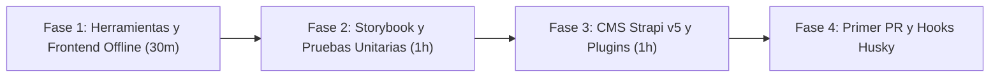

Esta guía acompaña a los nuevos desarrolladores desde la configuración inicial de su entorno hasta su primer Pull Request verificado.



---

## Fase 1: Requisitos e Instalación Local (Día 1 — Primeros 30 Minutos)

### 1. Herramientas Requeridas

| Herramienta | Versión Requerida | Comando de Verificación | Notas |
| :--- | :--- | :--- | :--- |
| **Node.js** | `>= 24.x` (`24` en `.nvmrc`) | `node -v` | Ejecuta `nvm use` dentro de `frontend/` |
| **pnpm** | `>= 10.x` (`10.33.3`) | `pnpm -v` | Gestionado mediante Corepack o pnpm global |
| **Git** | `>= 2.30` | `git --version` | Requerido para los hooks Husky (`pre-commit`, `pre-push`) |
| **Docker** | Opcional | `docker -v` | Solo necesario si deseas probar PostgreSQL 16 en lugar de SQLite |

### 2. Dependencias Locales del Workspace
El monorepo enlaza dos paquetes hermanos ubicados en `/Projects/experiments`:
- `../astro-tiptap-blocks` (`@vicacha-devs/astro-tiptap-blocks`) — usado por `frontend/` para renderizar bloques Tiptap sin `set:html`.
- `../strapi-v5-extensions/packages/*` (`@vicacha-devs/strapi-plugin-*`) — 10 extensiones de dominio usadas por `backend/`.

### 3. Levantar el Frontend en Modo Offline Mock
```bash
cd central-mosque-bogota/frontend
cp .env.example .env
pnpm install
pnpm dev
```
Abre `http://localhost:4321`:
- `/` redirige automáticamente a `/es`.
- Cambia de idioma con el selector del encabezado (`LanguagePicker`) y verifica que `/ar` active `<html dir="rtl" lang="ar">`.

---

## Fase 2: Exploración de Componentes y Pruebas (Día 1 — Tarde)

### 1. Explorador de Componentes Storybook 10
```bash
cd frontend
pnpm storybook
```
En `http://localhost:6006` puedes alternar **Modo Claro / Oscuro**, dirección **LTR / RTL** y revisar la pestaña **Accessibility (a11y)**.

### 2. Ejecutar Pruebas Unitarias y Cobertura
```bash
cd frontend
./node_modules/.bin/vitest --project=unit --run --coverage
```
Los 92 archivos de prueba (201 tests) se ejecutan en ~9 segundos usando `renderAstroComponentToDom` y `happy-dom`.

---

## Fase 3: Levantar el Backend Strapi v5 (Día 2)

Por defecto, `backend/` utiliza **SQLite** (`.tmp/data.db`) sin requerir configuración externa:

```bash
cd central-mosque-bogota/backend
cp .env.example .env
pnpm install
pnpm develop
```

Al iniciar por primera vez (`backend/src/index.ts`), Strapi automáticamente:
1. Registra los 4 idiomas (`es`, `en`, `ar`, `tr`).
2. Configura permisos públicos de mínimo privilegio (`find`/`findOne` para lectura, `create` para formularios).
3. Inserta la semilla inicial de configuración, líderes, servicios, eventos, artículos y campañas.

---

## Fase 4: Flujo Git, Husky y Primer PR (Día 3+)

- **`pre-commit`**: Ejecuta `lint-staged` (`eslint --fix` y `oxfmt`).
- **`commit-msg`**: Valida Conventional Commits (`feat:`, `fix:`, `docs:`, `test:`, `refactor:`).
- **`pre-push`**: Ejecuta `pnpm test:unit`.
- Antes de abrir tu PR, ejecuta `pnpm verify` en la raíz y completa el [Checklist TODO de Verificación](/es/05-quality-and-verification/verification-todo-checklist/).
