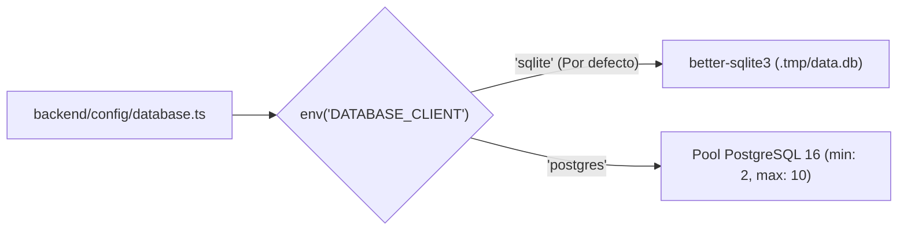

## 1. Estructura de Directorios (`backend/`)

```text
backend/
├── config/
│   ├── admin.ts          # Admin JWT, tokens de transferencia y botón de vista previa
│   ├── api.ts            # Límites de paginación REST (defaultLimit: 25, maxLimit: 100)
│   ├── database.ts       # Modo dual SQLite (better-sqlite3) / PostgreSQL 16 (pg)
│   ├── middlewares.ts    # CSP estricta (Cloudinary + OpenStreetMap), CORS y cabeceras
│   ├── plugins.ts        # Configuración de los 10 plugins @vicacha-devs + Tiptap + SEO + Cache
│   └── server.ts         # Host (127.0.0.1), Puerto (1337) y tareas Cron
├── src/
│   ├── admin/            # Traducciones admin en 4 idiomas (es, en, ar, tr) y Vite transforms
│   ├── api/              # 9 esquemas propios (5 Single Types + 4 Collection Types) y /api/health
│   ├── bootstrap/        # Idiomas, permisos, Content Manager Organizer, metadatos y lifecycles
│   ├── components/       # 7 esquemas reutilizables (shared.seo, shared.link, faith.pillar-card, etc.)
│   ├── seed/             # Semillas idempotentes en 4 idiomas, navegación, sitemap, tiptap y emails
│   └── index.ts          # Orquestador de los ciclos register y bootstrap
├── Dockerfile            # Contenedor multi-stage Node 24 Alpine para producción
└── package.json
```

---

## 2. Estrategia Dual de Base de Datos (`backend/config/database.ts`)



- **Desarrollo Local (`sqlite`)**: Cero dependencias externas; almacena los datos en `backend/.tmp/data.db` y carga la semilla inicial automáticamente.
- **Staging y Producción (`postgres`)**: Se conecta a PostgreSQL 16 (`docker-compose.yml` en `127.0.0.1:5432` localmente o servicio administrado en la nube).

---

## 3. Seguridad y Caché (`backend/config/middlewares.ts` y `plugins.ts`)

1. **Content Security Policy (`strapi::security`)**:
   - Autoriza explícitamente `res.cloudinary.com` para recursos multimedia y `*.tile.openstreetmap.org` para mapas.
2. **CORS (`strapi::cors`)**:
   - Restringe peticiones cross-origin a los orígenes configurados (`CORS_ORIGINS`, por defecto `http://localhost:4321`).
3. **Caché REST (`strapi-cache` `v1.13.0`)**:
   - Soporta proveedores `memory` (LRU), `valkey` y `redis` (`CACHE_TTL=3600000` / 1 hora, `CACHE_MAX_ITEMS=1000`).
   - Almacena en caché las respuestas `GET` de `/api/global-setting`, `/api/about-page`, `/api/donations-page`, `/api/islam-faith-page`, `/api/contact-page`, `/api/community-services`, `/api/articles`, `/api/leaders`, `/api/faqs`, `/api/events/occurrences`, `/api/events/spotlights`, `/api/media-feeds/episodes` y `/api/donations/campaigns`, excluyendo rutas transaccionales (`/api/bookings`, `/api/inbox`, `/api/certificates/apply`, `/api/certificates/verify`, `/api/donations/pledges`, `/api/donations/webhooks`, `/api/events/register`, `/api/events/cancel`).
   - Incluye traducciones nativas del panel de administración para `en`, `es`, `ar`, `tr` y `de` (botones `Purge Cache` / `Purge Entity Cache`) y purga la caché automáticamente al publicar cambios editoriales.
