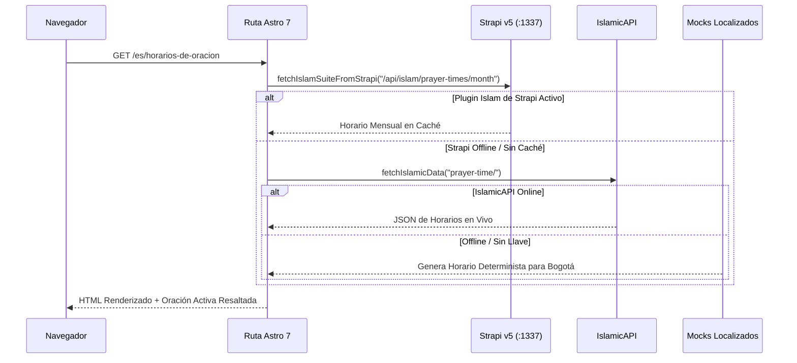

## 1. Arquitectura Dual de Colecciones de Contenido

El frontend utiliza dos mecanismos complementarios de Astro 7:

1. **Content Layer en Tiempo de Build (`frontend/src/content.config.ts`)**:
   - Impulsado por `createResilientStrapiLoader` y `createStrapiSingleTypeLoader` (`src/services/strapi/loader.ts`), envolviendo `@sensinum/astro-strapi-loader`.
   - Sincroniza los 4 idiomas (`es`, `en`, `ar`, `tr`) para:
     - **Collection Types**: `events`, `articles`, `faqs`, `leaders`, `communityServices`, `mediaHighlights`, `donationCampaigns`
     - **Single Types**: `globalSetting`, `aboutPage`, `islamFaithPage`, `donationsPage`, `contactPage`
2. **Live Content Collections en Tiempo Real (`frontend/src/live.config.ts`)**:
   - Impulsadas por `defineLiveCollection` en Astro 7:
     - `prayerTimes` (`src/services/islamicAPI/loaders/prayerTimesLoader.ts`)
     - `zakatNisab` (`src/services/islamicAPI/loaders/zakatNisabLoader.ts`)

---

## 2. Mapa de Rutas de la Aplicación (`frontend/src/pages/`)

| Archivo de Ruta | Modo de Renderizado | Descripción |
| :--- | :--- | :--- |
| `src/pages/index.astro` | Redirección Estática | Redirige `/` a `/es` (idioma por defecto) |
| `src/pages/404.astro` | Estático | Página 404 multilingüe con enlaces rápidos |
| `src/pages/[lang]/index.astro` | Estático (4 idiomas) | Inicio (HeroHijri, DailyPrayTime, UrgentAlertBanner, NextEvents, Services, Donations, Spotlights) |
| `src/pages/[lang]/[prayerInformation].astro` | **SSR (`prerender = false`)** | Ruta localizada de Horarios de Oración (`/es/horarios-de-oracion`, `/en/prayer-information`, `/ar/مواقيت-الصلاة`, `/tr/namaz-vakitleri`) |
| `src/pages/[lang]/about-us.astro` | Estático (4 idiomas) | Historia institucional, misión/visión, directorio de líderes y preguntas frecuentes |
| `src/pages/[lang]/islam-and-faith.astro` | Estático (4 idiomas) | Cinco Pilares, Explorador de Escrituras (Corán/Hadiz/Tasbih), Qibla y Efemérides Hijri, Etiqueta del Visitante |
| `src/pages/[lang]/events-and-programs.astro` | Estático (4 idiomas) | Catálogo filtrable de eventos, Cursos de la Academia + Modal de Inscripción, Banner de Ramadán |
| `src/pages/[lang]/events/[slug].astro` | Estático (`getStaticPaths`) | Detalle de evento individual con póster, horario y enlaces de acción |
| `src/pages/[lang]/articles/[slug].astro` | Estático (`getStaticPaths`) | Detalle de artículo educativo renderizado mediante `<TiptapContent />` |
| `src/pages/[lang]/community-services.astro` | Estático (4 idiomas) | Directorio de servicios comunitarios + Modal de Ventanilla Única (`ServiceDeskIntakeSection`) |
| `src/pages/[lang]/media.astro` | Estático (4 idiomas) | Destacados multimedia, Archivo filtrable, Publicaciones y Glosario, Galerías Fotográficas, Canales de Difusión |
| `src/pages/[lang]/donate.astro` | Estático (4 idiomas) | Calculadora de Zakat, Campañas, Canales de Pago, Apadrinamiento de Facturas de Servicios, Reporte de Donación |
| `src/pages/[lang]/contact-and-visit.astro` | Estático (4 idiomas) | Formulario de Contacto, Reserva de Visita Guiada, Etiqueta del Visitante, Ubicación y Horarios |
| `src/pages/[lang]/search.astro` | Estático (4 idiomas) | Buscador transversal en artículos, eventos, servicios, publicaciones y preguntas frecuentes |
