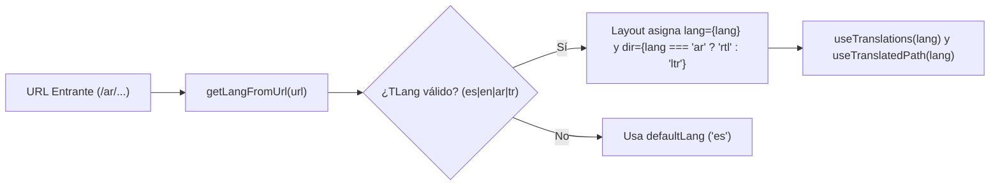

## 1. Idiomas Soportados (`frontend/src/i18n/ui.ts`)

| Código | Idioma | Dirección | ¿Por Defecto? | Audiencia Principal |
| :--- | :--- | :--- | :--- | :--- |
| `es` | Español | `ltr` | **Sí (`defaultLang`)** | Comunidad local de Bogotá y Colombia, visitantes y colegios |
| `en` | English | `ltr` | No | Visitantes internacionales, cuerpo diplomático y angloparlantes |
| `ar` | العربية (Árabe) | **`rtl`** | No | Comunidad araboparlante, eruditos y embajadas |
| `tr` | Türkçe (Turco) | `ltr` | No | Comunidad turca y aliados de Diyanet / Türkiye Bursları |

---

## 2. Funciones de Utilidad i18n (`frontend/src/i18n/utils.ts`)

| Función | Firma | Propósito |
| :--- | :--- | :--- |
| `getLangFromUrl` | `(url: URL) => TLang` | Extrae el primer segmento de la ruta (`es`, `en`, `ar`, `tr`) o retorna `"es"` |
| `useTranslations` | `(lang: TLang) => (key) => string` | Retorna la función `t(key)` con respaldo automático a `ui.es[key]` |
| `useTranslatedPath` | `(lang: TLang) => (path, l?) => string` | Traduce slugs de ruta usando el diccionario `routes` en `ui.ts` |
| `getRouteFromUrl` | `(url: URL) => string \| undefined` | Resuelve la llave canónica de una ruta localizada para cambiar de idioma desde `LanguagePicker` |

---

## 3. Reglas Obligatorias de Estilo RTL para Árabe (`ar`)

Cuando `lang === "ar"`, `frontend/src/layouts/Layout.astro` asigna `<html lang="ar" dir="rtl">`. Para que el diseño se invierta automáticamente de derecha a izquierda:

| Nunca Usar (Físico) | Usar Siempre (Lógico Tailwind v4) | Razón |
| :--- | :--- | :--- |
| `ml-*`, `mr-*` | `ms-*`, `me-*` | El margen inicial/final se invierte automáticamente en RTL |
| `pl-*`, `pr-*` | `ps-*`, `pe-*` | El padding inicial/final se invierte automáticamente en RTL |
| `left-*`, `right-*` | `start-*`, `end-*` | Posiciona docks y etiquetas correctamente en ambas direcciones |
| `text-left`, `text-right` | `text-start`, `text-end` | Alinea el texto al borde de inicio de lectura |
| `border-l-*`, `border-r-*` | `border-s-*`, `border-e-*` | Mantiene los bordes decorativos en el lado de inicio |
| `rounded-l-*`, `rounded-r-*` | `rounded-s-*`, `rounded-e-*` | Conserva los bordes redondeados en grupos de botones e inputs |
