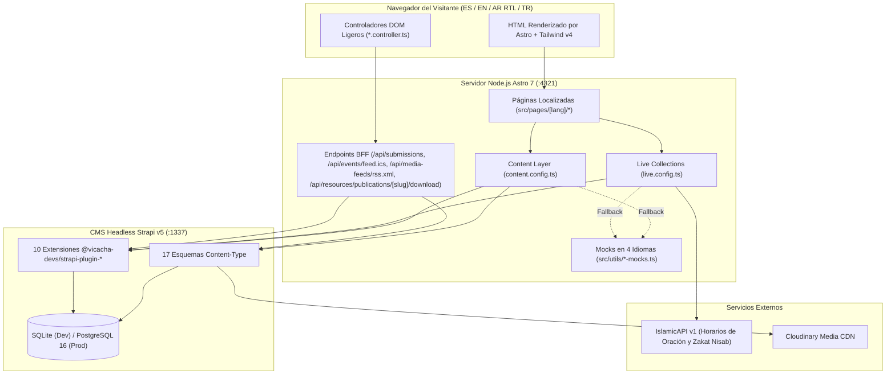

## 1. Topología de la Plataforma

La plataforma web de la **Mezquita Central de Bogotá** combina un CMS Headless (**Strapi v5**) con un frontend **Astro 7 SSR**, respaldados por una capa Backend-for-Frontend (BFF) y mocks multilingües para resiliencia offline.

---

## 2. Pilares Arquitectónicos

| Pilar | Implementación | Beneficio |
| :--- | :--- | :--- |
| **Híbrido Estático + SSR en Vivo** | Páginas institucionales pre-renderizadas (`getStaticPaths`) + rutas SSR (`prerender = false`) para horarios de oración y endpoints BFF | TTFB menor a 50ms en páginas de contenido y datos en tiempo real para oración y formularios |
| **Resiliencia en 3 Capas** | `Caché Plugin Strapi v5` -> `API Externa (IslamicAPI)` -> `Mocks Localizados Deterministas` | Cero caídas incluso si Strapi o IslamicAPI no están disponibles temporalmente |
| **Backend-for-Frontend (BFF)** | Endpoints de servidor en `src/pages/api/*` para formularios, descargas PDF, RSS e ICS | Mantiene `STRAPI_API_TOKEN` e `ISLAMIC_API_KEY` estrictamente en el servidor |
| **Seguridad Cero-`set:html`** | `@vicacha-devs/astro-tiptap-blocks` + `isomorphic-dompurify` (`tiptap-sanitizer.ts`) | Elimina vectores XSS provenientes del contenido enriquecido del CMS |
| **Soporte Nativo 4 Idiomas y RTL** | Propiedades lógicas CSS (`ps-*`, `pe-*`, `start-*`, `end-*`) + diccionarios (`es`, `en`, `ar`, `tr`) | Espejado automático derecha-a-izquierda en árabe (`ar`) sin duplicar plantillas |
