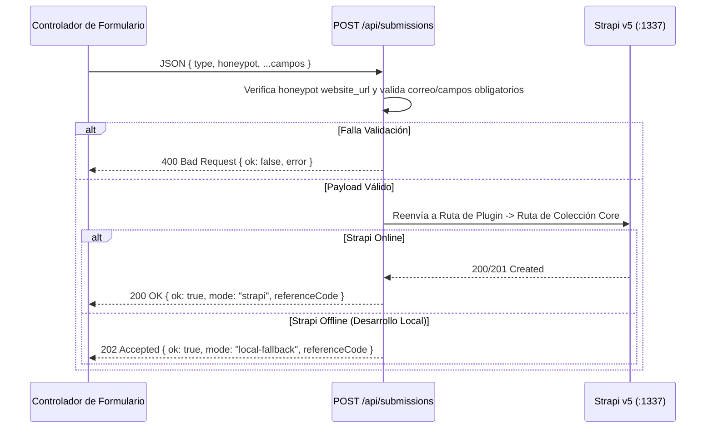

## 1. Resumen de Endpoints BFF (`frontend/src/pages/api/`)

Todas las acciones dinámicas del navegador se comunican con endpoints SSR de Astro (`prerender = false`) en lugar de llamar a Strapi directamente desde el cliente.

| Endpoint | Método | Archivo | Propósito |
| :--- | :--- | :--- | :--- |
| `/api/submissions` | `POST` | `src/pages/api/submissions.ts` | Recepción unificada de 6 tipos de formularios con honeypot anti-spam, validación y reenvío a Strapi v5 |
| `/api/events/feed.ics` | `GET` | `src/pages/api/events/feed.ics.ts` | Calendario iCalendar RFC 5545 (`.ics`) de eventos próximos (`?lang=es\|en\|ar\|tr`) |
| `/api/media-feeds/rss.xml` | `GET` | `src/pages/api/media-feeds/rss.xml.ts` | Feed RSS 2.0 XML de artículos y contenidos multimedia (`?lang=es\|en\|ar\|tr`) |
| `/api/resources/publications/[slug]/download` | `GET` | `src/pages/api/resources/publications/[slug]/download.ts` | Descarga segura de publicaciones PDF con validación de magic-bytes `%PDF-` y generador `%PDF-1.4` offline |

---

## 2. Recepción Unificada de Formularios (`POST /api/submissions`)

### Los 6 Tipos de Envío (`SubmissionType`)
1. `contact-message` -> `/api/inbox/contact-messages` -> `/api/contact-submissions`
2. `visit-booking` -> `/api/bookings/visit-requests` -> `/api/visit-bookings`
3. `donation-submission` -> `/api/donations/submissions` -> `/api/donation-submissions`
4. `service-desk-request` -> `/api/inbox/service-requests` -> `/api/contact-submissions`
5. `course-enrollment` -> `/api/events/course-enrollments` -> `/api/contact-submissions`
6. `newsletter-subscription` -> `/api/broadcasts/subscribers` -> `/api/contact-submissions`

---

## 3. Descarga Segura de Publicaciones PDF (`GET /api/resources/publications/[slug]/download`)

1. **Protección contra Path Traversal**: Rechaza cualquier `slug` que no cumpla `/^[a-z0-9-]+$/i` con `400 Bad Request` y `X-Content-Type-Options: nosniff`.
2. **Verificación de Magic-Bytes**: Comprueba que los primeros bytes recibidos de Strapi correspondan a `%PDF-` antes de transmitir el archivo.
3. **Síntesis `%PDF-1.4` Offline**: Si Strapi está apagado, `buildFallbackPublicationPdf(pub, lang)` genera un documento `%PDF-1.4` válido con el título, autor, categoría y resumen localizados.
