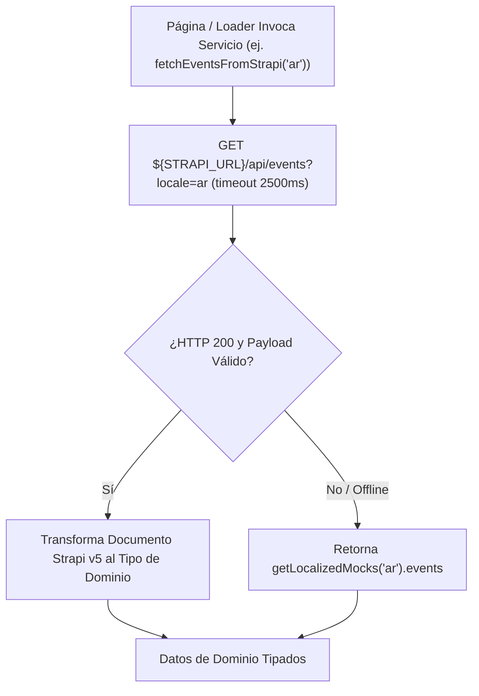

## 1. Capa de Servicios Strapi (`frontend/src/services/strapi/`)

| Archivo | Exportaciones | Responsabilidad |
| :--- | :--- | :--- |
| `loader.ts` | `createResilientStrapiLoader`, `createStrapiSingleTypeLoader` | Envuelve `@sensinum/astro-strapi-loader` en los 4 idiomas (`es`, `en`, `ar`, `tr`) y puebla el Content Store de Astro con mocks si Strapi no está disponible |
| `api.ts` | `fetchFromStrapi`, `fetchPluginFromStrapi`, `fetchIslamSuiteFromStrapi`, `fetchEventsFromStrapi`, `fetchArticlesFromStrapi`, `fetchAcademyCoursesFromStrapi`, `fetchBroadcastsFromStrapi`, `fetchPublicationsFromStrapi`, `fetchGlossaryFromStrapi`, `fetchPhotoGalleriesFromStrapi`, `fetchUtilityInvoicesFromStrapi`, `fetchEventSpotlightsFromStrapi`, etc. | Clientes REST tipados con timeout de 2.5s y respaldo automático para endpoints de Strapi v5 y plugins `@vicacha-devs/strapi-plugin-*` |
| `tiptap-sanitizer.ts` | `sanitizeTiptapHtml`, `stripHtmlTags`, `extractPlainTextParagraphs` | Sanitiza el HTML de Tiptap con `isomorphic-dompurify` y extrae párrafos en texto plano |

---

## 2. Cómo se Integra `@sensinum/astro-strapi-loader` (`VirtusLab-Open-Source/astro-strapi-loader`)

Nuestro frontend en Astro utiliza [`VirtusLab-Open-Source/astro-strapi-loader`](https://github.com/VirtusLab-Open-Source/astro-strapi-loader) (`"@sensinum/astro-strapi-loader": "^1.0.7"` en [`frontend/package.json`](file:///Users/sjoseluis/Projects/experiments/central-mosque-bogota/frontend/package.json#L29)), envuelto por [`frontend/src/services/strapi/loader.ts`](file:///Users/sjoseluis/Projects/experiments/central-mosque-bogota/frontend/src/services/strapi/loader.ts).

Por defecto, `strapiLoader` consulta un único idioma desde un endpoint REST de Strapi y lanza un error si el servidor Strapi no está disponible durante `astro build` o `astro dev`. Nuestras funciones [`createResilientStrapiLoader`](file:///Users/sjoseluis/Projects/experiments/central-mosque-bogota/frontend/src/services/strapi/loader.ts#L38-L160) (exportada también como `createStrapiCollectionLoader`) y [`createStrapiSingleTypeLoader`](file:///Users/sjoseluis/Projects/experiments/central-mosque-bogota/frontend/src/services/strapi/loader.ts#L168-L196) añaden **cuatro capacidades de producción**:

1. **Consulta Multilingüe (`es`, `en`, `ar`, `tr`)**:
   - Recorre `DEFAULT_LOCALES = ["es", "en", "ar", "tr"]` e invoca `strapiLoader(contentType, { url, token }, { ...query, locale: lang })`.
   - Almacena cada entrada en el Content Layer Store de Astro con clave compuesta `documentId: "${lang}:${slugOrId}"` para que las páginas filtren `getCollection(...)` por `entry.data.locale === lang`.
2. **Población Profunda Automática (`populate: "deep"`)**:
   - Configura `query` por defecto en `{ populate: "deep" }` (junto con `strapi-v5-plugin-populate-deep` en el backend) para hidratar componentes anidados, imágenes y relaciones.
3. **Transformación Tipada (`mapStrapiEntry`)**:
   - Convierte los documentos crudos de Strapi v5 al modelo de dominio tipado antes de ejecutar la validación Zod (`parseData`) de Astro.
4. **Circuit-Breaker con Timeout y Fallback a Mocks (`fallbackByLocale`)**:
   - Protege `baseLoader.load(innerContext)` con un timeout de `2500ms` y un circuit-breaker de `10s` (`offlineEndpoints`). Si Strapi está desconectado o devuelve 0 registros para un idioma, `fallbackByLocale(lang)` inyecta los mocks localizados validados bajo el mismo esquema Zod.

### Las 12 Colecciones del Content Layer de Astro (`frontend/src/content.config.ts`)

| Colección en Astro | Función Loader | Endpoint en Strapi (`contentType`) | Tipo |
| :--- | :--- | :--- | :--- |
| `articles` | `createStrapiCollectionLoader` | `/api/articles` | Collection Type |
| `events` | `createStrapiCollectionLoader` | `/api/events/occurrences` | Colección de Plugin (`@vicacha-devs/strapi-plugin-events`) |
| `faqs` | `createStrapiCollectionLoader` | `/api/faqs` | Collection Type |
| `communityServices` | `createStrapiCollectionLoader` | `/api/community-services` | Collection Type |
| `mediaHighlights` | `createStrapiCollectionLoader` | `/api/media-feeds/episodes` | Colección de Plugin (`@vicacha-devs/strapi-plugin-media-feeds`) |
| `donationCampaigns` | `createStrapiCollectionLoader` | `/api/donations/campaigns` | Colección de Plugin (`@vicacha-devs/strapi-plugin-donations`) |
| `leaders` | `createStrapiCollectionLoader` | `/api/leaders` | Collection Type |
| `aboutPage` | `createStrapiSingleTypeLoader` | `/api/about-page` | Single Type |
| `globalSetting` | `createStrapiSingleTypeLoader` | `/api/global-setting` | Single Type |
| `islamFaithPage` | `createStrapiSingleTypeLoader` | `/api/islam-faith-page` | Single Type |
| `donationsPage` | `createStrapiSingleTypeLoader` | `/api/donations/calculator` | Endpoint de Plugin |
| `contactPage` | `createStrapiSingleTypeLoader` | `/api/contact-page` | Single Type |

---

## 3. Módulos de Mocks Localizados (`frontend/src/utils/*-mocks.ts`)

| Módulo Mock | Datos de Dominio Provistos (`es`, `en`, `ar`, `tr`) |
| :--- | :--- |
| `localized-mocks.ts` | Agregador principal (`getLocalizedMocks(lang)`) que unifica todos los dominios |
| `data.mocks.ts` | Datos base en `es` para horarios de oración, eventos, servicios, líderes y FAQs |
| `islam-suite-mocks.ts` | Súplica diaria, Cinco Pilares, Explorador de Escrituras (Aleyas, Hadices, Tasbih), Qibla y Efemérides Hijri, Horario de Ramadán, Alerta Urgente |
| `event-mocks.ts` | Catálogo de eventos, páginas de detalle (`events/[slug]`) y cursos de la Academia |
| `spotlight-mocks.ts` | Convocatorias y becas activas (`eventSpotlights`) para `EventSpotlightDock` |
| `article-mocks.ts` | Artículos educativos con HTML Tiptap y párrafos de respaldo |
| `donation-mocks.ts` | Campañas de donación, métricas de impacto y canales de pago en Colombia (Bancolombia, Nequi, Bre-B) |
| `utility-invoice-mocks.ts` | Facturas mensuales de servicios públicos de la Mezquita (Energía, Agua, Gas, Internet, Administración) |
| `resources-mocks.ts` | Publicaciones descargables en PDF, glosario islámico y álbumes fotográficos |
| `media-mocks.ts` | Destacados multimedia, archivo filtrable de audio/video/documentos y canales de difusión |
| `institutional-mocks.ts` | Línea de tiempo histórica, misión/visión, perfiles de liderazgo y normas de etiqueta |
| `inbox-mocks.ts` | Flujos de ventanilla única (Khutbah, Nikah, Janazah, Shahada, Certificados) |
