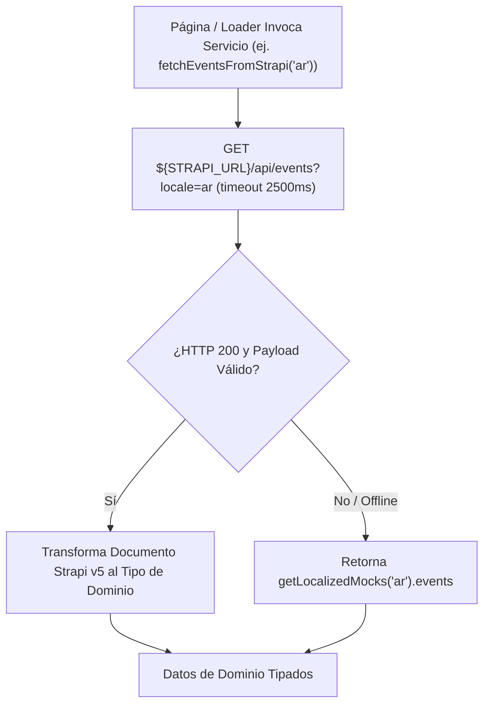

## 1. Capa de Servicios Strapi (`frontend/src/services/strapi/`)

| Archivo | Exportaciones | Responsabilidad |
| :--- | :--- | :--- |
| `loader.ts` | `createResilientStrapiLoader`, `createStrapiSingleTypeLoader` | Envuelve `@sensinum/astro-strapi-loader` en los 4 idiomas (`es`, `en`, `ar`, `tr`) y puebla el Content Store de Astro con mocks si Strapi no está disponible |
| `api.ts` | `fetchFromStrapi`, `fetchPluginFromStrapi`, `fetchIslamSuiteFromStrapi`, `fetchEventsFromStrapi`, `fetchArticlesFromStrapi`, `fetchAcademyCoursesFromStrapi`, `fetchBroadcastsFromStrapi`, `fetchPublicationsFromStrapi`, `fetchGlossaryFromStrapi`, `fetchPhotoGalleriesFromStrapi`, `fetchUtilityInvoicesFromStrapi`, `fetchEventSpotlightsFromStrapi`, etc. | Clientes REST tipados con timeout de 2.5s y respaldo automático para endpoints de Strapi v5 y plugins `@vicacha-devs/strapi-plugin-*` |
| `tiptap-sanitizer.ts` | `sanitizeTiptapHtml`, `stripHtmlTags`, `extractPlainTextParagraphs` | Sanitiza el HTML de Tiptap con `isomorphic-dompurify` y extrae párrafos en texto plano |

---

## 2. Módulos de Mocks Localizados (`frontend/src/utils/*-mocks.ts`)

| Módulo Mock | Datos de Dominio Provistos (`es`, `en`, `ar`, `tr`) |
| :--- | :--- |
| `localized-mocks.ts` | Agregador principal (`getLocalizedMocks(lang)`) que unifica todos los dominios |
| `data.mocks.ts` | Datos base en `es` para horarios de oración, eventos, servicios, líderes y FAQs |
| `islam-suite-mocks.ts` | Súplica diaria, Cinco Pilares, Explorador de Escrituras (Aleyas, Hadices, Tasbih), Qibla y Efemérides Hijri, Horario de Ramadán, Alerta Urgente |
| `event-mocks.ts` | Catálogo de eventos, páginas de detalle (`events/[slug]`) y cursos de la Academia |
| `spotlight-mocks.ts` | Convocatorias y becas activas (`eventSpotlights`) para `EventSpotlightDock` |
| `article-mocks.ts` | Artículos educativos con HTML Tiptap y párrafos de respaldo |
| `donation-mocks.ts` | Campañas de donación, métricas de impacto y canales de pago en Colombia (Bancolombia, Nequi, Bre-B) |
| `utility-invoice-mocks.ts` | Facturas mensuales de servicios públicos de la Mezquita (Energía, Agua, Gas, Internet, Administración) |
| `resources-mocks.ts` | Publicaciones descargables en PDF, glosario islámico y álbumes fotográficos |
| `media-mocks.ts` | Destacados multimedia, archivo filtrable de audio/video/documentos y canales de difusión |
| `institutional-mocks.ts` | Línea de tiempo histórica, misión/visión, perfiles de liderazgo y normas de etiqueta |
| `inbox-mocks.ts` | Flujos de ventanilla única (Khutbah, Nikah, Janazah, Shahada, Certificados) |
