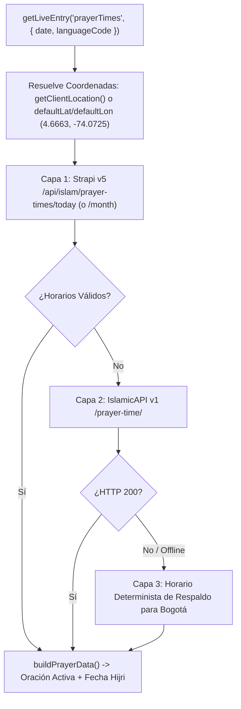

## 1. Loader de Horarios de Oración en 3 Capas (`prayerTimesLoader.ts`)

Registrado en `frontend/src/live.config.ts` como la Live Collection `prayerTimes`, soporta consultas **diarias** (`loadEntry`) y **mensuales** (`loadCollection` con formato `YYYY-MM`):

---

## 2. Cálculo de la Oración Activa (`src/utils/islamic.utils.ts`)

`calculateActivePrayer(times: TPrayerTimes, currentMinutes?: number)` determina cuál de las 5 oraciones obligatorias (`fajr`, `dhuhr`, `asr`, `maghrib`, `isha`) está activa según la hora local en Bogotá (`America/Bogota`):

1. **Ventana de Transición de Salida del Sol (`BUFFER_MINUTES_BEFORE_SUNRISE = 45`)**:
   - Entre la salida del sol (`Sunrise`) y `Dhuhr`, `calculateActivePrayer` retorna `undefined` dado que `Sunrise` marca el fin del tiempo de Fajr y no una oración obligatoria.
2. **Continuidad de Isha Después de Medianoche**:
   - Si `currentMinutes >= ishaMinutes` O `currentMinutes < fajrMinutes` (después de medianoche antes de Fajr), `isha` permanece como la oración activa.
3. **Resaltado Exclusivo para el Día Actual**:
   - `buildPrayerData` verifica `isSameDay(date, new Date())` y solo asigna `activePray` en la fila correspondiente al día de hoy.

---

## 3. Loader y Calculadora de Zakat Nisab (`zakatNisabLoader.ts`)

Registrado en `frontend/src/live.config.ts` como `zakatNisab`:
- **Estándares de Cálculo**: `"common"` (85g Oro / 595g Plata) y `"classical"` (87.48g Oro / 612.36g Plata).
- **Monedas Soportadas**: `"cop"` (Peso Colombiano por defecto), `"usd"`, `"eur"`, `"try"`, `"sar"`.
- **Controlador Cliente (`zakat-calculator.controller.ts`)**:
  - Calcula `patrimonioNeto = Math.max(0, efectivo + oro + inversiones + cuentasPorCobrar - pasivos)`.
  - Compara el patrimonio neto con el umbral Nisab seleccionado (Plata u Oro) y calcula `zakatAPagar = patrimonioNeto * 0.025` (2.5%) cuando supera el umbral.
