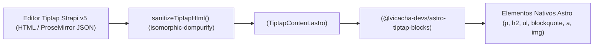

## 1. Pipeline de Texto Enriquecido Seguro

Los campos de texto enriquecido del CMS (`article.content`, `event.body`, `aboutPage.historyContent`) se editan en Strapi v5 con `@notum-cz/strapi-plugin-tiptap-editor`. Para prevenir vulnerabilidades XSS, el frontend **nunca** inyecta cadenas HTML crudas con `set:html`.

---

## 2. `<TiptapContent />` (`src/components/data/display/TiptapContent/TiptapContent.astro`)

`<TiptapContent />` recibe dos propiedades:
- `content`: Cadena HTML o documento JSON ProseMirror proveniente de Strapi v5.
- `fallbackParagraphs`: Arreglo opcional `string[]` usado por los mocks localizados cuando `content` está vacío.

Configura un objeto `TiptapTheme` con clases lógicas de Tailwind v4 (`ps-5`, `border-s-4`, `text-start`) para que los artículos y citas en árabe (`ar`) se rendericen con sangría y bordes en el lado derecho.

---

## 3. Funciones de Sanitización (`src/services/strapi/tiptap-sanitizer.ts`)

| Función | Firma | Descripción |
| :--- | :--- | :--- |
| `sanitizeTiptapHtml` | `(rawHtml?: string \| null) => string` | Ejecuta `DOMPurify.sanitize` con lista blanca de etiquetas semánticas y bloquea protocolos peligrosos (`javascript:`, `data:`) en atributos `href`/`src` |
| `stripHtmlTags` | `(rawHtml?: string \| null) => string` | Elimina todas las etiquetas HTML (`ALLOWED_TAGS: []`) para descripciones SEO, resúmenes RSS y fragmentos de búsqueda |
| `extractPlainTextParagraphs` | `(rawHtml?: string \| null) => string[]` | Divide bloques HTML (`
`, `</li>`, `</h*>`, `</blockquote>`) en un arreglo limpio de párrafos de texto plano |
