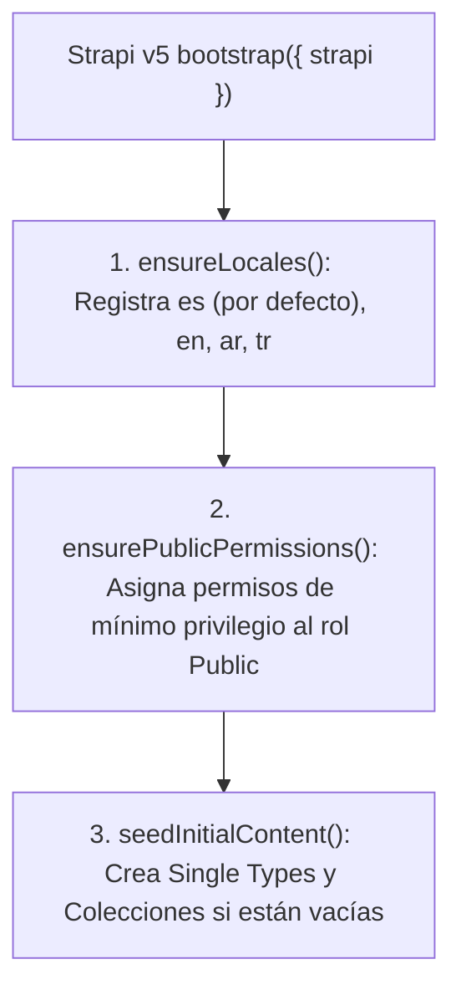

## 1. Ciclo de Arranque (`backend/src/index.ts`)

Cuando Strapi v5 inicia (`pnpm develop` o `pnpm start`), el hook `bootstrap({ strapi })` en `backend/src/index.ts` ejecuta tres pasos idempotentes:

---

## 2. Paso 1: Registro de Idiomas (`ensureLocales`)

Consulta `plugin::i18n.locales` y garantiza que existan los 4 idiomas requeridos:
- `es` — Español (`isDefault: true`)
- `en` — Inglés
- `ar` — Árabe (`العربية`)
- `tr` — Turco (`Türkçe`)

---

## 3. Paso 2: Permisos Públicos de Mínimo Privilegio (`ensurePublicPermissions`)

El rol `Public` de Strapi se limita estrictamente a:

| Alcance de Permiso | Acciones Permitidas | Justificación de Seguridad |
| :--- | :--- | :--- |
| **Lectura Pública (`find`, `findOne`)** | `global-setting`, `prayer-setting`, `about-page`, `islam-faith-page`, `donations-page`, `contact-page`, `event`, `article`, `faq`, `leader`, `community-service`, `media-highlight`, `donation-campaign` | Permite al frontend Astro y visitantes leer el contenido publicado sin poder modificarlo ni eliminarlo |
| **Recepción de Formularios (`create`)** | `contact-submission`, `visit-booking`, `donation-submission` | Permite registrar envíos (`POST`), pero **bloquea** la lectura (`find` / `findOne`) de datos personales enviados por otros usuarios |

---

## 4. Paso 3: Semilla Inicial de Contenido (`seedInitialContent`)

Si la base de datos está vacía, `seedInitialContent` crea documentos localizados (`es`, `en`, `ar`, `tr`) para:
- Datos globales de contacto y coordenadas de Bogotá (`4.6663, -74.0725`).
- Parámetros de cálculo de oración (`MWL`, `Shafi`, horarios de Yumu'ah).
- Páginas institucionales (`about-page`, `islam-faith-page`, `donations-page`, `contact-page`).
- Líderes, Servicios Comunitarios, Eventos, Artículos, Preguntas Frecuentes, Destacados Multimedia y Campañas de Donación.
