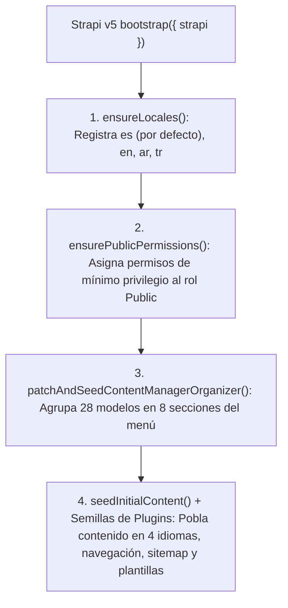

## 1. Ciclo de Arranque (`backend/src/index.ts`)

Cuando Strapi v5 inicia (`pnpm develop` o `pnpm start`), `backend/src/index.ts` ejecuta el pipeline modular de arranque definido en `backend/src/bootstrap/` y `backend/src/seed/`:

---

## 2. Paso 1: Registro de Idiomas (`ensureLocales`)

Consulta `plugin::i18n.locales` (`backend/src/bootstrap/permissions-and-locales.ts`) y garantiza que existan los 4 idiomas requeridos:
- `es` — Español (`isDefault: true`)
- `en` — Inglés
- `ar` — Árabe (`العربية`)
- `tr` — Turco (`Türkçe`)

---

## 3. Paso 2: Permisos Públicos de Mínimo Privilegio (`ensurePublicPermissions`)

El rol `Public` de Strapi se limita estrictamente a:

| Alcance de Permiso | Acciones Permitidas | Justificación de Seguridad |
| :--- | :--- | :--- |
| **Modelos de Solo Lectura (`PUBLIC_READ_MODELS`: `find`, `findOne`)** | `api::global-setting.global-setting`, `api::about-page.about-page`, `api::donations-page.donations-page`, `api::islam-faith-page.islam-faith-page`, `api::contact-page.contact-page`, `api::community-service.community-service`, `api::article.article`, `api::leader.leader`, `api::faq.faq`, `plugin::events.event`, `plugin::donations.campaign`, `plugin::media-feeds.media-item`, `plugin::resources.publication`, `plugin::resources.gallery-album`, `plugin::resources.glossary-term` | Permite al frontend Astro y visitantes leer el contenido publicado sin poder modificarlo ni eliminarlo |
| **Recepción de Formularios (`PUBLIC_CREATE_ONLY_MODELS`: `create`)** | `plugin::inbox.submission`, `plugin::bookings.booking`, `plugin::donations.pledge` | Permite registrar envíos (`POST`), pero **bloquea** la lectura (`find` / `findOne`) de datos personales enviados por otros usuarios |
| **Controladores Públicos de Plugins** | Acciones públicas seleccionadas en `islam`, `events`, `bookings`, `calendar`, `donations`, `inbox`, `broadcasts`, `resources`, `media-feeds`, `certificates`, `navigation`, `typesense` y `strapi-5-sitemap-plugin` | Expone únicamente endpoints públicos de horarios, calendario, búsqueda y verificación |

> **Garantía Crítica de Seguridad**: `plugin::inbox.submission.find`, `plugin::bookings.booking.find` y `plugin::donations.pledge.find` **jamás** se otorgan al rol `Public`. Solo los administradores autenticados pueden consultar los envíos en el Panel de Strapi.

---

## 4. Paso 3: Semilla Inicial de Contenido y Plugins (`backend/src/seed/`)

Si la base de datos está vacía, los módulos de semilla crean documentos localizados (`es`, `en`, `ar`, `tr`) y configuraciones de plugins:
- **`initial-content-seed.ts`**: Configuración global de la Mezquita, páginas institucionales (`about-page`, `islam-faith-page`, `donations-page`, `contact-page`), Líderes, Servicios Comunitarios, Artículos, Preguntas Frecuentes y las colecciones de los 10 plugins `@vicacha-devs`.
- **`navigation-seed.ts`, `sitemap-seed.ts`, `tiptap-seed.ts`, `email-templates-seed.ts`, `media-folders-seed.ts`**: Preconfigura menús de navegación, sitemap XML, presets de TipTap v3, plantillas de correo transaccional y carpetas de la librería multimedia.
