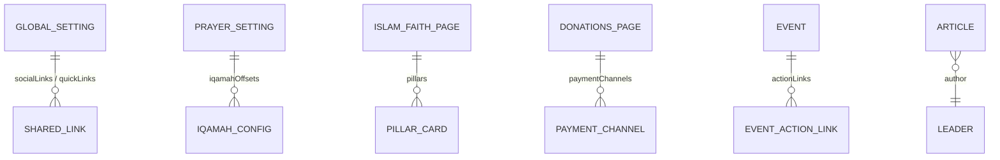

## 1. Diagrama de Entidad-Relación

---

## 2. Single Types (`backend/src/api/`)

| Identificador API | ¿Localizado (`i18n`)? | Campos Principales | Consumido Por |
| :--- | :--- | :--- | :--- |
| `global-setting` | Sí (`es`, `en`, `ar`, `tr`) | `mosqueName`, `tagline`, `address`, `phone`, `email`, `whatsappNumber`, `socialLinks`, `seo` | `Header.astro`, `Footer.astro`, `Layout.astro` |
| `prayer-setting` | No (Config global) | `calculationMethod`, `juristicSchool`, `hijriCalendarMethod`, `hijriAdjustmentDays`, `defaultLatitude` (`4.6663`), `defaultLongitude` (`-74.0725`), `jumuahKhutbahTime`, `jumuahPrayerTime`, `iqamahConfigs` | `prayerTimesLoader.ts`, `DailyPrayTime.astro` |
| `about-page` | Sí (`es`, `en`, `ar`, `tr`) | `heroTitle`, `heroSubtitle`, `historyTitle`, `historyContent` (Tiptap), `missionStatement`, `visionStatement`, `values` | `src/pages/[lang]/about-us.astro` |
| `islam-faith-page` | Sí (`es`, `en`, `ar`, `tr`) | `heroTitle`, `pillars` (`faith.pillar-card`), `shahadaArabic`, `shahadaTransliteration`, `shahadaTranslation` | `src/pages/[lang]/islam-and-faith.astro` |
| `donations-page` | Sí (`es`, `en`, `ar`, `tr`) | `heroTitle`, `impactHeadline`, `impactStats`, `zakatExplanation`, `paymentChannels` (`donation.payment-channel`) | `src/pages/[lang]/donate.astro` |
| `contact-page` | Sí (`es`, `en`, `ar`, `tr`) | `heroTitle`, `officeHours`, `visitingGuidelines`, `googleMapsEmbedUrl`, `publicTransportDirections` | `src/pages/[lang]/contact-and-visit.astro` |

---

## 3. Collection Types (`backend/src/api/`)

| Identificador API | ¿Localizado (`i18n`)? | Acceso Público | Descripción |
| :--- | :--- | :--- | :--- |
| `event` | Sí | `find`, `findOne` | Eventos, conferencias, talleres y avisos destacados en el Spotlight Dock (`spotlightEnabled`, `spotlightPriority`, `poster`) |
| `article` | Sí | `find`, `findOne` | Artículos educativos y transcripciones de Jutbah con texto enriquecido Tiptap (`content`), `category`, `readingTimeMinutes` |
| `community-service` | Sí | `find`, `findOne` | Servicios de la Mezquita (Matrimonio/Nikah, Janazah, Shahada, Consejería, Biblioteca, Certificación Halal) |
| `donation-campaign` | Sí | `find`, `findOne` | Campañas de donación activas (`goalAmountCop`, `raisedAmountCop`, `donorCount`, `isUrgent`) |
| `faq` | Sí | `find`, `findOne` | Preguntas frecuentes agrupadas por `category` y `sortOrder` |
| `leader` | Sí | `find`, `findOne` | Imames, eruditos y junta directiva (`fullName`, `roleTitle`, `biography`, `languagesSpoken`) |
| `media-highlight` | Sí | `find`, `findOne` | Videos destacados, grabaciones de Jutbah, entrevistas y pódcast |
| `contact-submission` | No | Solo `create` | Mensajes de contacto y solicitudes de servicios recibidos vía `POST /api/submissions` |
| `visit-booking` | No | Solo `create` | Reservas de visitas guiadas y grupos escolares (`visitorName`, `groupSize`, `preferredDate`, `status`) |
| `donation-submission` | No | Solo `create` | Comprobantes de donación reportados por donantes (`donorName`, `amountCop`, `paymentMethod`, `referenceNumber`) |
| `health` | No | `GET /api/health` | Sonda de salud para Docker y balanceadores de carga |
