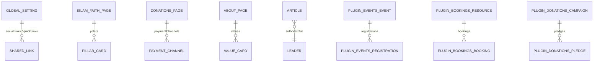

## 1. Diagrama de Entidad-Relación

---

## 2. Single Types Propios (`backend/src/api/`)

| UID (`api::*`) | ¿Localizado (`i18n`)? | Campos Principales | Consumido Por |
| :--- | :--- | :--- | :--- |
| `api::global-setting.global-setting` | Sí (`es`, `en`, `ar`, `tr`) | `mosqueName`, `tagline`, `address`, `phone`, `email`, `whatsappNumber`, `socialLinks`, `seo` | `Header.astro`, `Footer.astro`, `Layout.astro` |
| `api::about-page.about-page` | Sí (`es`, `en`, `ar`, `tr`) | `heroTitle`, `heroSubtitle`, `historyTitle`, `historyContent` (Tiptap), `missionStatement`, `visionStatement`, `values` (`institution.value-card`) | `src/pages/[lang]/about-us.astro` |
| `api::islam-faith-page.islam-faith-page` | Sí (`es`, `en`, `ar`, `tr`) | `heroTitle`, `pillars` (`faith.pillar-card`), `shahadaArabic`, `shahadaTransliteration`, `shahadaTranslation` | `src/pages/[lang]/islam-and-faith.astro` |
| `api::donations-page.donations-page` | Sí (`es`, `en`, `ar`, `tr`) | `heroTitle`, `impactHeadline`, `impactStats` (`donation.impact-stat`), `zakatExplanation`, `paymentChannels` (`donation.payment-channel`) | `src/pages/[lang]/donate.astro` |
| `api::contact-page.contact-page` | Sí (`es`, `en`, `ar`, `tr`) | `heroTitle`, `officeHours`, `visitingGuidelines`, `googleMapsEmbedUrl`, `publicTransportDirections` | `src/pages/[lang]/contact-and-visit.astro` |

---

## 3. Collection Types Propios (`backend/src/api/`)

| UID (`api::*`) | ¿Localizado (`i18n`)? | Acceso Público | Descripción |
| :--- | :--- | :--- | :--- |
| `api::article.article` | Sí | `find`, `findOne` | Artículos educativos y transcripciones de Jutbah con texto enriquecido Tiptap (`content`), `category`, `readingTimeMinutes` y relación sincronizada `authorProfile` (`api::leader.leader`) |
| `api::community-service.community-service` | Sí | `find`, `findOne` | Servicios de la Mezquita (Matrimonio/Nikah, Janazah, Shahada, Consejería, Biblioteca, Certificación Halal) |
| `api::faq.faq` | Sí | `find`, `findOne` | Preguntas frecuentes agrupadas por `category` y `sortOrder` |
| `api::leader.leader` | Sí | `find`, `findOne` | Imames, eruditos y junta directiva (`fullName`, `slug`, `roleTitle`, `biography`, `languagesSpoken`) enlazados a `/[lang]/staff/[slug]` |
| `api::health.health` | No | `GET /api/health` | Sonda de salud para Docker y balanceadores de carga |

---

## 4. Content-Types de Dominio Provistos por Plugins (`plugin::*`)

Las entidades de eventos, reservas, donaciones, liturgia, multimedia, publicaciones, ventanilla de atención, certificados y difusiones pertenecen a las 10 extensiones `@vicacha-devs/strapi-plugin-*`:

| Grupo en Content Manager Organizer | UIDs de Content-Type (`plugin::*`) | Acceso del Rol Público |
| :--- | :--- | :--- |
| **Events, Scheduling & Bookings** | `plugin::events.event`, `plugin::events.registration`, `plugin::bookings.resource`, `plugin::bookings.booking` | `event` (`find`, `findOne`); `booking` (solo `create`) |
| **Islam, Liturgy & Scripture** | `plugin::islam.scripture-entry`, `plugin::islam.hilal-announcement` | Vía endpoints públicos `/api/islam/*` |
| **Donations & Certificates** | `plugin::donations.campaign`, `plugin::donations.pledge`, `plugin::certificates.template`, `plugin::certificates.certificate` | `campaign` (`find`, `findOne`); `pledge` (solo `create`) |
| **Media, Resources & Library** | `plugin::media-feeds.media-item`, `plugin::media-feeds.media-series`, `plugin::resources.publication`, `plugin::resources.gallery-album`, `plugin::resources.glossary-term` | `media-item`, `publication`, `gallery-album`, `glossary-term` (`find`, `findOne`) |
| **Inbox & Omnichannel Broadcasts** | `plugin::inbox.form`, `plugin::inbox.submission`, `plugin::inbox.subscriber`, `plugin::inbox.alert-banner`, `plugin::broadcasts.campaign`, `plugin::broadcasts.automation-rule`, `plugin::broadcasts.delivery-log` | `submission` (solo `create`) + endpoints públicos `/api/inbox/*` y `/api/broadcasts/*` |
