## 1. Ecosistema de Plugins Propios

Además de los esquemas nativos de Strapi v5, `backend/package.json` integra **10 extensiones `@vicacha-devs/strapi-plugin-*`** (ubicadas en `../strapi-v5-extensions/packages/`):

```mermaid
flowchart TB
  Strapi["Strapi v5 Core (:1337)"] --> P1["strapi-plugin-islam (Oración, Zakat, Corán, Hadiz, Qibla, Ramadán)"]
  Strapi --> P2["strapi-plugin-events (Eventos, Spotlights, Cursos Academia, ICS)"]
  Strapi --> P3["strapi-plugin-donations (Campañas, Facturas Servicios, Comprobantes)"]
  Strapi --> P4["strapi-plugin-inbox (Mensajes Contacto y 5 Flujos de Ventanilla)"]
  Strapi --> P5["strapi-plugin-bookings (Agendamiento de Visitas Guiadas y Colegios)"]
  Strapi --> P6["strapi-plugin-resources (Publicaciones PDF, Glosario, Galerías)"]
  Strapi --> P7["strapi-plugin-media-feeds (Archivo Audio/Video y Sindicación RSS 2.0)"]
  Strapi --> P8["strapi-plugin-broadcasts (Canales WhatsApp/Telegram y Boletín)"]
  Strapi --> P9["strapi-plugin-calendar (Calendario de Efemérides Hijri-Gregoriano)"]
  Strapi --> P10["strapi-plugin-certificates (Certificados de Shahada, Nikah y Donación)"]
```

---

## 2. Matriz de Integración con el Frontend

| Paquete del Plugin | Llave Config | Prefijo REST | Consumidor Frontend (`src/services/strapi/api.ts`) |
| :--- | :--- | :--- | :--- |
| `@vicacha-devs/strapi-plugin-islam` | `islam` | `/api/islam/*` | `fetchIslamSuiteFromStrapi` (`prayerTimesLoader`, `zakatNisabLoader`, `DailyDuaModal`, `FivePillarsSection`, `ScriptureExplorerSection`, `QiblaAndObservancesSection`, `RamadanScheduleBanner`, `UrgentAlertBanner`) |
| `@vicacha-devs/strapi-plugin-events` | `events` | `/api/events/*` | `fetchEventsFromStrapi`, `fetchAcademyCoursesFromStrapi`, `fetchEventSpotlightsFromStrapi`, `GET /api/events/feed.ics` |
| `@vicacha-devs/strapi-plugin-donations` | `donations` | `/api/donations/*` | `fetchUtilityInvoicesFromStrapi`, `POST /api/submissions` (`donation-submission`) |
| `@vicacha-devs/strapi-plugin-inbox` | `inbox` | `/api/inbox/*` | `fetchServiceDeskWorkflowsFromStrapi`, `POST /api/submissions` (`contact-message`, `service-desk-request`) |
| `@vicacha-devs/strapi-plugin-bookings` | `bookings` | `/api/bookings/*` | `POST /api/submissions` (`visit-booking`) |
| `@vicacha-devs/strapi-plugin-resources` | `resources` | `/api/resources/*` | `fetchPublicationsFromStrapi`, `fetchGlossaryFromStrapi`, `fetchPhotoGalleriesFromStrapi`, `GET /api/resources/publications/[slug]/download` |
| `@vicacha-devs/strapi-plugin-media-feeds` | `media-feeds` | `/api/media-feeds/*` | `fetchMediaArchiveFromStrapi`, `GET /api/media-feeds/rss.xml` |
| `@vicacha-devs/strapi-plugin-broadcasts` | `broadcasts` | `/api/broadcasts/*` | `fetchBroadcastsFromStrapi`, `POST /api/submissions` (`newsletter-subscription`) |
| `@vicacha-devs/strapi-plugin-calendar` | `calendar` | `/api/calendar/*` | Sincronización de efemérides Hijri con `QiblaAndObservancesSection` |
| `@vicacha-devs/strapi-plugin-certificates` | `certificates` | `/api/certificates/*` | Emisión de certificados oficiales en PDF (Shahada, Nikah y Donaciones) |
