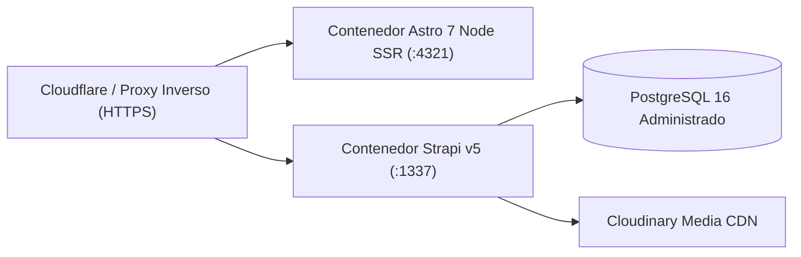

## 1. Topología de Despliegue en Producción



### Compilación y Arranque de Servicios

#### 1. Backend Strapi v5 (`backend/Dockerfile`)
```bash
cd backend
pnpm build
NODE_ENV=production pnpm start
```
- Sonda de salud: `GET http://127.0.0.1:1337/api/health` -> retorna `200 OK`.

#### 2. Frontend Astro 7 SSR (`frontend/`)
```bash
cd frontend
pnpm build
HOST=127.0.0.1 PORT=4321 node ./dist/server/entry.mjs
```

---

## 2. Respaldo y Restauración de Base de Datos (PostgreSQL 16)

```bash
# Crear respaldo comprimido
pg_dump -h 127.0.0.1 -U mosque_admin -Fc central_mosque_bogota > mosque_backup_$(date +%F).dump

# Restaurar respaldo
pg_restore -h 127.0.0.1 -U mosque_admin -d central_mosque_bogota --clean mosque_backup_YYYY-MM-DD.dump
```

---

## 3. Resolución de Incidentes Frecuentes

| Síntoma | Causa Raíz | Solución |
| :--- | :--- | :--- |
| El frontend muestra `[WARN] Strapi unreachable, falling back to localized mocks` | Strapi v5 está detenido o `STRAPI_URL` no apunta a `http://127.0.0.1:1337` | Verifica `GET http://127.0.0.1:1337/api/health`; el sitio sigue operando sin interrupción gracias a los mocks localizados |
| Los horarios de oración usan el respaldo en lugar de IslamicAPI | Falta `ISLAMIC_API_KEY` o se alcanzó el límite (`HTTP 429`) | Configura `ISLAMIC_API_KEY` en `frontend/.env` o usa la caché del plugin `@vicacha-devs/strapi-plugin-islam` |
| Un cambio editorial en Strapi no se refleja de inmediato | TTL de 1 hora en `strapi-cache` o ruta pre-renderizada | Guardar/Publicar en Strapi limpia `strapi-cache` automáticamente; ejecuta `astro build` si es una página estática |
